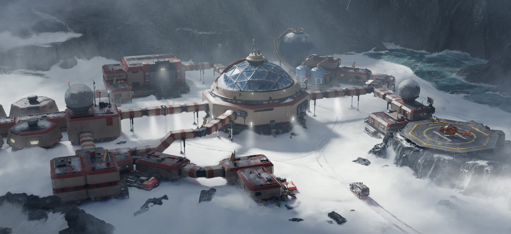
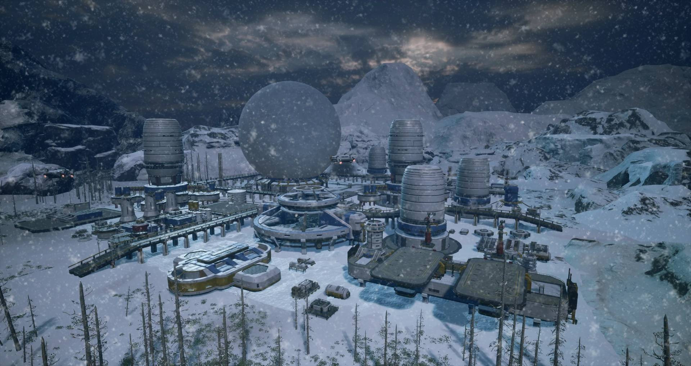
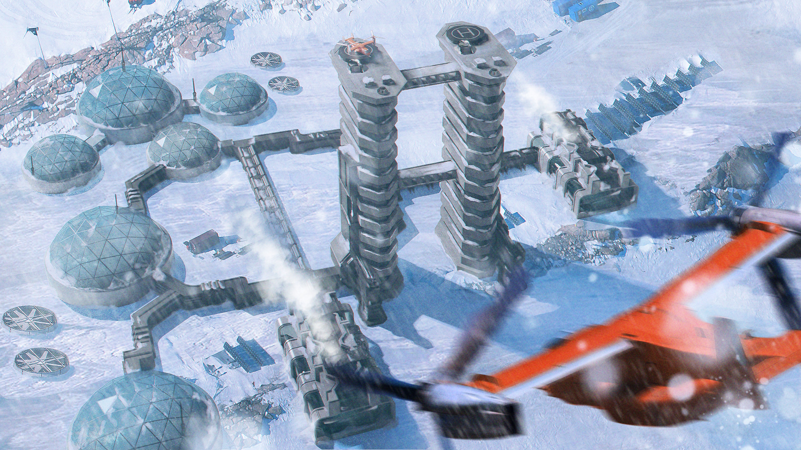
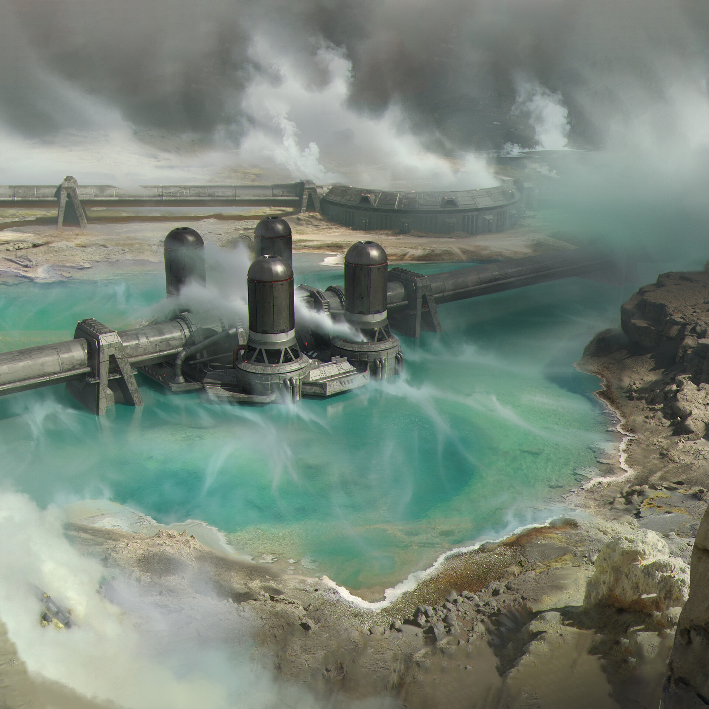
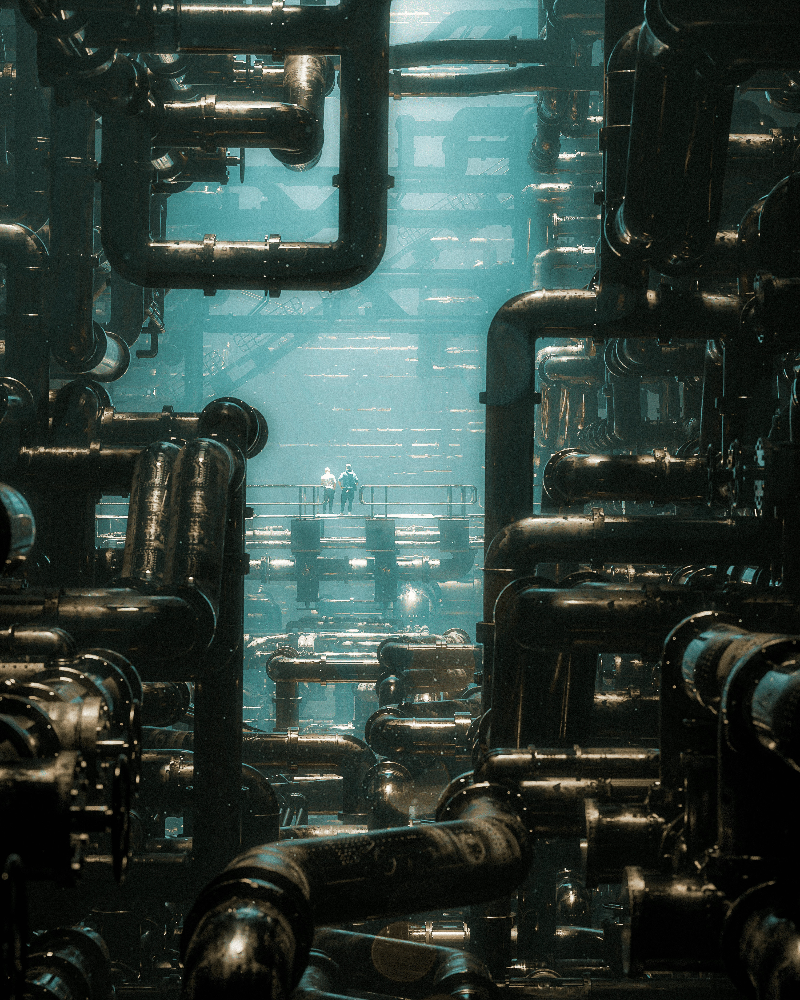
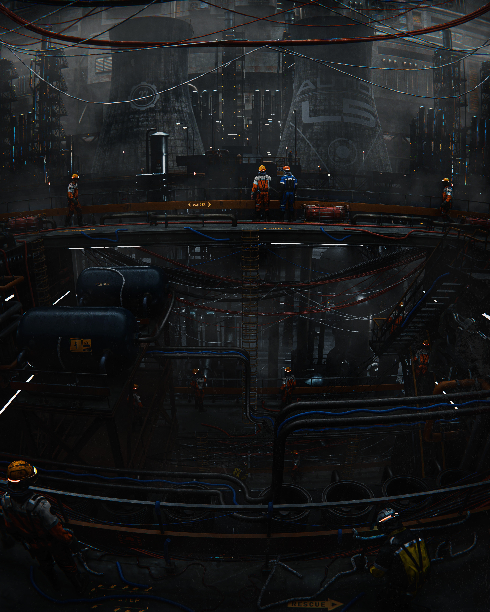

# Citadel · 视觉设计卡

**光 · 尺度 · 材质 · 镜头 · 排版**

给 Crepuscular Citadel 的 3D 场景与 UI 的参考图册。 每张卡只讲一种视觉语言，配一组真实画面；指着图说「做成这样」。

27 张视觉卡 · 3 个场景配方 · 头图：<a href="https://silentfleetkk.github.io/qingming-bianjing/opus-5.5/qingming-bianjing.html">清明上河 · 黄昏全城</a>

<a href="#光影">光影</a> · <a href="#色彩">色彩</a> · <a href="#构图重心">构图重心</a> · <a href="#造型尺度">造型尺度</a> · <a href="#材质">材质</a> · <a href="#水与大气">水与大气</a> · <a href="#镜头运动">镜头运动</a> · <a href="#排版-ui">排版 UI</a> · <a href="#场景配方">场景配方</a>

 

<table>
<tr><td width="33%" valign="top"></td><td width="33%" valign="top"></td><td width="33%" valign="top"></td></tr>
<tr><td valign="top"><a href="https://skillry.dev/ai-videos/kimi-k3-1/kimi-moonshot-068067-1">云上神殿与巨龙 · 用人物标定巨物</a></td><td valign="top"><a href="https://github.com/Leonxlnx/athenaion">Athenaion · 神殿、民居与山脉的尺度阶梯</a></td><td valign="top"><a href="https://skillry.dev/ai-videos/kimi-k3-1/crangerus-549203">雾中巨像 · 近舟、暗水与层层远山</a></td></tr>
</table>

| 1 · 找感觉 | 2 · 读拆解 | 3 · 组场景 |
|---|---|---|
| 先翻图，挑出和目标场景气质最接近的卡 | 卡内按光影、色彩、构图等维度拆开，给出色值、比例与源码参数 | 用配方把多张卡分到不同维度，检查光源、色彩与明暗是否打架 |

维度定义见 [视觉维度](public/docs/DIMENSIONS.md)，每张图的出处与筛选结论见 [来源与筛选记录](public/sources.md)。

 

## 光影

### 逆光露轮廓

> 把亮背景放在需要读懂的外轮廓后面，让暗主体以形状而不是满身高光成立。

<table>
<tr><td width="33%" valign="top"></td><td width="33%" valign="top"></td><td width="33%" valign="top"></td></tr>
<tr><td valign="top"><a href="https://silentfleetkk.github.io/qingming-bianjing/opus-5.5/qingming-bianjing.html">清明上河 · 黄昏虹桥</a></td><td valign="top"><a href="https://skillry.dev/ai-videos/kimi-k3-1/kimi-moonshot-068067-1">Unreal 云上神殿与巨龙</a></td><td valign="top"><a href="https://skillry.dev/ai-videos/kimi-k3-1/crangerus-549203">中式幻想 RPG · 雾中巨像</a></td></tr>
</table>

**情绪** 敬畏、压迫 · **用在博客** street-1 门廊、platform-1 窗侧、Shrine 巨像背景（title / atlas locked） · <a href="public/cards/backlight-reveals-silhouette/README.md">拆解与做法 →</a>

### 侧光刻石

> 让侧来的光同时照见凸面、留下凹槽，石材的体量才不会被花纹替代。

<table>
<tr><td width="33%" valign="top"></td><td width="33%" valign="top"></td><td width="33%" valign="top"></td></tr>
<tr><td valign="top"><a href="https://github.com/Leonxlnx/athenaion">Athenaion · Fallen head</a></td><td valign="top"><a href="https://x.com/k1rallik/status/2113693629713633435">Blender cathedral interior</a></td><td valign="top"><a href="https://github.com/Leonxlnx/athenaion">Athenaion · Temple facade</a></td></tr>
</table>

**情绪** 庄严、厚重 · **用在博客** Shrine 石阶、BlackCityHall 立柱 · <a href="public/cards/side-light-carves-stone/README.md">拆解与做法 →</a>

 

## 色彩

### 冷境暖灯

> 让整个世界保持冷色，把“有人在”的信息压缩成一小块暖光。

<table>
<tr><td width="33%" valign="top"></td><td width="33%" valign="top"></td><td width="33%" valign="top"></td></tr>
<tr><td valign="top"><a href="https://x.com/i/status/2113279019005460816">Castle above the clouds</a></td><td valign="top"><a href="https://skillry.dev/ai-videos/kimi-k3-1/kimi-moonshot-068067-8">末日机器人短片</a></td><td valign="top"><a href="https://github.com/holooooo/webgl-seascape-video/blob/915cb7c9a318e03bd2228bc232494b496ff2316c/episodes/04-jiangnan-voxel/interactive.html">江南山谷 · 蓝调全景</a></td></tr>
</table>

**情绪** 孤寂、庇护 · **用在博客** title 主视觉、Shrine 夜景与 Alley2 门口 · <a href="public/cards/cold-world-warm-refuge/README.md">拆解与做法 →</a>

### 低彩分灰阶

> 减少色相竞争，让暗壁、灰天、亮水各占一个明度层，画面仍能有重量。

<table>
<tr><td width="33%" valign="top"></td><td width="33%" valign="top"></td><td width="33%" valign="top"></td></tr>
<tr><td valign="top"><a href="https://github.com/Zp-Peter/kimi-k31pro-opus55-benchmark-showcase/blob/65e82c53b63f2fdd918617269c057d8e53af2c6f/kimi/iceland-black-sand/dist/index.html">黑沙之境 · 海岸全景</a></td><td valign="top"><a href="https://github.com/Zp-Peter/kimi-k31pro-opus55-benchmark-showcase/blob/65e82c53b63f2fdd918617269c057d8e53af2c6f/opus/reynisfjara/index.html">雷尼斯黑沙滩 · 海滩</a></td><td valign="top"><a href="https://skillry.dev/ai-videos/kimi-k3-1/crangerus-549203">中式幻想 RPG · 雾中巨像</a></td></tr>
</table>

**情绪** 肃穆、清冷 · **用在博客** BlackCityHall 外部、Beach1/2 海岸方案 · <a href="public/cards/low-chroma-value-steps/README.md">拆解与做法 →</a>

 

## 构图重心

### 斜向配重

> 把重体块压向一侧，用斜向地面或水带把另一侧的空场接回来。

<table>
<tr><td width="33%" valign="top"></td><td width="33%" valign="top"></td><td width="33%" valign="top"></td></tr>
<tr><td valign="top"><a href="https://github.com/Leonxlnx/athenaion">Athenaion · Panorama</a></td><td valign="top"><a href="https://skillry.dev/ai-videos/kimi-k3-1/kimi-moonshot-068067-1">Unreal 云上神殿与巨龙</a></td><td valign="top"><a href="https://github.com/Zp-Peter/kimi-k31pro-opus55-benchmark-showcase/blob/65e82c53b63f2fdd918617269c057d8e53af2c6f/opus/reynisfjara/index.html">雷尼斯黑沙滩 · 海滩</a></td></tr>
</table>

**情绪** 张力、延伸 · **用在博客** luxury-house-1 窗侧、platform-1 柱廊、BlackCityHall 外廊（title / atlas locked） · <a href="public/cards/diagonal-mass-balance/README.md">拆解与做法 →</a>

### 留空放大孤立物

> 让一个可辨认的物体独占大面积空场，空白本身成为时间和距离。

<table>
<tr><td width="33%" valign="top"></td><td width="33%" valign="top"></td><td width="33%" valign="top"></td></tr>
<tr><td valign="top"><a href="https://github.com/noahsabaj/falcon9-blender/releases/tag/v1.0">Falcon 9 · 暮空尾迹</a></td><td valign="top"><a href="https://www.echohive.ai/posts/ozymandias/animation.html">Ozymandias · 孤立残像</a></td><td valign="top"><a href="https://github.com/Zp-Peter/kimi-k31pro-opus55-benchmark-showcase/blob/65e82c53b63f2fdd918617269c057d8e53af2c6f/opus/reynisfjara/index.html">雷尼斯黑沙滩 · 海滩</a></td></tr>
</table>

**情绪** 孤寂、静止 · **用在博客** title 的单地标构图、Platform 远眺背景 · <a href="public/cards/emptiness-isolates-landmark/README.md">拆解与做法 →</a>

### 近框套远景

> 用有厚度的近景边界围住远处目标，让观众先拥有一个站立的位置。

<table>
<tr><td width="33%" valign="top"></td><td width="33%" valign="top"></td><td width="33%" valign="top"></td></tr>
<tr><td valign="top"><a href="https://github.com/Leonxlnx/athenaion">Athenaion · Ruined portico</a></td><td valign="top"><a href="https://skillry.dev/ai-videos/kimi-k3-1/crangerus-549203">中式幻想 RPG · 雾中巨像</a></td><td valign="top"><a href="https://github.com/Leonxlnx/athenaion">Athenaion · 水庭</a></td></tr>
</table>

**情绪** 窥见、敬畏 · **用在博客** street-1 门廊、platform-1 窗景、Shrine 入口与 Alley2 门洞（title / atlas locked） · <a href="public/cards/framed-distant-view/README.md">拆解与做法 →</a>

### 河道串景

> 用连续水道在密集场景里留出一条可读路径，把近景、中景与远处地标串起来。

<table>
<tr><td width="33%" valign="top"></td><td width="33%" valign="top"></td><td width="33%" valign="top"></td></tr>
<tr><td valign="top"><a href="https://poseidia.vercel.app/">Poseidia · Sea Canal</a></td><td valign="top"><a href="https://silentfleetkk.github.io/qingming-bianjing/opus-5.5/qingming-bianjing.html">清明上河 · 黄昏全城</a></td><td valign="top"><a href="https://valley.mengto.here.now/">Sakura River Valley</a></td></tr>
</table>

**情绪** 开阔、悠远 · **用在博客** Beach 水口与岸边地标的后续建模 · <a href="public/cards/river-leads-the-eye/README.md">拆解与做法 →</a>

 

## 造型尺度

### 冷境承托设施

> 让冷色空地或寒雾托出人工设施，用连廊、入口和小型载具说明人在巨构中如何停留。

<table>
<tr><td width="33%" valign="top"></td><td width="33%" valign="top"></td><td width="33%" valign="top"></td></tr>
<tr><td valign="top"><a href="https://www.artstation.com/artwork/zPRVWZ">Antarctica Research Station</a></td><td valign="top"><a href="https://www.artstation.com/artwork/Gvnagd">Arctic Sci-Fi Research Base – Environment Design</a></td><td valign="top"><a href="https://www.artstation.com/artwork/rR39eL">Arctic Research Station</a></td></tr>
</table>

**情绪** 孤立、坚守 · **用在博客** landfill-room-1 模块远端、black-city-1 巨构入口；只借寒境组织，不新增极地场景 · <a href="public/cards/cold-ground-frames-station/README.md">拆解与做法 →</a>

### 柱廊明暗节奏

> 用重复的柱身与暗腔给空间节拍，再用递减的间距把视线带向深处。

<table>
<tr><td width="33%" valign="top"></td><td width="33%" valign="top"></td><td width="33%" valign="top"></td></tr>
<tr><td valign="top"><a href="https://x.com/k1rallik/status/2113693629713633435">Blender cathedral interior</a></td><td valign="top"><a href="https://github.com/Leonxlnx/athenaion">Athenaion · Temple facade</a></td><td valign="top"><a href="https://skillry.dev/ai-videos/kimi-k3-1/kimi-moonshot-068067-1">Unreal 云上神殿与巨龙</a></td></tr>
</table>

**情绪** 庄严、神圣 · **用在博客** BlackCityHall 登记场景、Shrine 入口 · <a href="public/cards/colonnade-rhythm/README.md">拆解与做法 →</a>

### 巨像越画框

> 只让巨物的一部分进入画面，同时留下熟悉轮廓，观众会主动补全框外的体量。

<table>
<tr><td width="33%" valign="top"></td><td width="33%" valign="top"></td><td width="33%" valign="top"></td></tr>
<tr><td valign="top"><a href="https://skillry.dev/ai-videos/kimi-k3-1/kimi-moonshot-068067-2">云上石像</a></td><td valign="top"><a href="https://skillry.dev/ai-videos/kimi-k3-1/crangerus-549203">中式幻想 RPG · 雾中巨像</a></td><td valign="top"><a href="https://skillry.dev/ai-videos/kimi-k3-1/kimi-moonshot-068067-1">Unreal 云上神殿与巨龙</a></td></tr>
</table>

**情绪** 压迫、敬畏 · **用在博客** Shrine 巨像、BlackCity 近地标取景 · <a href="public/cards/colossus-crosses-the-frame/README.md">拆解与做法 →</a>

### 管网串起巨构

> 用粗管、桥架与运输线把设备串成有功能的整体，巨构的尺度来自连接关系，不只来自堆大的盒子。

<table>
<tr><td width="33%" valign="top"></td><td width="33%" valign="top"></td><td width="33%" valign="top"></td></tr>
<tr><td valign="top"><a href="https://www.artstation.com/artwork/ykvLaQ">Geothermal Plant part 1</a></td><td valign="top"><a href="https://www.artstation.com/artwork/Bkr6eD">The Pipe City</a></td><td valign="top"><a href="https://www.artstation.com/artwork/L4Vb4K">Power Grid</a></td></tr>
</table>

**情绪** 运转、沉重 · **用在博客** landfill-1 工业远景、landfill-room-1 罐体与检修通道；不迁入炮台/地热资产 · <a href="public/cards/networks-link-industrial-masses/README.md">拆解与做法 →</a>

### 骨架规整草木野

> 把清楚的建筑骨架与不均匀生长的植物并置，让两种秩序互相说明。

<table>
<tr><td width="33%" valign="top"></td><td width="33%" valign="top"></td><td width="33%" valign="top"></td></tr>
<tr><td valign="top"><a href="https://skillry.dev/ai-videos/kimi-k3-1/kimi-moonshot-068067-4">Blender 机场室内雨林</a></td><td valign="top"><a href="https://github.com/Leonxlnx/athenaion">Athenaion · 水庭</a></td><td valign="top"><a href="https://github.com/Leonxlnx/athenaion">Athenaion · Ruined portico</a></td></tr>
</table>

**情绪** 生机、时间 · **用在博客** Shrine 庭院与废墟边缘、Landfill 断口草簇 · <a href="public/cards/ordered-frame-wild-growth/README.md">拆解与做法 →</a>

### 熟悉物标定巨构

> 给巨物旁边放一个观众认识大小的东西，巨大才会从形容词变成直觉。

<table>
<tr><td width="33%" valign="top"></td><td width="33%" valign="top"></td><td width="33%" valign="top"></td></tr>
<tr><td valign="top"><a href="https://skillry.dev/ai-videos/kimi-k3-1/kimi-moonshot-068067-1">Unreal 云上神殿与巨龙</a></td><td valign="top"><a href="https://github.com/Leonxlnx/athenaion">Athenaion · Panorama</a></td><td valign="top"><a href="https://skillry.dev/ai-videos/kimi-k3-1/kimi-moonshot-068067-4">Blender 机场室内雨林</a></td></tr>
</table>

**情绪** 宏大、敬畏 · **用在博客** atlas 主地标、BlackCityHall、Shrine 会面背景 · <a href="public/cards/scale-by-familiar-objects/README.md">拆解与做法 →</a>

### 阶台托举主殿

> 用宽台、细阶和最高处主殿组成逐级上升的体量，庄严感来自可读的攀登关系。

<table>
<tr><td width="33%" valign="top"></td><td width="33%" valign="top"></td><td width="33%" valign="top"></td></tr>
<tr><td valign="top"><a href="https://github.com/Leonxlnx/athenaion">Athenaion · 水庭</a></td><td valign="top"><a href="https://github.com/Leonxlnx/athenaion">Athenaion · Grand staircase</a></td><td valign="top"><a href="https://github.com/Leonxlnx/athenaion">Athenaion · Panorama</a></td></tr>
</table>

**情绪** 庄严、攀登 · **用在博客** Shrine 入口层台、BlackCityHall 门厅基座 · <a href="public/cards/terraces-carry-the-temple/README.md">拆解与做法 →</a>

 

## 材质

### 残损仍识原形

> 保留足以辨认的原形，再用缺失、断口和散件说明它经历过什么。

<table>
<tr><td width="33%" valign="top"></td><td width="33%" valign="top"></td><td width="33%" valign="top"></td></tr>
<tr><td valign="top"><a href="https://www.echohive.ai/posts/ozymandias/animation.html">Ozymandias · 孤立残像</a></td><td valign="top"><a href="https://github.com/Leonxlnx/athenaion">Athenaion · Fallen head</a></td><td valign="top"><a href="https://github.com/Leonxlnx/athenaion">Athenaion · Ruined portico</a></td></tr>
</table>

**情绪** 沧桑、失落 · **用在博客** Shrine 旧庭院、BlackCityHall 历史层提案 · <a href="public/cards/broken-form-remains-legible/README.md">拆解与做法 →</a>

### 焦散落在表面

> 把透光的物体、表面高光和投到周围的光斑分开组织，透明材质才有空间关系。

<table>
<tr><td width="33%" valign="top"></td><td width="33%" valign="top"></td><td width="33%" valign="top"></td></tr>
<tr><td valign="top"><a href="https://aureliengmz.github.io/clearwater/">Clearwater</a></td><td valign="top"><a href="https://x.com/liambraus/status/2113724051332194589">Glass goblets · 12s</a></td><td valign="top"><a href="https://x.com/liambraus/status/2113724051332194589">Glass goblets · 21s</a></td></tr>
</table>

**情绪** 澄澈、精密 · **用在博客** Beach 浅水、Shrine 器物、Platform 展示道具 · <a href="public/cards/caustics-on-receivers/README.md">拆解与做法 →</a>

### 金饰点亮哑面

> 让金色光泽只强调冠、盾、边和器件，大体块继续由哑石、毛发或布料承担。

<table>
<tr><td width="33%" valign="top"></td><td width="33%" valign="top"></td><td width="33%" valign="top"></td></tr>
<tr><td valign="top"><a href="https://github.com/Leonxlnx/athenaion">Athenaion · Temple facade</a></td><td valign="top"><a href="https://skillry.dev/ai-videos/kimi-k3-1/oddjolt-160428">悟空 · 金箍与棍端</a></td><td valign="top"><a href="https://github.com/Leonxlnx/athenaion">Athenaion · Grand staircase</a></td></tr>
</table>

**情绪** 庄严、精致 · **用在博客** Shrine 门饰与立柱、BlackCityHall 徽记提案 · <a href="public/cards/gold-accents-matte-mass/README.md">拆解与做法 →</a>

### 镜面邻粗面

> 让会映出形状的面紧挨着哑光实体，观众靠高光形状读懂材质差异。

<table>
<tr><td width="33%" valign="top"></td><td width="33%" valign="top"></td><td width="33%" valign="top"></td></tr>
<tr><td valign="top"><a href="https://github.com/noahsabaj/falcon9-blender/releases/tag/v1.0">Falcon 9 · 海面降落</a></td><td valign="top"><a href="https://github.com/Zp-Peter/kimi-k31pro-opus55-benchmark-showcase/blob/65e82c53b63f2fdd918617269c057d8e53af2c6f/opus/reynisfjara/index.html">雷尼斯黑沙滩 · 海滩</a></td><td valign="top"><a href="https://skillry.dev/ai-videos/kimi-k3-1/kimi-moonshot-068067-1">Unreal 云上神殿与巨龙</a></td></tr>
</table>

**情绪** 清晰、触感 · **用在博客** BlackCityHall 石地局部、Shrine 雨后台阶方案 · <a href="public/cards/mirror-beside-roughness/README.md">拆解与做法 →</a>

### 风化依附形体

> 让磨损发生在边缘、接缝和暴露面，而不是给全部表面撒同一种噪点。

<table>
<tr><td width="33%" valign="top"></td><td width="33%" valign="top"></td><td width="33%" valign="top"></td></tr>
<tr><td valign="top"><a href="https://github.com/Leonxlnx/athenaion">Athenaion · Grand staircase</a></td><td valign="top"><a href="https://github.com/Leonxlnx/athenaion">Athenaion · Fallen head</a></td><td valign="top"><a href="https://github.com/Leonxlnx/athenaion">Athenaion · Ruined portico</a></td></tr>
</table>

**情绪** 古老、遗迹 · **用在博客** Shrine 台阶、BlackCityHall 石构件 · <a href="public/cards/weathering-follows-form/README.md">拆解与做法 →</a>

 

## 水与大气

### 雾层分远近

> 让远景先失去反差、再失去细节，近景仍有黑位，雾才会把空间拉开。

<table>
<tr><td width="33%" valign="top"></td><td width="33%" valign="top"></td><td width="33%" valign="top"></td></tr>
<tr><td valign="top"><a href="https://skillry.dev/ai-videos/kimi-k3-1/crangerus-549203">中式幻想 RPG · 雾中巨像</a></td><td valign="top"><a href="https://github.com/holooooo/webgl-seascape-video/blob/915cb7c9a318e03bd2228bc232494b496ff2316c/episodes/04-jiangnan-voxel/interactive.html">江南山谷 · 蓝调全景</a></td><td valign="top"><a href="https://silentfleetkk.github.io/qingming-bianjing/opus-5.5/qingming-bianjing.html">清明上河 · 黄昏全城</a></td></tr>
</table>

**情绪** 幽远、敬畏 · **用在博客** Shrine 远山、atlas 地标之间的空气层 · <a href="public/cards/fog-separates-depth/README.md">拆解与做法 →</a>

### 水面续轮廓

> 让岸上形体在水里接着存在，倒影为建筑增加第二个向下延伸的空间。

<table>
<tr><td width="33%" valign="top"></td><td width="33%" valign="top"></td><td width="33%" valign="top"></td></tr>
<tr><td valign="top"><a href="https://github.com/holooooo/webgl-seascape-video/blob/915cb7c9a318e03bd2228bc232494b496ff2316c/episodes/04-jiangnan-voxel/interactive.html">江南山谷 · 清晨河岸</a></td><td valign="top"><a href="https://silentfleetkk.github.io/qingming-bianjing/opus-5.5/qingming-bianjing.html">清明上河 · 雨中虹桥</a></td><td valign="top"><a href="https://github.com/noahsabaj/falcon9-blender/releases/tag/v1.0">Falcon 9 · 海面降落</a></td></tr>
</table>

**情绪** 安静、延展 · **用在博客** Beach1/2 水岸后续建模、Shrine 水庭提案 · <a href="public/cards/water-continues-silhouette/README.md">拆解与做法 →</a>

 

## 镜头运动

### 俯瞰读层级

> 把相机抬到能读懂地形与通路的位置，同时保留近景遮挡，避免把世界拍成桌面模型。

<table>
<tr><td width="33%" valign="top"></td><td width="33%" valign="top"></td><td width="33%" valign="top"></td></tr>
<tr><td valign="top"><a href="https://silentfleetkk.github.io/qingming-bianjing/opus-5.5/qingming-bianjing.html">清明上河 · 黄昏全城</a></td><td valign="top"><a href="https://github.com/Leonxlnx/athenaion">Athenaion · Panorama</a></td><td valign="top"><a href="https://github.com/holooooo/webgl-seascape-video/blob/915cb7c9a318e03bd2228bc232494b496ff2316c/episodes/04-jiangnan-voxel/interactive.html">江南山谷 · 蓝调全景</a></td></tr>
</table>

**情绪** 开阔、统观 · **用在博客** street-1 场景总览机位；atlas/title locked, not changed · <a href="public/cards/high-view-reads-hierarchy/README.md">拆解与做法 →</a>

### 低机位入场

> 把观众放进通道，允许近物切出画外，让消失方向成为入口。

<table>
<tr><td width="33%" valign="top"></td><td width="33%" valign="top"></td><td width="33%" valign="top"></td></tr>
<tr><td valign="top"><a href="https://valley.mengto.here.now/">Sakura River Valley · 行船</a></td><td valign="top"><a href="https://skillry.dev/ai-videos/kimi-k3-1/crangerus-549203">雾中巨像 · 人舟水路</a></td><td valign="top"><a href="https://github.com/OpenVGLab/awesome-opus5.5-frontend-showcases/blob/cac43b250f07b7b86f4709c61effc84269f46494/repro/warp-shooter/index.html">Warp Striker · 城市峡谷</a></td></tr>
</table>

**情绪** 进入、压迫 · **用在博客** title 到主城的入场、Shrine 水路背景 · <a href="public/cards/low-eye-entry/README.md">拆解与做法 →</a>

### 分级机位靠近

> 先交代海岸与目的地，再把相机交给柱壁，让近景回答远景留下的问题。

<table>
<tr><td width="33%" valign="top"></td><td width="33%" valign="top"></td><td width="33%" valign="top"></td></tr>
<tr><td valign="top"><a href="https://github.com/Zp-Peter/kimi-k31pro-opus55-benchmark-showcase/blob/65e82c53b63f2fdd918617269c057d8e53af2c6f/opus/reynisfjara/index.html">雷尼斯黑沙滩 · 海滩</a></td><td valign="top"><a href="https://github.com/Zp-Peter/kimi-k31pro-opus55-benchmark-showcase/blob/65e82c53b63f2fdd918617269c057d8e53af2c6f/opus/reynisfjara/index.html">雷尼斯黑沙滩 · 柱壁</a></td><td valign="top"><a href="https://github.com/Zp-Peter/kimi-k31pro-opus55-benchmark-showcase/blob/65e82c53b63f2fdd918617269c057d8e53af2c6f/kimi/iceland-black-sand/dist/index.html">黑沙之境 · 海岸全景</a></td></tr>
</table>

**情绪** 肃穆、靠近 · **用在博客** BlackCityHall 外廊、Shrine 入口 · <a href="public/cards/staged-camera-approach/README.md">拆解与做法 →</a>

 

## 排版 UI

### HUD细线叠层

> 让细线与数字提供秩序，中央留给目标；仅在事件发生时改变颜色和字级。

<table>
<tr><td width="33%" valign="top"></td><td width="33%" valign="top"></td><td width="33%" valign="top"></td></tr>
<tr><td valign="top"><a href="https://vincentwei1021.github.io/mg-styles-15/#22-hud">KESTREL-9 · 扫描</a></td><td valign="top"><a href="https://vincentwei1021.github.io/mg-styles-15/#22-hud">KESTREL-9 · 锁定</a></td><td valign="top"><a href="https://github.com/OpenVGLab/awesome-opus5.5-frontend-showcases/blob/cac43b250f07b7b86f4709c61effc84269f46494/repro/warp-shooter/index.html">Warp Striker · 城市峡谷</a></td></tr>
</table>

**情绪** 精密、警戒 · **用在博客** atlas 地点选中状态、Platform 设备叠层提案 · <a href="public/cards/thin-line-hud/README.md">拆解与做法 →</a>

### 巨字随景退场

> 全景用大字命名世界，进入近景后让标题退场，保留足够轻的导航。

<table>
<tr><td width="33%" valign="top"></td><td width="33%" valign="top"></td><td width="33%" valign="top"></td></tr>
<tr><td valign="top"><a href="https://github.com/Zp-Peter/kimi-k31pro-opus55-benchmark-showcase/blob/65e82c53b63f2fdd918617269c057d8e53af2c6f/kimi/iceland-black-sand/dist/index.html">黑沙之境 · 海岸全景</a></td><td valign="top"><a href="https://github.com/Zp-Peter/kimi-k31pro-opus55-benchmark-showcase/blob/65e82c53b63f2fdd918617269c057d8e53af2c6f/kimi/iceland-black-sand/dist/index.html">黑沙之境 · 玄武岩柱</a></td><td valign="top"><a href="https://github.com/Zp-Peter/kimi-k31pro-opus55-benchmark-showcase/blob/65e82c53b63f2fdd918617269c057d8e53af2c6f/opus/reynisfjara/index.html">雷尼斯黑沙滩 · 海滩</a></td></tr>
</table>

**情绪** 克制、肃穆 · **用在博客** title 主视觉、BlackCityHall / Shrine 初次进入 · <a href="public/cards/type-yields-to-scene/README.md">拆解与做法 →</a>

 

## 场景配方

把多张卡分配到不同维度，组成一个完整场景的情绪板与检查表。

<table>
<tr><td width="33%" valign="top"></td><td width="33%" valign="top"></td><td width="33%" valign="top"></td></tr>
<tr><td valign="top"><a href="public/recipes/black-shore.md"><b>黑沙与银水的海岸</b></a> 给 Beach1/2 后续美术方案、BlackCityHall 外部材质研究 的配方：黑壁、灰天、银色湿带构成三块主关系…</td><td valign="top"><a href="public/recipes/mist-colossi.md"><b>雾水之间的巨像门</b></a> 给 Shrine 会面背景 / title 静态远景备选 的构图配方：观众在普通船棚或门檐下，沿暗水望向两侧越框巨像。人…</td><td valign="top"><a href="public/recipes/terraced-sanctuary.md"><b>石阶托起云上神殿</b></a> 给 Shrine 入口、BlackCityHall 门厅后续造景 的配方：宽层台决定秩序，侧光解释石材，局部朱金装饰与远…</td></tr>
</table>

---

图像保留原作者权利，本库仅作设计研究与评论引用；每张图的出处、复现方式与图像类型（网页截图、视频帧、作者渲染）见各卡 SOURCE.md。抽卡方法见 <a href="docs/VISUAL_CARD_PROMPT.md">提示词</a>；旧版机制卡归档在 <a href="archive/engineering-v1/">archive</a>。
