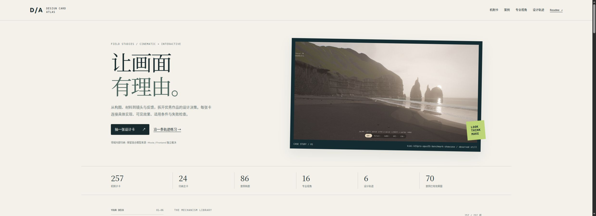

<div align="center">

# Design Card Atlas

**Cinematic worlds. Interactive interfaces. Explainable design decisions.**

从真实项目的代码、画面和失败条件中，归纳帮助模型与创作者做设计决策的卡片。

**257 子卡 · 24 主卡 · 86 案例 · 16 专业视角 · 6 设计轨迹**

[浏览卡库](index.html) · [全部案例](docs/CASES.md) · [完整效果图索引](docs/CASE_GALLERY.md) · [来源审计](docs/SOURCE_AUDIT.md)

</div>



## 它如何帮助设计

卡片围绕具体决策组织：如何让建筑先有可读轮廓，如何让材料粗糙度和湿润程度各自表达，如何让镜头停下来读出物件，如何让导航动画保留对象身份。每个动作连接源码、案例画面、成立条件、失败模式和最小对照。

**Movie** 判断编排镜头中的构图、尺度、材料、节奏与连续性；**Frontend** 另外判断自由观察、输入、返回、打断、可读性与状态一致性。模型署名和混合模型分工保留为来源信息，不作为质量得分。

## 效果与案例

图像是作者图、历史截图、线上观察或本地影片静帧；具体类型、版本边界和来源写在案例中。静帧展示不等于连续运动、物理正确性或性能验收。

<table>
<tr>
<td width="50%" valign="top"><a href="cases/kimi-k31pro-opus55-benchmark-showcase.md"></a><br><b>黑沙滩 / 接触与时间</b><br>玄武岩的尺度、退潮薄膜与湿暗的双时钟。<br><a href="cases/kimi-k31pro-opus55-benchmark-showcase.md">案例分析 →</a></td>
<td width="50%" valign="top"><a href="cases/apple-music-effect.md"></a><br><b>液态标志 / 可控光学</b><br>解析曲面、边缘色散和子帧采样。<br><a href="cases/apple-music-effect.md">案例分析 →</a></td>
</tr>
<tr>
<td width="50%" valign="top"><a href="cases/mg-styles-15.md"></a><br><b>15种短片 / 动作语法</b><br>从装配、描线到字形变换，逐片保留节拍差异。<br><a href="cases/mg-styles-15.md">案例分析 →</a></td>
<td width="50%" valign="top"><a href="cases/invisible-cities-opus-5.5.md"></a><br><b>城市图谱 / 空间信息</b><br>城市身份稳定，布局表达不同阅读结构。<br><a href="cases/invisible-cities-opus-5.5.md">案例分析 →</a></td>
</tr>
<tr>
<td width="50%" valign="top"><a href="cases/little-rain-cloud.md"></a><br><b>雨云 / 留下痕迹</b><br>雨滴、湿图与植物回应共同建立行动反馈。<br><a href="cases/little-rain-cloud.md">案例分析 →</a></td>
<td width="50%" valign="top"><a href="cases/web-ocean.md"></a><br><b>海洋 / 多尺度一致</b><br>波浪、高光、天空与泡沫如何形成同一环境。<br><a href="cases/web-ocean.md">案例分析 →</a></td>
</tr>
<tr>
<td width="50%" valign="top"><a href="cases/csc35-diorama-day.md"></a><br><b>微缩房间 / 尺度与角色</b><br>玩具屋视角、家具体量和人物需求的关系。<br><a href="cases/csc35-diorama-day.md">案例分析 →</a></td>
<td width="50%" valign="top"><a href="cases/map-of-middle-earth.md"></a><br><b>中土旅程 / 地形与镜头</b><br>路线、地标和事件光照组织电影旅程。<br><a href="cases/map-of-middle-earth.md">案例分析 →</a></td>
</tr>
<tr>
<td width="50%" valign="top"><a href="cases/neon-zenith.md"></a><br><b>雨夜街 / 光色因果</b><br>让招牌、地面与雨雾共享发光分布。<br><a href="cases/neon-zenith.md">案例分析 →</a></td>
<td width="50%" valign="top"><a href="cases/electromagnetism.md"></a><br><b>交互仪表 / 操作可解释</b><br>三维场、仪表与二维曲线连接同一操作。<br><a href="cases/electromagnetism.md">案例分析 →</a></td>
</tr>
<tr>
<td width="50%" valign="top"><a href="cases/dopa-drill.md"></a><br><b>学习反馈 / 感官强度</b><br>局部错误提示与逐级音画，保留可操作目标。<br><a href="cases/dopa-drill.md">案例分析 →</a></td>
<td width="50%" valign="top"><a href="cases/gsap-threejs-codrops.md"></a><br><b>列表到详情 / 对象连续</b><br>同一视觉对象保留起点和身份。<br><a href="cases/gsap-threejs-codrops.md">案例分析 →</a></td>
</tr>
</table>

全部 **86** 个来源都有案例档案；**70** 个已有可展示的效果/界面图，共 **139** 份观察材料。剩余条目逐项标为无独立画面、未补图或仅有宣传参考，不用假图填充。[查看全部图文案例](docs/CASE_GALLERY.md)。

## 从专业视角重新看一张图

| 视角 | 要问的问题 |
|---|---|
| [造型轮廓与尺度：先建立大小关系，再增加细节](lenses/CINE-01.md) | 关闭纹理和后期后，仍能辨认主地标、支撑结构和近远尺度吗？ |
| [构图与负空间：给主线索保留可读的空隙](lenses/CINE-02.md) | 观众第一眼的落点是什么，第二眼是否沿可解释的路径到达它？ |
| [材质表面：让颜色、反射与微结构讲同一状态](lenses/CINE-03.md) | 观众能从多条一致线索读出干湿、粗糙度与接触，而非只看见一层滤色吗？ |
| [光照与曝光：先决定亮度关系，再决定光晕](lenses/CINE-04.md) | 发光体、受光面和天空能互相解释，主体中间调是否仍可读？ |
| [空气纵深：让距离、遮挡和透射共同塑形](lenses/CINE-05.md) | 近物的黑、远物的淡和光柱的明，是否来自同一空间关系？ |
| [时间节奏：区分发生、响应和残留](lenses/CINE-06.md) | 一个动作何时出现结果，结果又以什么时间尺度消失？ |
| [镜头调度：每次移动都带来新的信息](lenses/CINE-07.md) | 镜头的起点、终点和途中遮挡分别要让观众理解什么？ |
| [光学效果的可控性：以信息损失为预算](lenses/CINE-08.md) | 加上景深、快门、bloom或透镜扭曲后，哪些结构必须仍然清楚？ |
| [视觉层级与字体职责](lenses/IF-01.md) | 去掉动画和品牌颜色后，读者还能辨认标题、正文、元数据与下一步操作吗？ |
| [色彩角色与可读性](lenses/IF-02.md) | 这个颜色是在表示动作、状态、数据量还是环境气氛；同一颜色是否被赋予了互相冲突的含义？ |
| [信息与操作的空间映射](lenses/IF-03.md) | 用户看见的对象、点击区域、键盘焦点以及结果面板是否指向同一个东西？ |
| [对象身份与转场连续性](lenses/IF-04.md) | 跨页、重排或收起之后，用户还知道刚才那个对象去了哪里吗？ |
| [反馈与真实状态](lenses/IF-05.md) | 画面上的“成功、完成、保存、更新中”究竟由哪个真实事件触发？ |
| [叙事节奏与可打断性](lenses/IF-06.md) | 等待动画是在帮助理解变化，还是在强迫用户观看；打断后状态还能接上吗？ |
| [感官强度与可访问性](lenses/IF-07.md) | 减少运动、静音或仅用键盘时，用户还能得到同等状态信息并可靠操作吗？ |
| [渲染预算与交付稳定性](lenses/IF-08.md) | 高级画面未就绪、GPU失败或异步结果过期时，用户仍能看到内容并继续操作吗？ |

新增 **16** 份深入案例按“画面观察 → 因果链 → 审美决策 → 相邻方案 → 迁移顺序”展开，其余案例保留逐机制分析。视角来自跨案例阅读和[一手专业资料](docs/PROFESSIONAL_SOURCES.md)，不是已校准的审美打分体系。

## 抽卡与设计轨迹

- **抽一张**：从当前问题、视角、用途和证据筛选池中取一个机制。
- **抽三张对照**：优先不同来源，用来比较做法；并不默认三个效果可以叠加。
- **收藏与导出**：导出包含条件、失败检查和源码链接的 Markdown 工作简报，补现场约束后交给模型。收藏仅保存在当前浏览器。
- **沿轨迹练习**：按有因果关系的步骤推进，每步都有检查点与停止条件。

| 轨迹 | 目标 | 步骤 |
|---|---|---:|
| 雨夜街：先让城市可读，再让雨解释灯光 | 候选设计顺序。先确定街口、地标和店铺身份，之后才接入雨与反光；同一检查机位贯穿过程。每步不通过就回到该步，不靠下一层效果遮盖问题。 | 5 |
| 海岸：从地形块面走到退潮后的时间痕迹 | 候选设计顺序。先让陆地、海面和观看距离有可读尺度，再决定波带、阳光和退潮记忆；这里的岸浪与远海泡沫是不同模型，不互相冒充。 | 5 |
| 微缩建筑 movie：先有可信空间，再分配镜头职责 | 候选设计顺序。建筑、接地和观看路径先组成同一个空间，随后以建立环境、观察主体、回望关系的镜头次序组织短片。不是固定风格或片长模板。 | 5 |
| 液态品牌片：先保存识别，再让形变提供揭示 | 候选设计顺序。先确定必须被记住的轮廓或文字，再设计少数可解释的形态变化；折射、色散和运动模糊只服务这条识别路径。 | 5 |
| 前端列表到详情：先建立阅读与对象连续，再增强动效 | 候选设计顺序。列表与详情必须先能独立完成阅读和导航；空间转场为同一内容提供连续性，不能把用户操作变成等待演出。 | 5 |
| 交互世界复苏：动作留下路线，信号抵达后世界才回应 | 候选设计顺序。先让用户找到可操作对象，再用实际行动产生路径与状态；复苏是已完成连接的可见结果。可剪成movie，但不能把演示轨迹当成真实在线行为。 | 5 |

轨迹数据在 [trajectories.json](data/editorial/trajectories.json)。例如先解决雨夜街的轮廓与接地，再统一光色和湿痕，最后检查镜头与自由交互；不以增加效果数量作为完成标准。

## 给模型的一次工作输入

```text
目标：修复一个明确的画面或交互问题。
先读取1–3张相关卡及案例图片，列出条件与相邻方案区别。
保留当前机位、时间、随机种子和性能预算。
一次只改一组可归因变量，输出前后对照及失败检查。
分别给Movie和Frontend结论；无改善可拒绝该机制。
```

[空白工作模板](docs/WORK_BRIEF.md) · [专业证据仍缺什么](docs/EXPERT_GAPS.md)

## 来源范围与 Pro 推荐核对

原有65个目录，加21个补充仓库，合计86条来源。84个是独立Git仓，2个是本地条目。Pro完整答复的 **10项主推荐 + 2项观察候选 + 2项降级作品 = 14项** 全部已克隆并核对origin；混合模型和归属争议不阻止收录。

本库独立保存分析、图片、媒体出处和源码永久链接。参考源码继续独立管理，不把几十个上游工作树塞进卡库；[固定版本清单](data/sources.json)和恢复脚本可在新机器重新获取。合集的全部外链没有递归镜像。

```bash
# 只预览恢复清单，不下载
python3 scripts/fetch_sources.py --dest ../design-references --pro-only

# 确认需要这些参考仓后，获取分析对应的固定版本
python3 scripts/fetch_sources.py --dest ../design-references --pro-only --execute
```

## 本地使用

打开 `index.html` 即可使用，或启动静态服务器：

```bash
python3 -m http.server 3081 --bind 127.0.0.1
# 浏览器打开 http://127.0.0.1:3081
```

无前端依赖安装，无外部字体/CDN，图片随仓保存。修改数据后：

```bash
python3 scripts/build.py
python3 scripts/check.py
```

结构检查覆盖卡号、关联、永久源码指针、图片哈希和本地链接。桌面浏览器已检查筛选、抽卡、收藏、导出下载及模态框；已编写响应式样式，但本次浏览器视口覆盖未生效，移动布局尚未完成实测。

## 内容组织

```text
cards/                  一种操作，一张子卡；卡后附来源效果图
patterns/               跨案例共享机制及不能互换的分支
cases/                  全部案例的分析、边界与视觉材料
lenses/                 专业诊断视角
data/editorial/         新增归纳、案例、轨迹和来源审计
assets/previews/        已观察的原始图片/静帧及其哈希台账
site/                   抽卡、检索、收藏、导出界面
scripts/                构建、校验、参考源码恢复
```

第三方图片与素材保留原权属。原创工具代码的MIT许可仅适用于 `site/` 与 `scripts/`，不覆盖第三方媒体。[引用与媒体说明](RIGHTS.md)。
