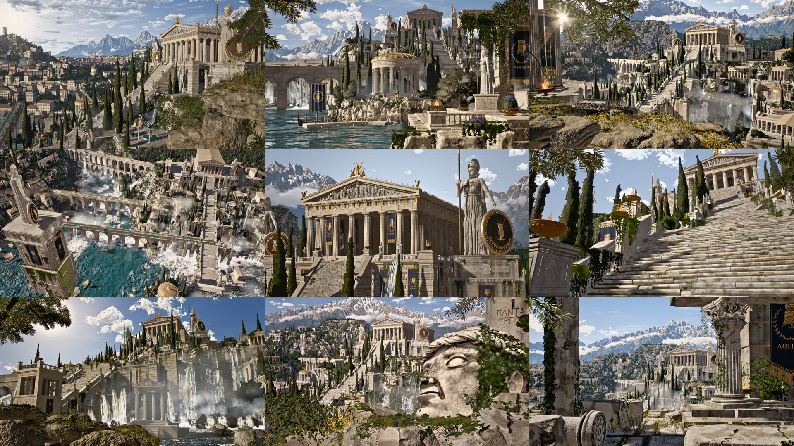

# ATH-005 · 围绕已审核构图限制相机运动幅度，并独立验证采样路径
案例：[ athenaion ](../cases/athenaion.md) · 机制证据：`still_observed`

效果图用于理解来源作品，不自动验证本卡中的每个机制。

## 设计动作

小幅运动延续已验收构图，不自动保证所有中间帧。长焦压缩和宽镜头展示属于不同镜头职责。只看过静帧，未确认运动流畅与GPU表现。

## 实现与参数

8段时长之和59.9减7*.8=54.3秒。shot5 fov18.5，dolly6/tilt1.2/zoom-.03；shot8仅truck.9/pan-.6。e=ease(u)-.5；linear/inout在u=.5回参考，easeout的shot9需u=1-sqrt(.5)≈.2929，注释“全都中点参考”不准确。renderFrame默认spp8。

## 审美细节

小幅运动延续已验收构图，不自动保证所有中间帧。长焦压缩和宽镜头展示属于不同镜头职责。只看过静帧，未确认运动流畅与GPU表现。

## 适用条件

- 镜头目标和参考framing已确定
- 动态对象与阴影时间与采样一致

## 相邻方案与区别

区别于全城自动漫游或单条长轨道；每段小范围只服务该构图。

## 失败模式

- 相机路径没有避障，楼梯跟随需另做
- easeout使注释中点假设失效
- 5像素非黑检查不等于画面质量验收
- 9个参考相机不能写成9段成片

## Movie 裁决

- **verdict**：prototype
- **reason**：适合电影按镜头收敛；需补路径接地与子帧目检。

## Frontend 裁决

- **verdict**：adapt
- **reason**：适合点击地标后的短预览，恢复自由视角须保留用户状态。

## 最小对照

每段取0/.25/.5/.75/1和快门边缘帧，检查碰撞、边缘主体、阴影与景深；任何主体被裁/穿墙/时序跳变即回调幅度。

## 源码证据

- [Repos/athenaion/src/world/shots.js:1–44](https://github.com/Leonxlnx/athenaion/blob/9b8bd23b39c458a50fb1201037360047781c45b5/src/world/shots.js#L1-L44)：9个参考相机记录pos/target/fov/dof；shot5为18.5度长焦
- [Repos/athenaion/src/video/sequence.js:9–38](https://github.com/Leonxlnx/athenaion/blob/9b8bd23b39c458a50fb1201037360047781c45b5/src/video/sequence.js#L9-L38)：实际8段、30FPS、.8秒交叉溶解、.5快门；shot3注释因GPU挂起删除
- [Repos/athenaion/src/video/sequence.js:37–70](https://github.com/Leonxlnx/athenaion/blob/9b8bd23b39c458a50fb1201037360047781c45b5/src/video/sequence.js#L37-L70)：围绕参考帧计算dolly/truck/crane/pan/tilt，未做地形或碰撞约束
- [Repos/athenaion/src/video/player.js:19–57](https://github.com/Leonxlnx/athenaion/blob/9b8bd23b39c458a50fb1201037360047781c45b5/src/video/player.js#L19-L57)：每帧多样本快门采样、更新第一子样本CSM，读5像素粗略检测空黑帧

## 项目效果图

已查看的来源静帧；不证明当前版本运行。

来源：[原作者/出处](https://github.com/Leonxlnx/athenaion/blob/9b8bd23b39c458a50fb1201037360047781c45b5/media/overview.jpg) · historical_still_viewed。静帧观察；没有由此验证连续动画或性能。

已查看的来源静帧；不证明当前版本运行。

来源：[原作者/出处](https://github.com/Leonxlnx/athenaion/blob/9b8bd23b39c458a50fb1201037360047781c45b5/media/shot5.jpg) · historical_still_viewed。静帧观察；没有由此验证连续动画或性能。

## 归纳与练习

暂未归入新增专业视角；保留原机制边界。

[MP-11](../patterns/MP-11.md)
