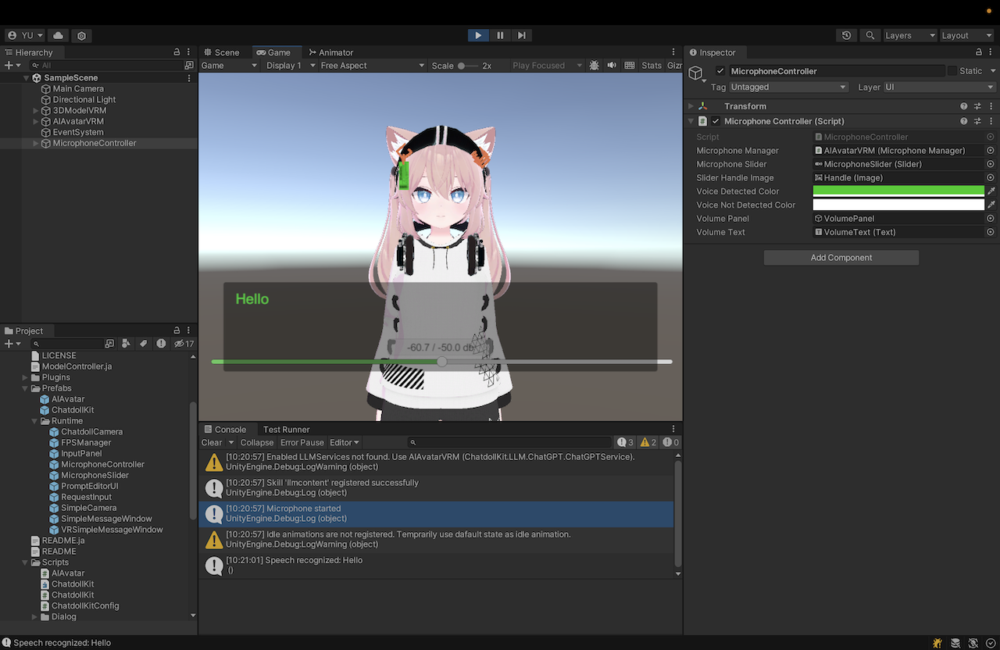

# CN-002 · 让临时表情到期后回到中性
案例：[ ChatdollKit ](../cases/ChatdollKit.md) · 机制证据：`source_only`

效果图用于理解来源作品，不自动验证本卡中的每个机制。

## 设计动作

让临时表情到期后回到中性。这是由该仓实现提炼的候选操作，跨项目效果待验证。

## 实现与参数

SetFace复制队列→UpdateFace→SetExpressionSmoothly(name,1.0)→Duration到期出队→Neutral。

## 审美细节

表情具有寿命，减少一句惊讶长期留在下一句上的语义残影；默认持续时长字段7秒不等于所有表达都应用该值。

## 适用条件

- 每张2D表情有明确neutral资源
- 表达持续时间有语义依据

## 相邻方案与区别

与按LLM token反复换脸不同，这里按有时限的表达段保持。

## 失败模式

- 同名同Duration连续片段不会重新进入设置分支，需核对复位语义
- 全局7秒可能压过短句节奏

## Movie 裁决

- **verdict**：adapt
- **reason**：可映射2D立绘淡入淡出，不建议导入3D角色

## Frontend 裁决

- **verdict**：adapt
- **reason**：表情重置与跳过/关闭要联动

## 最小对照

连续两句同表情同duration、不同表情、取消会面三组；结束后仍停在强表情即失败。

## 源码证据

- [Repos/ChatdollKit/Scripts/Model/FaceController.cs:27–70](https://github.com/uezo/ChatdollKit/blob/e694f443247e0a322ea5f0b5dc4a36838defc20e/Scripts/Model/FaceController.cs#L27-L70)：表情队列按持续时间出队，空时设Neutral，并平滑设置表情

## 项目效果图

Unity Game视图中粉发猫耳角色位于中央；下方半透明识别文字与音量条，右侧为Microphone Controller设置。编辑器截图，不是独立产品页面。

来源：本轮已观察的历史截图 · author_historical_screenshot。已实际查看作者历史图；仅支持画面布局、配色和可见状态，不证明当前HEAD、动态行为或运行质量。

## 归纳与练习

暂未归入新增专业视角；保留原机制边界。

[MP-17](../patterns/MP-17.md)
