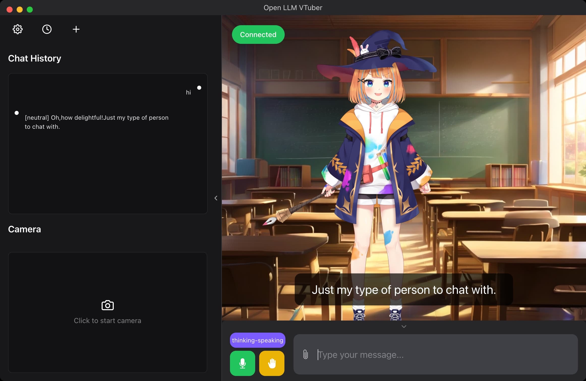

# CN-005 · 只把用户实际听见的回复写回中断上下文
案例：[ Open-LLM-VTuber ](../cases/Open-LLM-VTuber.md) · 机制证据：`source_only`

效果图用于理解来源作品，不自动验证本卡中的每个机制。

## 设计动作

只把用户实际听见的回复写回中断上下文。这是由该仓实现提炼的候选操作，跨项目效果待验证。

## 实现与参数

task.cancel→等待取消→agent.handle_interrupt(heard_response)→保存已听文本及中断标记→广播停止。

## 审美细节

让下一句接续观众实际经历的内容，防止角色假设自己已说完尚未播放的结论。

## 适用条件

- 前端准确回报heard_response
- 多角色说话身份保留

## 相邻方案与区别

与只停音频不同，同时修正对话记忆；文本截断也不能假冒音素级听闻。

## 失败模式

- heard_response若由整段生成文本冒充仍会产生虚假连续性
- 本段仅验证group分支，不代表所有中断路径一致

## Movie 裁决

- **verdict**：reference
- **reason**：确定脚本电影通常不发生观众打断

## Frontend 裁决

- **verdict**：adapt
- **reason**：会面可暂停与返回的交互有相关性

## 最小对照

播到第二段一半关闭再回到会面；回复不得引用未出现的第三段。

## 源码证据

- [Repos/Open-LLM-VTuber/src/open_llm_vtuber/conversations/conversation_handler.py:173–213](https://github.com/Open-LLM-VTuber/Open-LLM-VTuber/blob/992309c0aa19845960228f880013d4685fde93b5/src/open_llm_vtuber/conversations/conversation_handler.py#L173-L213)：取消组会话后存heard_response及Interrupted标记，并广播interrupt-signal

## 项目效果图

左侧历史与摄像头区域、右侧教室中的角色及字幕，底部有thinking-speaking状态、麦克风和打断按钮。

来源：本轮已观察的历史截图 · author_historical_screenshot。已实际查看作者历史图；仅支持画面布局、配色和可见状态，不证明当前HEAD、动态行为或运行质量。

## 归纳与练习

[IF-06](../lenses/IF-06.md)

[MP-18](../patterns/MP-18.md)
