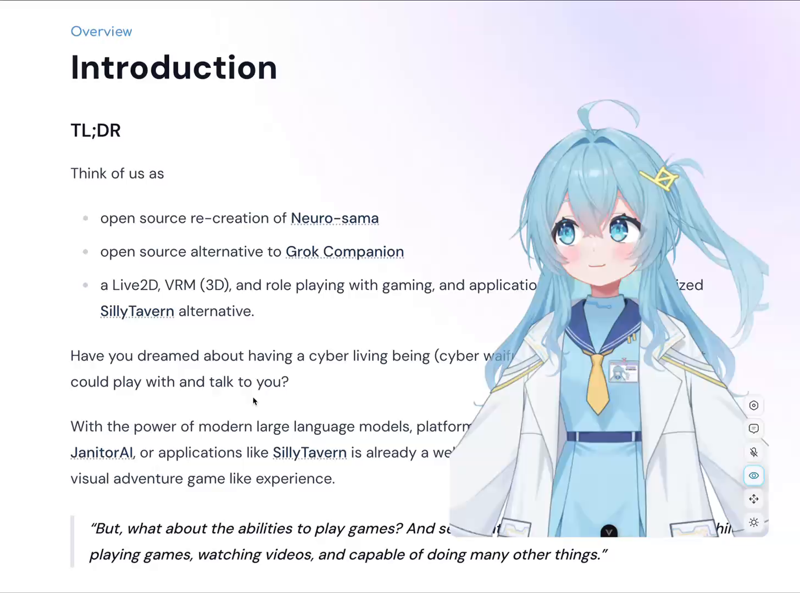

# CN-012 · 按当前播放身份停止会话并保留可恢复音量
案例：[ airi ](../cases/airi.md) · 机制证据：`source_only`

效果图用于理解来源作品，不自动验证本卡中的每个机制。

## 设计动作

按当前播放身份停止会话并保留可恢复音量。这是由该仓实现提炼的候选操作，跨项目效果待验证。

## 实现与参数

voiceGetTurns取得当前身份→按session过滤→voiceInterrupt；volume clamp0..1，0置mute，unmute恢复lastAudibleVolume。

## 审美细节

停止当前话语与未来是否生成声音分开；避免按钮显示开声但gain仍为0。

## 适用条件

- 音频host是播放身份权威
- 退出会话时清理订阅

## 相邻方案与区别

不同于只修改布尔isSpeaking，把停止动作绑定实际活动turn。

## 失败模式

- 缓存旧turn可能停错会话，所以实现先查询
- mute与stop混为一谈会让旧音频继续响

## Movie 裁决

- **verdict**：reference
- **reason**：电影不需会话选择，工具预览有用

## Frontend 裁决

- **verdict**：adapt
- **reason**：有语音时可借状态设计；当前先不新增语音系统

## 最小对照

切换会话A到B后停止A，B不能被误停；0→unmute必须恢复可听值。

## 源码证据

- [Repos/airi/packages/stage-ui/src/stores/speech-output-control.ts:14–84](https://github.com/moeru-ai/airi/blob/bc41885f0bfb3483a93833f4bcfbc8ad3afe483d/packages/stage-ui/src/stores/speech-output-control.ts#L14-L84)：从audio host查询turn后按session中断；音量clamp，取消静音恢复lastAudibleVolume

## 项目效果图

本地作者hover教程第0秒：浅蓝发角色作为桌面浮层位于文档右侧，旁边有竖向小工具按钮；角色遮盖部分正文。

来源：本轮已观察的历史截图 · author_demo_frame。已查看视频0、1、3、5秒抽帧，仅采用0秒可见角色状态；未连续播放，单帧不证明hover逻辑或口型。

## 归纳与练习

暂未归入新增专业视角；保留原机制边界。

保留独立案例。
