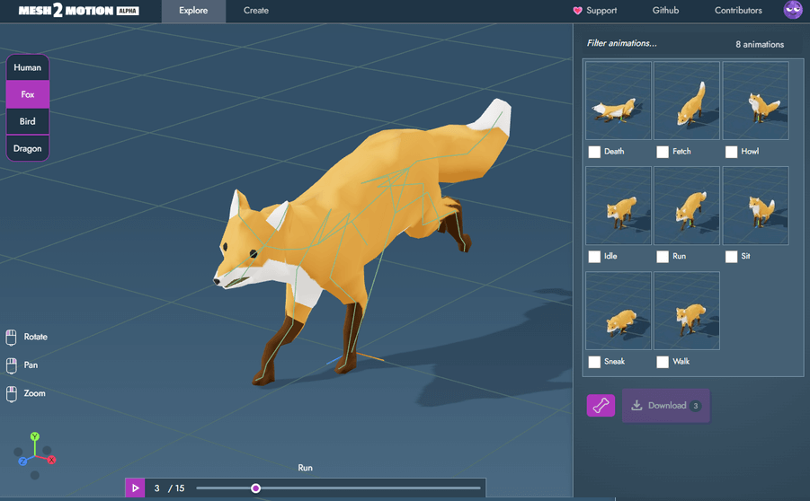

# CN-019 · 导出前清除失去目标的动画轨并保证时间严格递增
案例：[ mesh2motion-app ](../cases/mesh2motion-app.md) · 机制证据：`source_only`

效果图用于理解来源作品，不自动验证本卡中的每个机制。

## 设计动作

导出前清除失去目标的动画轨并保证时间严格递增。这是由该仓实现提炼的候选操作，跨项目效果待验证。

## 实现与参数

clean_clips_for_export→parseTrackName/findNode→过滤断绑定轨→保留times严格大于前值的索引→同步重建values。

## 审美细节

资产在编辑器里能动不代表导出后绑定完整；这是交付完整性机制，不是美术风格。

## 适用条件

- 导出对象层级确定
- 有原始动画可回溯

## 相邻方案与区别

与加载后压制warning不同，在导出边界明确修正数据。

## 失败模式

- 静默删轨可能掩盖错误删骨
- 去重可能改变极密运动，需要比较关键姿态

## Movie 裁决

- **verdict**：reference
- **reason**：离线镜头使用导出动画前有价值

## Frontend 裁决

- **verdict**：defer
- **reason**：本轮2D角色和静态场景无需新骨骼管线

## 最小对照

构造删骨轨+Float32同时间关键帧，导出无悬空轨并在三个关键时点姿态可比；姿态漂移为失败。

## 源码证据

- [Repos/mesh2motion-app/src/lib/processes/export-to-file/ExportAnimationCleanupService.ts:3–77](https://github.com/Mesh2Motion/mesh2motion-app/blob/653a9698f5f315523072f1c3ff3496100401317b/src/lib/processes/export-to-file/ExportAnimationCleanupService.ts#L3-L77)：过滤不绑定导出层级的track；去除Float32转换后非递增的keyframe

## 项目效果图

历史静帧实际查看：左侧模型主视口、右侧动画缩略列表、底部Run时间轴；不能验证真实运动或绑定质量。

来源：[原作者/出处](https://github.com/Mesh2Motion/mesh2motion-app/blob/653a9698f5f315523072f1c3ff3496100401317b/readme.png) · historical_still_viewed。静帧观察；没有由此验证连续动画或性能。

## 归纳与练习

暂未归入新增专业视角；保留原机制边界。

保留独立案例。
