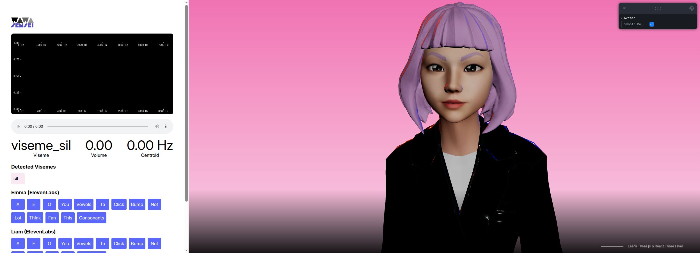

# CN-020 · 从音频频带估计有限嘴形再用短时惯性减抖
案例：[ wawa-lipsync ](../cases/wawa-lipsync.md) · 机制证据：`source_only`

效果图用于理解来源作品，不自动验证本卡中的每个机制。

## 设计动作

从音频频带估计有限嘴形再用短时惯性减抖。这是由该仓实现提炼的候选操作，跨项目效果待验证。

## 实现与参数

processAudio→extractFeatures→detectState→viseme评分→持续时间调权→15类输出；默认100ms当前形1.3x，之后衰减。

## 审美细节

有限嘴形适合2D分层嘴部映射；它是启发式声学分类，并非可靠音素识别或有字幕对齐。

## 适用条件

- 已有可用嘴形资源
- 单一清晰人声，非音乐混音

## 相邻方案与区别

与只按音量张嘴不同，利用频谱挑嘴形；与强制对齐不同，没有文本时间标注。

## 失败模式

- 注释说100–300ms渐变，但maxVisemeDuration=100使中段分支不可达
- 静音不入history导致旧特征可能残留，需先测收口

## Movie 裁决

- **verdict**：reference
- **reason**：离线影片宜用人工/文本对齐；本库可作预览

## Frontend 裁决

- **verdict**：defer
- **reason**：当前2D静图没有嘴部层则无直接收益

## 最小对照

固定音频：纯静音、人声尾停顿、音乐；停声150ms内回sil并统计抖动；不满足不采用。

## 源码证据

- [Repos/wawa-lipsync/packages/wawa-lipsync/src/lipsync.ts:44–85](https://github.com/wass08/wawa-lipsync/blob/312dc31a1ee998248aae3431474f455bfc3ae3e1/packages/wawa-lipsync/src/lipsync.ts#L44-L85)：默认FFT2048/history10；7频带50至8000Hz
- [Repos/wawa-lipsync/packages/wawa-lipsync/src/lipsync.ts:122–171](https://github.com/wass08/wawa-lipsync/blob/312dc31a1ee998248aae3431474f455bfc3ae3e1/packages/wawa-lipsync/src/lipsync.ts#L122-L171)：提取频带、谱质心、能量变化
- [Repos/wawa-lipsync/packages/wawa-lipsync/src/lipsync.ts:197–240](https://github.com/wass08/wawa-lipsync/blob/312dc31a1ee998248aae3431474f455bfc3ae3e1/packages/wawa-lipsync/src/lipsync.ts#L197-L240)：score后挑选viseme并维护状态时刻
- [Repos/wawa-lipsync/packages/wawa-lipsync/src/lipsync.ts:373–419](https://github.com/wass08/wawa-lipsync/blob/312dc31a1ee998248aae3431474f455bfc3ae3e1/packages/wawa-lipsync/src/lipsync.ts#L373-L419)：100ms当前嘴形1.3倍加权，超时逐步降至至少0.5
- [Repos/wawa-lipsync/packages/wawa-lipsync/src/visemes.ts:1–19](https://github.com/wass08/wawa-lipsync/blob/312dc31a1ee998248aae3431474f455bfc3ae3e1/packages/wawa-lipsync/src/visemes.ts#L1-L19)：15个Oculus风格嘴形枚举

## 项目效果图

README链接的作者教程封面：两种角色面孔与Real-Time Lipsync标题。它是宣传参考图，不是运行截图或口型同步证据。

来源：[原作者/出处](https://img.youtube.com/vi/GXU1amqvJF8/maxresdefault.jpg) · promotional_reference。已实际查看作者教程缩略图；不能作为效果主图，不能证明模型发声、口型正确或实时性能。

粉色背景中角色正面占右侧；左侧频谱、viseme、音量与质心读数并列，底部为样本发音按钮。

来源：[原作者/出处](https://wawa-lipsync.wawasensei.dev/) · live_site_still。本轮只看静默初始角色与仪表；未播放声音，未证明口型同步或频谱判定准确。

## 归纳与练习

暂未归入新增专业视角；保留原机制边界。

保留独立案例。
