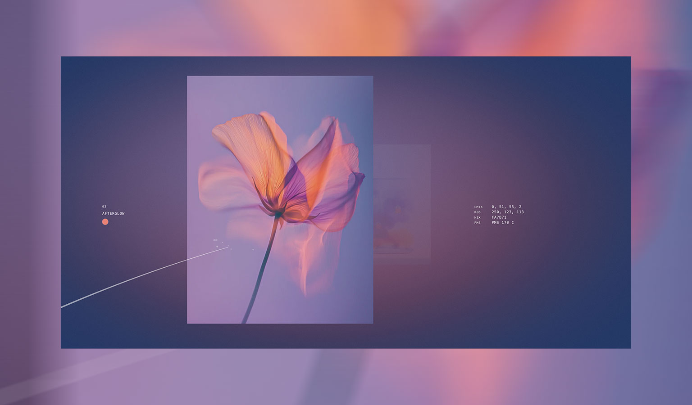

# FM-003 · 让滚动速度改变呼吸幅度而让停止恢复稳定
案例：[ codrops-depth-gallery ](../cases/codrops-depth-gallery.md) · 机制证据：`still_observed`

效果图用于理解来源作品，不自动验证本卡中的每个机制。

## 设计动作

运动响应分配给正在观看的平面，停下可读；不是所有元素持续等幅摇摆。

## 实现与参数

abs(velocity)/velocityMax clamp；breathScaleAmount=.03、tilt=.045、平滑=.14；背景亮度最多+0.10。

## 审美细节

运动响应分配给正在观看的平面，停下可读；不是所有元素持续等幅摇摆。

## 适用条件

- 输入速度可归一
- 有 reduced-motion 替代

## 相邻方案与区别

区别于时间驱动 idle animation：幅度由用户动作控制，但此源码仍有独立背景漂移。

## 失败模式

- 固定每帧 lerp 在不同刷新率下手感不同
- 亮度提升使浅色内容过曝

## Movie 裁决

- **verdict**：reference
- **reason**：需用编排速度取代手势输入

## Frontend 裁决

- **verdict**：adapt
- **reason**：可做少量封面反馈

## 最小对照

60/120Hz各滚动后停手，检查稳定时间与是否误触；关闭动效仍可完成阅读。

## 源码证据

- [Repos/codrops-depth-gallery/src/Experience/Gallery.js:443–503](https://github.com/houmahani/codrops-depth-gallery/blob/28190e0920df887f069524c3863db397af34c1c8/src/Experience/Gallery.js#L443-L503)：归一化速度驱动缩放/漂移并按透明度门控
- [Repos/codrops-depth-gallery/src/Experience/Background/shaders/fragment.glsl:42–48](https://github.com/houmahani/codrops-depth-gallery/blob/28190e0920df887f069524c3863db397af34c1c8/src/Experience/Background/shaders/fragment.glsl#L42-L48)：速度提升亮度0.10并加固定颗粒

## 项目效果图

view_image executed 2026-10-25; repository historical still only; not current runtime or motion evidence

来源：[原作者/出处](https://github.com/houmahani/codrops-depth-gallery/blob/28190e0920df887f069524c3863db397af34c1c8/resources/screenshot.jpg) · observed_still。静帧观察；没有由此验证连续动画或性能。

## 归纳与练习

[IF-07](../lenses/IF-07.md)

[MP-12](../patterns/MP-12.md)
