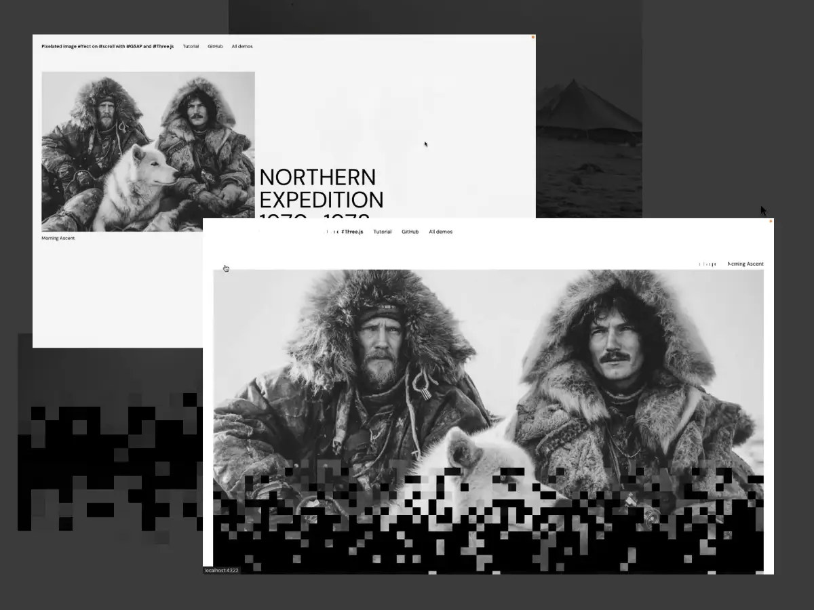

# FM-004 · 在列表到详情的转场中移动同一个视觉对象
案例：[ gsap-threejs-codrops ](../cases/gsap-threejs-codrops.md) · 机制证据：`source_only`

效果图用于理解来源作品，不自动验证本卡中的每个机制。

## 设计动作

保留图像身份和起点，用户知道进入的是哪张内容；1秒只是此案例参数，不能默认每次导航都等1秒。

## 实现与参数

点击标记→补全选中 shader→DOM图可见→Flip.getState→append同一img→Flip.from；未选中图退出。

## 审美细节

保留图像身份和起点，用户知道进入的是哪张内容；1秒只是此案例参数，不能默认每次导航都等1秒。

## 适用条件

- 源目标对象可一一对应
- 图片已加载且布局稳定

## 相邻方案与区别

区别于全屏fade：空间路径解释导航；区别于复制截图：同一DOM对象迁移。

## 失败模式

- 快速双击/返回破坏交接
- 图片加载失败使loadImages等待不结束

## Movie 裁决

- **verdict**：adapt
- **reason**：可用于章节镜头视觉对应

## Frontend 裁决

- **verdict**：prototype
- **reason**：适合手机卡片进入详情

## 最小对照

连续进入/返回20次，改变窗口宽度和慢加载，出现跳图/滚动丢位/不可中断即失败。

## 源码证据

- [Repos/gsap-threejs-codrops/src/app/main.ts:150–211](https://github.com/J0SUKE/gsap-threejs-codrops/blob/f236f2a7805e15600a59aeba0ad70ac25ef69b1f/src/app/main.ts#L150-L211)：选中图补足揭示并捕获Flip位置
- [Repos/gsap-threejs-codrops/src/app/main.ts:222–259](https://github.com/J0SUKE/gsap-threejs-codrops/blob/f236f2a7805e15600a59aeba0ad70ac25ef69b1f/src/app/main.ts#L222-L259)：同一img移入详情，1秒power3.inOut

## 项目效果图

Codrops原作者文章配图将两个页面状态叠放：黑白照片、大字排版与底部像素块边界可见。静态拼图不能证明滚动时序。

来源：[原作者/出处](https://tympanus.net/codrops/wp-content/uploads/2026/01/pixel_featured.webp) · author_demo_composite。已实际查看作者历史图；仅支持画面布局、配色和可见状态，不证明当前HEAD、动态行为或运行质量。

## 归纳与练习

[IF-04](../lenses/IF-04.md)

[MP-13](../patterns/MP-13.md)
