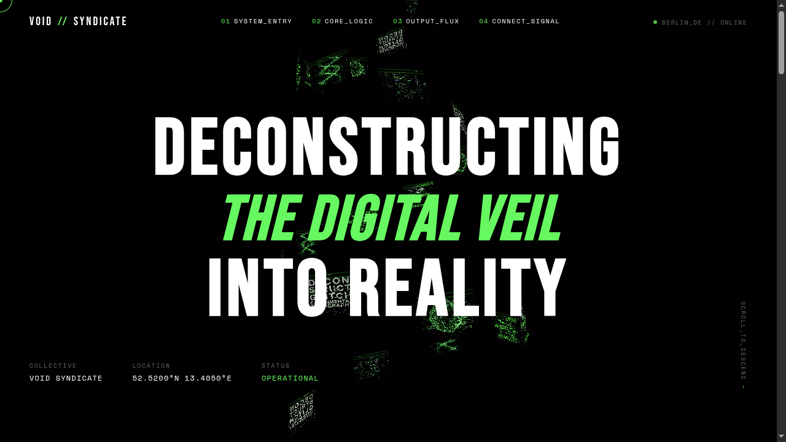

# FM-006 · 用半径收缩与图块缩小建立汇聚方向
案例：[ void-syndicate ](../cases/void-syndicate.md) · 机制证据：`source_only`

效果图用于理解来源作品，不自动验证本卡中的每个机制。

## 设计动作

几何排布本身给出从宽口到窄口的方向，不依赖Bloom；属于数据雕塑，不是黑洞引力透镜。

## 实现与参数

32张32×32细分平面沿helix；radius lerp(7,2,t)，图块2.2×1.6乘(1-.3t)。

## 审美细节

几何排布本身给出从宽口到窄口的方向，不依赖Bloom；属于数据雕塑，不是黑洞引力透镜。

## 适用条件

- 主相机看到收缩轴
- 重复素材有足够差异

## 相邻方案与区别

区别于圆柱轮播：半径/尺寸双收缩；区别于黑洞shader：没有光线弯折。

## 失败模式

- 正对轴或过近看成平面墙
- 不应称为物理黑洞

## Movie 裁决

- **verdict**：prototype
- **reason**：适合档案/数据空间单镜头

## Frontend 裁决

- **verdict**：reference
- **reason**：不适合作为文章主导航

## 最小对照

固定三机位对比圆柱与收缩锥，若无法辨认汇聚方向或遮住出口则失败。

## 源码证据

- [Repos/void-syndicate/src/script.js:26–50](https://github.com/ademmrewind/void-syndicate/blob/01a752e59031a9b78955fe3c7a816b485bb2aab5/src/script.js#L26-L50)：半径7→2，4圈×8块，高30
- [Repos/void-syndicate/src/script.js:267–323](https://github.com/ademmrewind/void-syndicate/blob/01a752e59031a9b78955fe3c7a816b485bb2aab5/src/script.js#L267-L323)：圆锥螺旋位置，图块随t缩小30%，朝外

## 项目效果图

黑底白色窄体标题与荧绿斜体强调；中央图块螺旋穿过文字，四角元数据维持信息框架。

来源：本轮已观察的历史截图 · historical_ui_still。历史本地网页截图，版本未绑定；不证明滚动惯性与连续色散。

## 归纳与练习

暂未归入新增专业视角；保留原机制边界。

保留独立案例。
