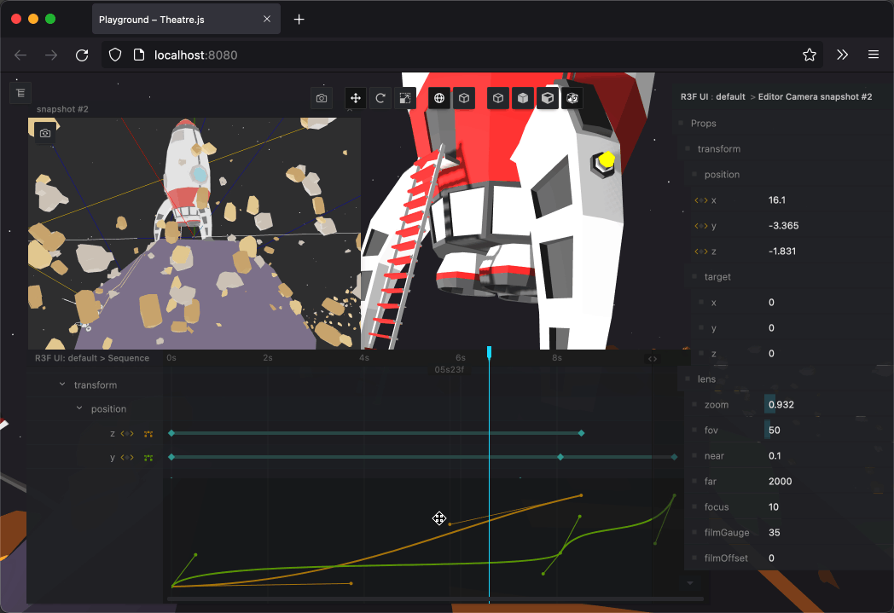

# FM-013 · 用停顿段与曲线段分别表达观看和移动
案例：[ theatre ](../cases/theatre.md) · 机制证据：`source_only`

效果图用于理解来源作品，不自动验证本卡中的每个机制。

## 设计动作

停留本身应是编排的一段，而不是移动速度偶然变慢；适合先特写停顿再拉远。

## 实现与参数

相邻keyframe→若不连接则hold，否则UnitBezier(left.out,right.in)求局部progress；首尾钳在端点。

## 审美细节

停留本身应是编排的一段，而不是移动速度偶然变慢；适合先特写停顿再拉远。

## 适用条件

- 每段有明确观察目标
- 空间路径单独检查碰撞

## 相邻方案与区别

区别于一条全程线性lerp：独立决定何时看清、何时位移；与Hermite空间路径可组合但不替代。

## 失败模式

- 时间曲线平滑不等于空间路径不过冲
- 全段都ease导致节奏拖沓

## Movie 裁决

- **verdict**：prototype
- **reason**：匹配特写→拉远场景SOP

## Frontend 裁决

- **verdict**：adapt
- **reason**：可用于短暂过渡，必须可跳过

## 最小对照

同一路径比较线性与停顿/加速/收尾，首个物件能看清且总时长不过长；检查中间采样穿模。

## 源码证据

- [Repos/theatre/packages/core/src/sequences/interpolationTripleAtPosition.ts:170–230](https://github.com/theatre-js/theatre/blob/6ea82b938ea49609489f6377ded693ccc6ee8f5b/packages/core/src/sequences/interpolationTripleAtPosition.ts#L170-L230)：connectedRight=false保持左值，Bezier用两端handles求进度

## 项目效果图

作者GIF第1秒：火箭场景、编辑相机小窗、右侧相机参数以及底部关键帧与曲线编辑器同屏；不能由此帧验证编辑器交互。

来源：[原作者/出处](https://raw.githubusercontent.com/AriaMinaei/theatre-docs/main/docs/.vuepress/public/preview-3d-short.gif) · author_demo_frame。实际查看所采用的1秒抽帧；没有运行项目、没有连续播放或验证动态行为。

## 归纳与练习

[IF-06](../lenses/IF-06.md)

[MP-11](../patterns/MP-11.md)
