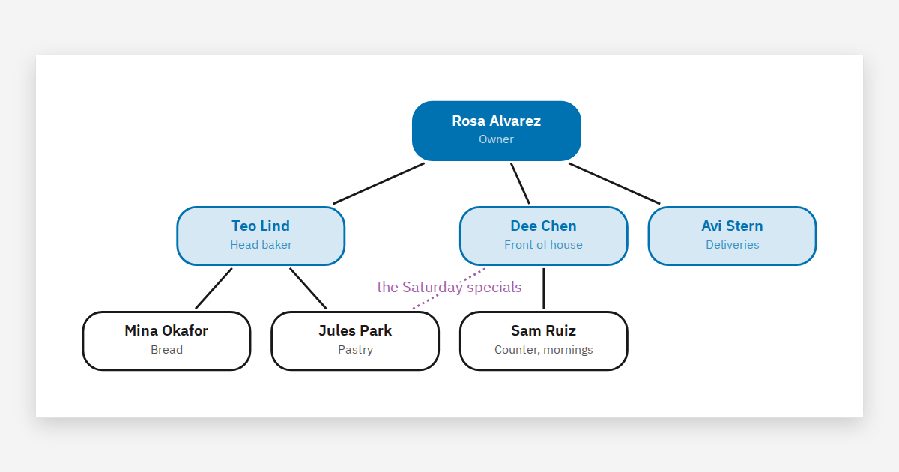

# FM-024 · 等内容绘制完成后恢复焦点并尊重新的用户意图
案例：[ tinylittleoffice ](../cases/tinylittleoffice.md) · 机制证据：`source_only`

效果图用于理解来源作品，不自动验证本卡中的每个机制。

## 设计动作

转场后的可读性包含键盘落点和滚动稳定；晚到回调不能抢走用户已移走的焦点。

## 实现与参数

drawn→await updateComplete→身份/弹窗检查→focusFirst或main.focus(preventScroll)。

## 审美细节

转场后的可读性包含键盘落点和滚动稳定；晚到回调不能抢走用户已移走的焦点。

## 适用条件

- 组件有完成信号
- 弹窗状态可检测

## 相邻方案与区别

区别于固定setTimeout focus：按真实绘制完成与当前状态恢复。

## 失败模式

- 异步渲染完成后抢走对话框焦点
- 回主列表焦点落body失去位置

## Movie 裁决

- **verdict**：defer
- **reason**：成片不适用

## Frontend 裁决

- **verdict**：adapt
- **reason**：手机列表/详情/会面返回适用

## 最小对照

慢加载时立刻开弹窗，完成回调不得抢焦点；返回列表后键盘继续原项。

## 源码证据

- [Repos/tinylittleoffice/src/kit/core/shell.ts:447–459](https://github.com/aboard-io/tinylittleoffice/blob/07f771ceab9e08c9c02e1e4abfe47877d128c202/src/kit/core/shell.ts#L447-L459)：等待editor.updateComplete，检查仍同editor且无dialog后focusFirst；主页焦点恢复
- [Repos/tinylittleoffice/src/kit/ui/theme.ts:28–44](https://github.com/aboard-io/tinylittleoffice/blob/07f771ceab9e08c9c02e1e4abfe47877d128c202/src/kit/ui/theme.ts#L28-L44)：auto主题跟设备change

## 项目效果图

作者样例输出的组织关系图：蓝色分层节点、黑色实线和紫色虚线说明；这是文档成品预览，不是编辑器截图。

来源：本轮已观察的历史截图 · author_sample_output。已实际查看作者历史图；仅支持画面布局、配色和可见状态，不证明当前HEAD、动态行为或运行质量。

## 归纳与练习

[IF-03](../lenses/IF-03.md) / [IF-08](../lenses/IF-08.md)

[MP-20](../patterns/MP-20.md)
