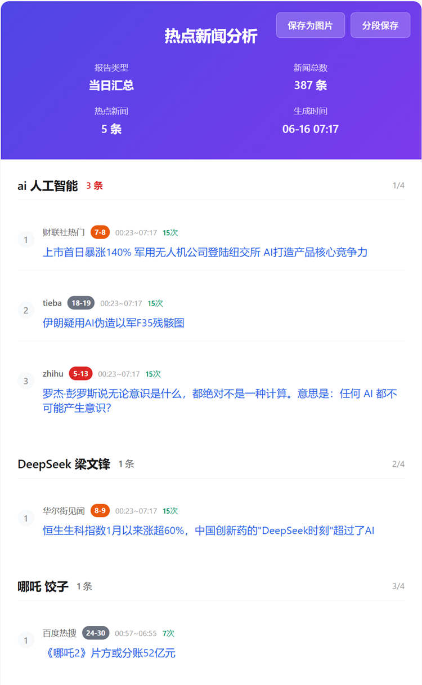

# FM-025 · 把来源、趋势与新增状态分配到不同视觉通道
案例：[ TrendRadar ](../cases/TrendRadar.md) · 机制证据：`source_only`

效果图用于理解来源作品，不自动验证本卡中的每个机制。

## 设计动作

多维状态不应挤进同一个红色分数；新近、热度、来源各自可追溯。

## 实现与参数

来源弱文字、排名数字底色、趋势箭头、NEW角标；趋势缺少两点返回None。

## 审美细节

多维状态不应挤进同一个红色分数；新近、热度、来源各自可追溯。

## 适用条件

- 原始指标含义明确
- 缺失趋势保持空

## 相邻方案与区别

区别于统一评分卡：保留不同指标语义；趋势方向不等于长期增长。

## 失败模式

- NEW与质量混同
- 红色高热被误解为可信
- 9px角标手机太小

## Movie 裁决

- **verdict**：reject
- **reason**：不用于3D场景观感

## Frontend 裁决

- **verdict**：adapt
- **reason**：适合手机信息流状态标注

## 最小对照

同一条目分别改变来源/排名/时间，用户能区分哪个维度变了；缺数据不显示假箭头。

## 源码证据

- [Repos/TrendRadar/trendradar/report/html.py:320–331](https://github.com/sansan0/TrendRadar/blob/792bcc3928b1617bba09df34989fd5675c159b86/trendradar/report/html.py#L320-L331)：NEW固定角标
- [Repos/TrendRadar/trendradar/report/html.py:389–447](https://github.com/sansan0/TrendRadar/blob/792bcc3928b1617bba09df34989fd5675c159b86/trendradar/report/html.py#L389-L447)：来源12px/标题15px/排名徽章/趋势符号
- [Repos/TrendRadar/trendradar/report/helpers.py:62–89](https://github.com/sansan0/TrendRadar/blob/792bcc3928b1617bba09df34989fd5675c159b86/trendradar/report/helpers.py#L62-L89)：趋势仅比较最近两条有效排名

## 项目效果图

热点新闻页面以紫色摘要区、主题分组、排名/来源/时间元数据组织长列表；新闻内容属于原图历史示例。

来源：本轮已观察的历史截图 · author_historical_screenshot。已实际查看作者历史图；仅支持画面布局、配色和可见状态，不证明当前HEAD、动态行为或运行质量。

## 归纳与练习

暂未归入新增专业视角；保留原机制边界。

[MP-14](../patterns/MP-14.md)
