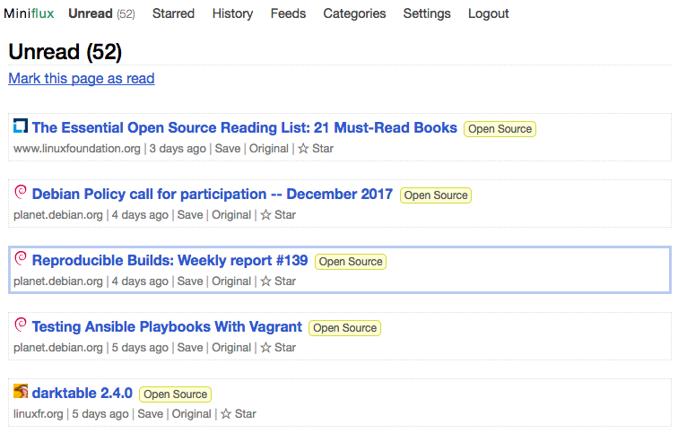
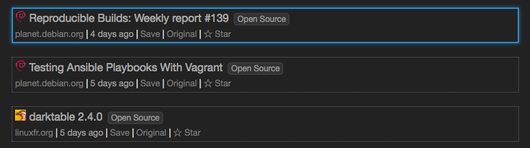

# FM-028 · 让正文的排版规则独立于界面与元数据
案例：[ miniflux ](../cases/miniflux.md) · 机制证据：`source_only`

效果图用于理解来源作品，不自动验证本卡中的每个机制。

## 设计动作

手机是Blog主体时，场景氛围不应压低正文可读性；正文/元数据/引用是三种不同阅读层。

## 实现与参数

entry-content单独字体/颜色/weight；图片max-width100% height auto；引用4px左线+缩进。

## 审美细节

手机是Blog主体时，场景氛围不应压低正文可读性；正文/元数据/引用是三种不同阅读层。

## 适用条件

- 中文字体与行高重新校准
- 长链接与宽图有回流

## 相邻方案与区别

区别于给全页面统一字体size：阅读区独立；区别于装饰卡片：长文保持连续。

## 失败模式

- 直接用西文1.4行高使中文紧张
- 小灰元数据在3D背景下对比不足

## Movie 裁决

- **verdict**：reject
- **reason**：不改善3D画面

## Frontend 裁决

- **verdict**：prototype
- **reason**：内容阅读的基础打磨

## 最小对照

用长中文、代码、宽图、长链接回归320/768px；不横溢，引用与正文可区分。

## 源码证据

- [Repos/miniflux/internal/ui/static/css/common.css:857–903](https://github.com/miniflux/v2/blob/c52bdef6e9811f7c20cebc034a6c0ec6799dc6df/internal/ui/static/css/common.css#L857-L903)：列表标题1rem、meta .8em、已读单独色
- [Repos/miniflux/internal/ui/static/css/common.css:1100–1187](https://github.com/miniflux/v2/blob/c52bdef6e9811f7c20cebc034a6c0ec6799dc6df/internal/ui/static/css/common.css#L1100-L1187)：正文1.2em/1.4行高、图片限宽、引用左边线
- [Repos/miniflux/internal/ui/static/css/serif.css:1–4](https://github.com/miniflux/v2/blob/c52bdef6e9811f7c20cebc034a6c0ec6799dc6df/internal/ui/static/css/serif.css#L1-L4)：正文可用Georgia独立字体

## 项目效果图

白底未读列表以蓝色标题、来源/时间行及细边框区分条目；选中行有浅蓝轮廓。

来源：[原作者/出处](https://miniflux.app/images/overview.png) · author_historical_screenshot。已实际查看作者历史图；仅支持画面布局、配色和可见状态，不证明当前HEAD、动态行为或运行质量。

官方深色主题局部图：选中条目以亮蓝描边和轻微光晕区别于下方灰色列表。

来源：[原作者/出处](https://miniflux.app/images/item-selection-black-theme.png) · author_historical_screenshot。已实际查看作者历史图；仅支持画面布局、配色和可见状态，不证明当前HEAD、动态行为或运行质量。

## 归纳与练习

[IF-01](../lenses/IF-01.md)

[MP-14](../patterns/MP-14.md)
