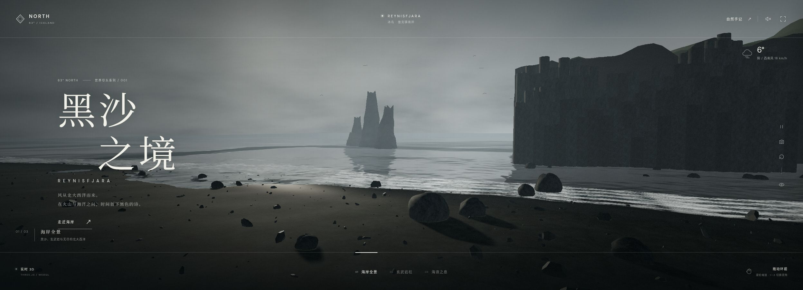
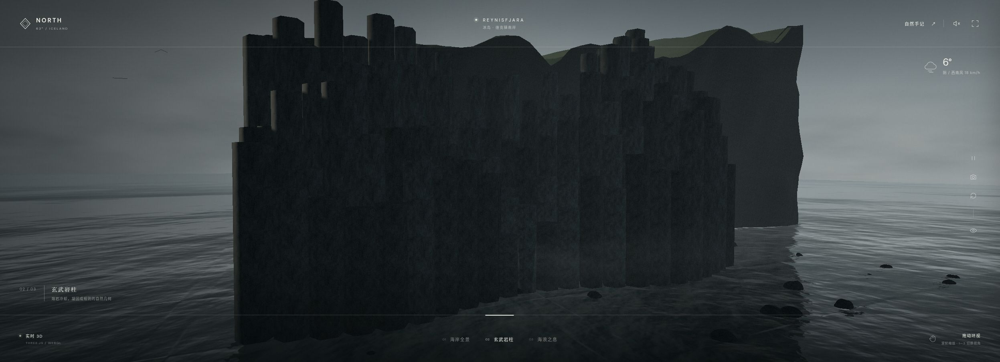

# KIM-001 · 让泡沫带沿共享岸线分批推进
案例：[ kimi-k31pro-opus55-benchmark-showcase ](../cases/kimi-k31pro-opus55-benchmark-showcase.md) · 机制证据：`still_observed`

效果图用于理解来源作品，不自动验证本卡中的每个机制。

## 设计动作

把边界现象绑定到同一空间函数。本卡是单仓候选，效果判断仍需样机。

## 实现与参数

cycle=mod(time*.82+phase,16)，带沿z推进cycle−13，smoothstep淡入淡出；fbm四层破碎边缘，alpha .68；水本体为Three Water加两项小位移。

## 审美细节

灰青泡沫(.46,.53,.54)混至偏暖白(.9,.93,.89)，远处150–340淡出，避免宽白胶带。

## 适用条件

- 岸线近似单值z=f(x)
- 只需中远景浪花视觉

## 相邻方案与区别

比OCN-003的世界空间历史泡沫便宜；这里没有平流缓存，也不模拟浪涌侵蚀。

## 失败模式

- 泡沫未与水波真实相位耦合
- 每16单位周期重置仍可能跳接
- 浅滩坡度变化时平面带浮空

## Movie 裁决

- **verdict**：reference
- **reason**：仅作更简单远岸实现对照，先保留已有Beach效果

## Frontend 裁决

- **verdict**：reference
- **reason**：Beach已有同类共享岸线和错相泡沫，六条独立带不是明确升级

## 最小对照

固定岸线对比静态与6带；低视角观察60秒，出现周期接缝或浮空则失败。

## 源码证据

- [Repos/kimi-k31pro-opus55-benchmark-showcase/kimi/iceland-black-sand/src/iceland/world.js:5–16](https://github.com/Zp-Peter/kimi-k31pro-opus55-benchmark-showcase/blob/65e82c53b63f2fdd918617269c057d8e53af2c6f/kimi/iceland-black-sand/src/iceland/world.js#L5-L16)：共享岸线和地形高度
- [Repos/kimi-k31pro-opus55-benchmark-showcase/kimi/iceland-black-sand/src/iceland/ocean.js:6–97](https://github.com/Zp-Peter/kimi-k31pro-opus55-benchmark-showcase/blob/65e82c53b63f2fdd918617269c057d8e53af2c6f/kimi/iceland-black-sand/src/iceland/ocean.js#L6-L97)：16周期、六条2.67错相、280×3.1带状网格
- [Repos/kimi-k31pro-opus55-benchmark-showcase/kimi/iceland-black-sand/src/iceland/world.js:35–45](https://github.com/Zp-Peter/kimi-k31pro-opus55-benchmark-showcase/blob/65e82c53b63f2fdd918617269c057d8e53af2c6f/kimi/iceland-black-sand/src/iceland/world.js#L35-L45)：湿度也使用相同岸线公式

## 项目效果图

全景：大衬线文字、黑柱壁剪影、远礁、灰雾和白浪带

来源：[原作者/出处](https://zp-peter.github.io/kimi-k31pro-opus55-benchmark-showcase/kimi/iceland-black-sand/dist/index.html) · live_still_observed。主agent从已登录Chrome在线站点获取，本agent实际view_image复看；非本地HEAD运行、非运动/性能验收。

柱岩机位：高度错落、柱面暗缝；山体轮廓较块状

来源：[原作者/出处](https://zp-peter.github.io/kimi-k31pro-opus55-benchmark-showcase/kimi/iceland-black-sand/dist/index.html) · live_still_observed。主agent从已登录Chrome在线站点获取，本agent实际view_image复看；非本地HEAD运行、非运动/性能验收。

## 归纳与练习

暂未归入新增专业视角；保留原机制边界。

保留独立案例。
