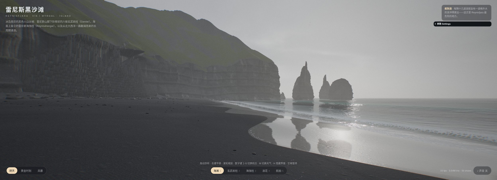
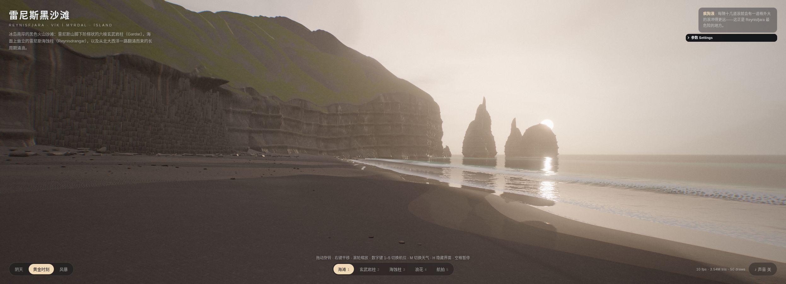

# KIM-002 · 用退潮时刻分别衰减湿暗和薄膜高光
案例：[ kimi-k31pro-opus55-benchmark-showcase ](../cases/kimi-k31pro-opus55-benchmark-showcase.md) · 机制证据：`still_observed`

效果图用于理解来源作品，不自动验证本卡中的每个机制。

## 设计动作

给同一事件的不同材质反应设置不同恢复时钟。本卡是单仓候选，效果判断仍需样机。

## 实现与参数

解析重建最近4波：R=11*uSurf.z*waveHeight；上冲v0*dt−.5*1.3*dt²，回流R−.5*.8*tb²；露出后sheen=exp(−since/4.5)，damp=exp(−since/30)。

## 审美细节

沙粒底色约(.05,.051,.055)，浸湿暗化但镜面薄膜更快消失；避免整片沙滩永远塑料亮。

## 适用条件

- 有可定义上冲距离和统一时间
- 材质能分离底层roughness与clearcoat

## 相邻方案与区别

与OCN-003不同：这是解析岸滩湿度记忆，不是GPU泡沫纹理反馈。Kimi静态湿度mask是更低成本基线。

## 失败模式

- 仅保留4波并非任意长历史
- 反序GLSL smoothstep需改写为1−smoothstep正序
- 大量重叠波max会形成不连续

## Movie 裁决

- **verdict**：prototype
- **reason**：潮退近景可明确读出时间层次

## Frontend 裁决

- **verdict**：adapt
- **reason**：交互海岸局部启用

## 最小对照

同一波退去后记录0/5/15/30秒；镜面先退、湿暗后退且无跳变；固定曝光与相机。

## 源码证据

- [Repos/kimi-k31pro-opus55-benchmark-showcase/opus/reynisfjara/src/glsl/shore.js:95–153](https://github.com/Zp-Peter/kimi-k31pro-opus55-benchmark-showcase/blob/65e82c53b63f2fdd918617269c057d8e53af2c6f/opus/reynisfjara/src/glsl/shore.js#L95-L153)：四个历史波；上冲1.3回流.8；薄膜4.5s湿暗30s
- [Repos/kimi-k31pro-opus55-benchmark-showcase/opus/reynisfjara/src/world/beach.js:75–125](https://github.com/Zp-Peter/kimi-k31pro-opus55-benchmark-showcase/blob/65e82c53b63f2fdd918617269c057d8e53af2c6f/opus/reynisfjara/src/world/beach.js#L75-L125)：湿暗颜色减半、粗糙度降.4、水膜独立
- [Repos/kimi-k31pro-opus55-benchmark-showcase/opus/reynisfjara/src/world/beach.js:181–201](https://github.com/Zp-Peter/kimi-k31pro-opus55-benchmark-showcase/blob/65e82c53b63f2fdd918617269c057d8e53af2c6f/opus/reynisfjara/src/world/beach.js#L181-L201)：薄膜clearcoat粗糙度.075至.035及平面反射

## 项目效果图

阴天：S形湿沙反射带、分层柱壁、细小HUD

来源：[原作者/出处](https://zp-peter.github.io/kimi-k31pro-opus55-benchmark-showcase/opus/reynisfjara/index.html) · live_still_observed。主agent从已登录Chrome在线站点获取，本agent实际view_image复看；非本地HEAD运行、非运动/性能验收。

黄金时刻现场截图：暖米色天空/雾、海蚀柱旁太阳与水/湿沙反光相呼应。

来源：[原作者/出处](https://zp-peter.github.io/kimi-k31pro-opus55-benchmark-showcase/opus/reynisfjara/index.html) · live_still_observed。主agent点击按钮后抓取，本agent复看；非本地HEAD或动态性能验收。

## 归纳与练习

[CINE-03](../lenses/CINE-03.md) / [CINE-06](../lenses/CINE-06.md)

[MP-06](../patterns/MP-06.md)
