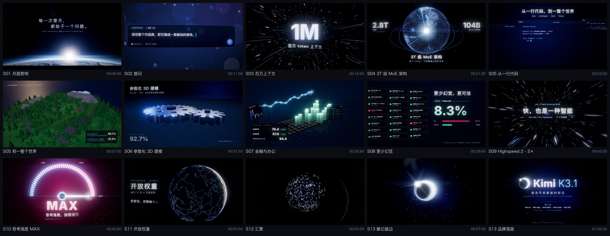

# KIM-008 · 把镜头局部时间与快门采样分开
案例：[ kimi-k31pro-opus55-benchmark-showcase ](../cases/kimi-k31pro-opus55-benchmark-showcase.md) · 机制证据：`still_observed`

效果图用于理解来源作品，不自动验证本卡中的每个机制。

## 设计动作

以可寻址时间驱动电影状态。本卡是单仓候选，效果判断仍需样机。

## 实现与参数

frame/fps→localTime→shot.update→HDR双target→accum平均→post；renderFrame默认8samples，交叠至少12；shutter=.5/fps。tapestop在.62s内时间积分减速。

## 审美细节

已看keyframes.jpg：蓝黑底冷白标题、能力图形、短段洋红强度表；接触表仅证明静帧构图，不证明运镜顺滑或片中参数宣传真实。

## 适用条件

- shot.update(t)可随机访问且无累积状态
- 离线导出容忍多次渲染

## 相邻方案与区别

REN-004是路径追踪收敛后前进一帧；本卡是栅格时域快门积分，与velocity blur也不同。Kimi Remotion Film16–22用Sequence更简洁。

## 失败模式

- 若update累加状态，倒放/重复采样不确定
- 一个时刻>2活动entry被忽略
- 输出高帧成本不宜实时照搬

## Movie 裁决

- **verdict**：prototype
- **reason**：导出电影的可复现剪辑与真实子帧模糊

## Frontend 裁决

- **verdict**：defer
- **reason**：实时交互用1sample，不复制8–12倍成本

## 最小对照

同一frame连续两次及乱序渲染hash应一致；1/8samples比较快速运动边缘；不一致先修状态。

## 源码证据

- [Repos/kimi-k31pro-opus55-benchmark-showcase/opus/kimi-k3.1-promo/src/engine/engine.js:28–42](https://github.com/Zp-Peter/kimi-k31pro-opus55-benchmark-showcase/blob/65e82c53b63f2fdd918617269c057d8e53af2c6f/opus/kimi-k3.1-promo/src/engine/engine.js#L28-L42)：转场重叠可见区间
- [Repos/kimi-k31pro-opus55-benchmark-showcase/opus/kimi-k3.1-promo/src/engine/engine.js:63–94](https://github.com/Zp-Peter/kimi-k31pro-opus55-benchmark-showcase/blob/65e82c53b63f2fdd918617269c057d8e53af2c6f/opus/kimi-k3.1-promo/src/engine/engine.js#L63-L94)：localTime重映射及两个活动镜头合成
- [Repos/kimi-k31pro-opus55-benchmark-showcase/opus/kimi-k3.1-promo/src/engine/engine.js:127–155](https://github.com/Zp-Peter/kimi-k31pro-opus55-benchmark-showcase/blob/65e82c53b63f2fdd918617269c057d8e53af2c6f/opus/kimi-k3.1-promo/src/engine/engine.js#L127-L155)：默认8子帧，转场至少12，180度快门
- [Repos/kimi-k31pro-opus55-benchmark-showcase/opus/kimi-k3.1-promo/src/timeline.json:1–20](https://github.com/Zp-Peter/kimi-k31pro-opus55-benchmark-showcase/blob/65e82c53b63f2fdd918617269c057d8e53af2c6f/opus/kimi-k3.1-promo/src/timeline.json#L1-L20)：64s30fps；46–47.5s四分之一秒重复切片

## 项目效果图

已查看的来源静帧；不证明当前版本运行。

来源：[原作者/出处](https://github.com/Zp-Peter/kimi-k31pro-opus55-benchmark-showcase/blob/65e82c53b63f2fdd918617269c057d8e53af2c6f/opus/kimi-k3.1-promo/out/keyframes.jpg) · historical_still_viewed。静帧观察；没有由此验证连续动画或性能。

## 归纳与练习

[CINE-06](../lenses/CINE-06.md) / [CINE-08](../lenses/CINE-08.md)

[MP-19](../patterns/MP-19.md)
