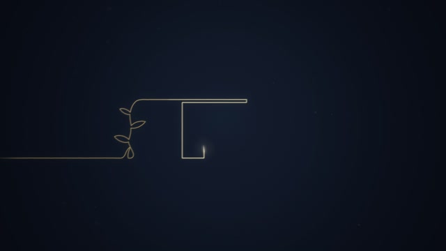
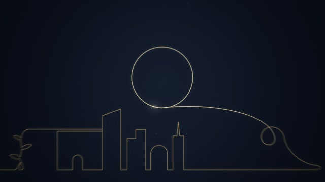

# MF-003 · 让描线在曲率处停顿，镜头追随经过平滑的笔尖
案例：[ mg-styles-15 ](../cases/mg-styles-15.md) · 机制证据：`still_observed`

效果图用于理解来源作品，不自动验证本卡中的每个机制。

## 设计动作

把路径几何转成局部时间预算；作为本片的具体实现案例，尚不构成跨作品普遍规律。

## 实现与参数

路径按STEP=.5px取样；转角以sigma=7/STEP的核平滑，TAU累加ds*(1+9*min(CORN,.3))。cue中的draw位置映射到tau再反查headS，重复位置形成屋顶/塔顶停顿。镜头以1/600s预计算，保持段冻结，.133s预停/.5s追赶；笔尖前后时间高斯平滑再加.08s前视。

## 审美细节

近黑蓝底、暖金细线、较亮活动笔尖；旧线作为记忆层。建筑轮廓在底部展开而标志占上部，细线保留大留白。

## 适用条件

- SVG路径能连续采样
- 转角时间权重与真实像素尺度一致
- 预计算镜头适用于确定时间线

## 相邻方案与区别

不同于stroke-dashoffset匀速：按曲率分配时间；也不是跟随原始笔尖坐标的抖动镜头。

## 失败模式

- 路径断点误当转角会异常停顿
- 曲率太密导致匀速感全失
- 小屏线宽/明暗不够会丢轮廓

## Movie 裁决

- **verdict**：prototype
- **reason**：适合建筑揭示、地图线索的叙事镜头。

## Frontend 裁决

- **verdict**：adapt
- **reason**：可用于单个图标或示意图；需要随时跳至完成态。

## 最小对照

同一路径比较匀速/曲率权重，检查屋顶角和长直线；镜头在停顿时漂移、线被裁掉或总时长变化即失败。

## 源码证据

- [Repos/mg-styles-15/demos/02-line-art/film.js:80–155](https://github.com/Vincentwei1021/mg-styles-15/blob/49052d80bfaf9fa8412cc9710530e5e95a3b8d8c/demos/02-line-art/film.js#L80-L155)：采样、转角时间加权、cue到弧长映射
- [Repos/mg-styles-15/demos/02-line-art/film.js:184–222](https://github.com/Vincentwei1021/mg-styles-15/blob/49052d80bfaf9fa8412cc9710530e5e95a3b8d8c/demos/02-line-art/film.js#L184-L222)：镜头冻结/补赶与高斯平滑
- [Repos/mg-styles-15/demos/02-line-art/audio.py:1–72](https://github.com/Vincentwei1021/mg-styles-15/blob/49052d80bfaf9fa8412cc9710530e5e95a3b8d8c/demos/02-line-art/audio.py#L1-L72)：读取cue/timing派生信息制作钢琴/弦乐声轨

## 项目效果图

本地影片 3 秒静帧。

来源：本轮已观察的历史截图 · video_still。静帧观察；没有由此验证连续动画或性能。

本地影片 7 秒静帧。

来源：本轮已观察的历史截图 · video_still。静帧观察；没有由此验证连续动画或性能。

## 归纳与练习

暂未归入新增专业视角；保留原机制边界。

[MP-11](../patterns/MP-11.md)
