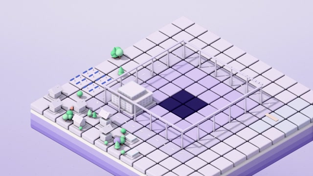

# MF-004 · 分地基、墙体、屋顶三次到位，让城市生长具有装配次序
案例：[ mg-styles-15 ](../cases/mg-styles-15.md) · 机制证据：`still_observed`

效果图用于理解来源作品，不自动验证本卡中的每个机制。

## 设计动作

把整体出现拆成具有结构关系的局部事件；作为本片的具体实现案例，尚不构成跨作品普遍规律。

## 实现与参数

growState在t0前.1s把地基sxz从.12展开；墙晚1/30s启动spring(14.8,.61)；屋顶按cues.roof_lag=.375s触发drop。update分别设置墙高、屋顶基准高度和局部弹跳，屋顶细件另延.05s。真等距R=(1,0,-1)、U=(-1,2,-1)、D=(1,1,1)；镜头主要移位/缩放。

## 审美细节

淡紫地块、青色核心塔、桃色和薄荷邻楼；环带生长先有平面秩序再出现高差。3s与7s可观察密度差，不能确认逐件节拍。

## 适用条件

- 模型预分部件且局部原点正确
- 屋顶位置跟随墙实际高度
- 建筑群有清晰中心和环序

## 相邻方案与区别

不同于整栋scale弹出：局部结构保持相互约束；不等同实时城市生成。

## 失败模式

- 提示词2–3帧屋顶跟随与实际.375s不同，勿照抄文字
- 屋顶资产未分离会穿透/悬空
- 过多楼同时起伏削弱中心层次

## Movie 裁决

- **verdict**：prototype
- **reason**：适合场景建立镜头或区域说明。

## Frontend 裁决

- **verdict**：reference
- **reason**：高密度2.5D全片不能直接当导航；借装配层次给少量卡片。

## 最小对照

用三栋不同高度楼测试；墙顶与屋顶底面是否相接、回弹是否穿插、核心塔是否可在一眼找到，任何失败需重新分层。

## 源码证据

- [Repos/mg-styles-15/demos/03-isometric/js/world.js:562–575](https://github.com/Vincentwei1021/mg-styles-15/blob/49052d80bfaf9fa8412cc9710530e5e95a3b8d8c/demos/03-isometric/js/world.js#L562-L575)：地基、墙体和屋顶延迟状态
- [Repos/mg-styles-15/demos/03-isometric/js/world.js:610–647](https://github.com/Vincentwei1021/mg-styles-15/blob/49052d80bfaf9fa8412cc9710530e5e95a3b8d8c/demos/03-isometric/js/world.js#L610-L647)：分部件应用growth与屋顶细节
- [Repos/mg-styles-15/demos/03-isometric/js/main.js:1–130](https://github.com/Vincentwei1021/mg-styles-15/blob/49052d80bfaf9fa8412cc9710530e5e95a3b8d8c/demos/03-isometric/js/main.js#L1-L130)：固定等距基底及镜头cue
- [Repos/mg-styles-15/demos/03-isometric/audio.py:1–72](https://github.com/Vincentwei1021/mg-styles-15/blob/49052d80bfaf9fa8412cc9710530e5e95a3b8d8c/demos/03-isometric/audio.py#L1-L72)：按环带时间安排marimba/木质击音

## 项目效果图

本地影片 3 秒静帧。

来源：本轮已观察的历史截图 · video_still。静帧观察；没有由此验证连续动画或性能。

本地影片 7 秒静帧。

来源：本轮已观察的历史截图 · video_still。静帧观察；没有由此验证连续动画或性能。

## 归纳与练习

暂未归入新增专业视角；保留原机制边界。

[MP-08](../patterns/MP-08.md)
