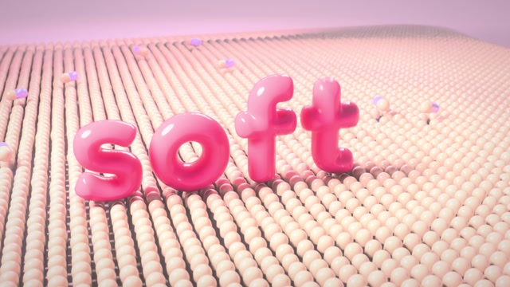
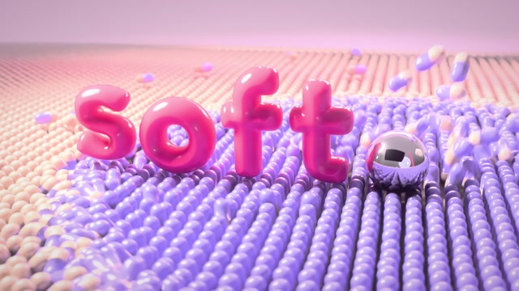

# MF-005 · 用模拟接触事件同时驱动胶囊场波纹与撞击声
案例：[ mg-styles-15 ](../cases/mg-styles-15.md) · 机制证据：`still_observed`

效果图用于理解来源作品，不自动验证本卡中的每个机制。

## 设计动作

让二级效果共享一次接触的时间和强度；作为本片的具体实现案例，尚不构成跨作品普遍规律。

## 实现与参数

letter_track以dt=1/2400积分一维软床；bed_force为指数硬化单边接触，实际Cd=47而函数默认85。z首次<0记录(t,abs(v))，升到.004重置接触。形变振子频率3.3Hz/zeta.14由减速度驱动。波纹使用接触位置/速度，字母振幅.105*min(vc/11,1.2)、传播3.4、波长.95、衰减.85；场中另叠预设SW扫波，非所有波均来自接触。audio读取事件，接触音提前半个24fps帧对齐感知。

## 审美细节

胶囊铺地先压后扩散，粉色软体字与金属球提供不同质量感线索。静帧可见波面和球，不能证明物理/音画精准一致。

## 适用条件

- 接触位置/速度能稳定记录
- 事件表是几何与音效共用入口
- 离线采样率足以捕获接触

## 相邻方案与区别

不同于按音乐随意振动整地板：冲击强度和传播起点来自接触；比完整模拟便于时间线求值但适用范围更窄。

## 失败模式

- 这是1D接触+解析波，不是完整软体有限元
- 手改字母轨迹未重算事件会脱节
- 接触阈值可产生漏击或重复击，需实查

## Movie 裁决

- **verdict**：prototype
- **reason**：适合少数英雄物件落地镜头，可烘焙事件与变形。

## Frontend 裁决

- **verdict**：defer
- **reason**：实时前端不默认引入Blender/Cycles管线；仅借事件结构。

## 最小对照

隔离一个字母，以接触前后帧和事件CSV核对z过零、波起点、声音峰值；出现预振动、重复事件、目标半帧偏移不符即失败。

## 源码证据

- [Repos/mg-styles-15/demos/04-3d-render/blender/sim.py:138–174](https://github.com/Vincentwei1021/mg-styles-15/blob/49052d80bfaf9fa8412cc9710530e5e95a3b8d8c/demos/04-3d-render/blender/sim.py#L138-L174)：1D积分、接触检测、接触速度与形变
- [Repos/mg-styles-15/demos/04-3d-render/blender/sim.py:257–300](https://github.com/Vincentwei1021/mg-styles-15/blob/49052d80bfaf9fa8412cc9710530e5e95a3b8d8c/demos/04-3d-render/blender/sim.py#L257-L300)：接触驱动传播环波
- [Repos/mg-styles-15/demos/04-3d-render/audio.py:94–113](https://github.com/Vincentwei1021/mg-styles-15/blob/49052d80bfaf9fa8412cc9710530e5e95a3b8d8c/demos/04-3d-render/audio.py#L94-L113)：事件驱动声音并使用半帧偏移

## 项目效果图

本地影片 3 秒静帧。

来源：本轮已观察的历史截图 · video_still。静帧观察；没有由此验证连续动画或性能。

本地影片 7 秒静帧。

来源：本轮已观察的历史截图 · video_still。静帧观察；没有由此验证连续动画或性能。

## 归纳与练习

暂未归入新增专业视角；保留原机制边界。

[MP-19](../patterns/MP-19.md)
