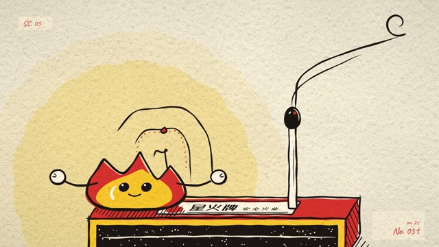
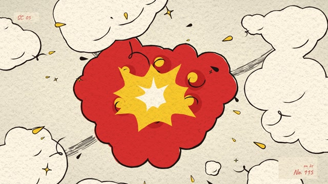

# MF-007 · 按动作段切换一拍、两拍、三拍曝光，并让线沸随绘稿更新
案例：[ mg-styles-15 ](../cases/mg-styles-15.md) · 机制证据：`still_observed`

效果图用于理解来源作品，不自动验证本卡中的每个机制。

## 设计动作

把时间离散化作为笔触风格的一部分；作为本片的具体实现案例，尚不构成跨作品普遍规律。

## 实现与参数

drawing(f)从SCHED找到曝光步长并量化帧，快速段on1、常规on2、停顿on3；boil seed跟drawing id换，on3用id%3、其他用id%4。engine.boil用世界坐标3D噪声，默认amp2.4/scale70，seed*2.371+.5取切片；不是每输出帧随机抖线。音频划擦在strike_start-FR，点燃冲击IG-FR有意领先一帧。

## 审美细节

暖纸/炭黑轮廓、红#e5402b与黄#ffc425；线条抖动与火苗快慢形成手绘节奏。当前SCHED末段224–230 on1、230–240 on3，不应照cue文字概括整个9–10秒on3。

## 适用条件

- 输出帧率24且绘稿更新独立
- 轮廓密度与噪声尺度匹配
- 强调段能切回on1

## 相邻方案与区别

不同于给平滑动画套抖动滤镜：运动和笔触共享离散绘稿时间；也不是真正人工逐帧描绘。

## 失败模式

- 每帧换噪声会像电子故障
- 全程on3使高速位移断裂
- cue文字与SCHED须以执行代码为准

## Movie 裁决

- **verdict**：prototype
- **reason**：适合短暂记忆/手绘章节、2D表情事件。

## Frontend 裁决

- **verdict**：adapt
- **reason**：少量插画反馈可用；正文和控件轮廓保持稳定。

## 最小对照

逐帧导出曝光切换两侧，确认同drawing id轮廓一致；若停顿仍闪烁或高速段拖影不连续则失败。

## 源码证据

- [Repos/mg-styles-15/demos/05-cel-boil/js/scene.js:1–43](https://github.com/Vincentwei1021/mg-styles-15/blob/49052d80bfaf9fa8412cc9710530e5e95a3b8d8c/demos/05-cel-boil/js/scene.js#L1-L43)：曝光表和drawing/boil版本选择
- [Repos/mg-styles-15/demos/05-cel-boil/js/engine.js:154–161](https://github.com/Vincentwei1021/mg-styles-15/blob/49052d80bfaf9fa8412cc9710530e5e95a3b8d8c/demos/05-cel-boil/js/engine.js#L154-L161)：空间相关噪声形变
- [Repos/mg-styles-15/demos/05-cel-boil/audio.py:209–225](https://github.com/Vincentwei1021/mg-styles-15/blob/49052d80bfaf9fa8412cc9710530e5e95a3b8d8c/demos/05-cel-boil/audio.py#L209-L225)：划擦和点燃音的有意提前

## 项目效果图

本地影片 3 秒静帧。

来源：本轮已观察的历史截图 · video_still。静帧观察；没有由此验证连续动画或性能。

本地影片 7 秒静帧。

来源：本轮已观察的历史截图 · video_still。静帧观察；没有由此验证连续动画或性能。

## 归纳与练习

暂未归入新增专业视角；保留原机制边界。

保留独立案例。
