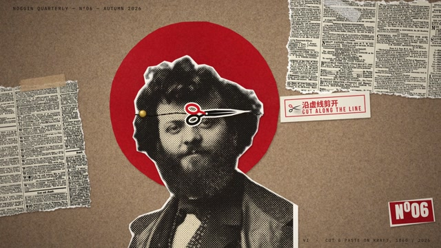
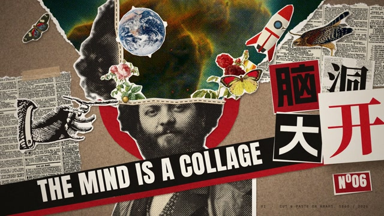

# MF-008 · 让纸片抬起时影子变软变远，落地时影子和尺度一起收紧
案例：[ mg-styles-15 ](../cases/mg-styles-15.md) · 机制证据：`still_observed`

效果图用于理解来源作品，不自动验证本卡中的每个机制。

## 设计动作

用投影与接触同步建立剪贴物的厚度；作为本片的具体实现案例，尚不构成跨作品普遍规律。

## 实现与参数

Q按12fps、Q6按6fps量化；slap预备3步增大至1+.38u²+.05u并抬起，落地scale=.972、下一拍1.01再归1。shadow blur=5+34*lift，偏移x=3+24*lift/y=5+34*lift；rimmed取28个偏移alpha样本形成3.5px白剪边。运动抖动2px、停留1.1px，旋转为amp*.2度。

## 审美细节

牛皮纸/报纸/白剪边与红圆提供材质层级；影子收紧比持续随机晃动更能说明“贴到纸上”。paper_slap叠纸页录音和合成thud，新闻纸第二拍特意晚1/12s。

## 适用条件

- 纸片有可用alpha轮廓
- 影子和物片变换共用lift
- 背景留白让边缘可辨

## 相邻方案与区别

不同于固定box-shadow的平面拼贴：接触距离改变影子；不同于真实3D纸模拟：用2D尺度/阴影的受控假象。

## 失败模式

- 白边过厚会变贴纸广告感
- 停留抖动也不能妨碍阅读
- 人物/照片权利须逐资产确认，源码注释不够

## Movie 裁决

- **verdict**：adapt
- **reason**：可用作记忆、档案和书页章节。

## Frontend 裁决

- **verdict**：adapt
- **reason**：可试单张档案卡；长文本保持静止并可关闭抖动。

## 最小对照

隔离同一纸片抬/落两态；若接触瞬间影子仍远或纸片下沉后没有回稳，拒绝。以实际来源许可逐项检查照片。

## 源码证据

- [Repos/mg-styles-15/demos/06-collage/index.html:1–85](https://github.com/Vincentwei1021/mg-styles-15/blob/49052d80bfaf9fa8412cc9710530e5e95a3b8d8c/demos/06-collage/index.html#L1-L85)：量化、slap尺度与阴影、白剪边
- [Repos/mg-styles-15/demos/06-collage/audio.py:23–54](https://github.com/Vincentwei1021/mg-styles-15/blob/49052d80bfaf9fa8412cc9710530e5e95a3b8d8c/demos/06-collage/audio.py#L23-L54)：纸声叠thud及明确时间偏移

## 项目效果图

本地影片 3 秒静帧。

来源：本轮已观察的历史截图 · video_still。静帧观察；没有由此验证连续动画或性能。

本地影片 7 秒静帧。

来源：本轮已观察的历史截图 · video_still。静帧观察；没有由此验证连续动画或性能。

## 归纳与练习

暂未归入新增专业视角；保留原机制边界。

保留独立案例。
