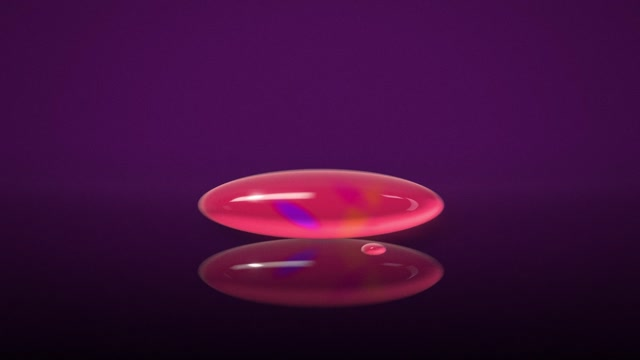
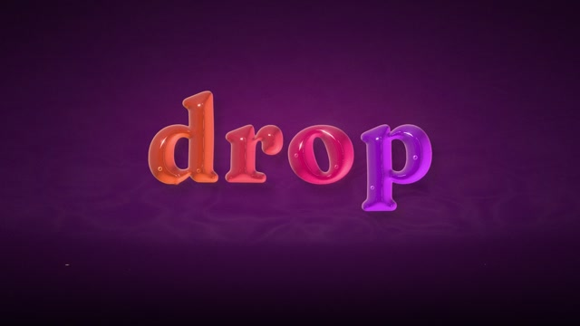

# MF-009 · 先把液滴分开，再把每一滴的距离场变成可读字形
案例：[ mg-styles-15 ](../cases/mg-styles-15.md) · 机制证据：`still_observed`

效果图用于理解来源作品，不自动验证本卡中的每个机制。

## 设计动作

把形态变化拆成分离空间与改变轮廓两个阶段；作为本片的具体实现案例，尚不构成跨作品普遍规律。

## 实现与参数

shader将胶囊/线段SDF与四通道字形纹理距离场混合，字形梯度用1px差分、尺度sqrt(sx*sy)近似；LX.w驱动椭圆SDF→glyph。scene在6.4s附近使用共同unfold spring(4,.35)，位置间距和字形尺度同源，轮廓变形m=(ts*30-.6*i+1.5)/2裁到0–1；分开后才加112%宽/92%高与每字.04s延迟的jelly波。

## 审美细节

梅紫底上橙粉紫连续高光体；3s可见压扁团，7s字母已分开。效果是解析距离场与纹理字形，不是流体求解或体积守恒。

## 适用条件

- 字形SDF和液滴方向/中心已对齐
- 共享间距避免相邻字交叠
- 先读出字再允许小幅呼吸

## 相邻方案与区别

不同于把整团缩成文字贴图：每滴承担一个字；比拓扑点对应morph更易融合，但可控轮廓精度较弱。

## 失败模式

- 任意字体孔洞可能在混合时消失
- 形变和位置各自错峰会字母穿插
- 不能把screen SDF效果宣称可直接做真实3D流体

## Movie 裁决

- **verdict**：prototype
- **reason**：适合短品牌/章节符号，尤其软质世界。

## Frontend 裁决

- **verdict**：reference
- **reason**：可借到短状态字；输入框、正文不宜变液体。

## 最小对照

逐帧检查最窄字间隙及o/p孔洞，改用另一组同长度字体；重叠、孔洞不可恢复或峰值弹性损害读字即失败。

## 源码证据

- [Repos/mg-styles-15/demos/07-liquid/js/shaders.js:152–210](https://github.com/Vincentwei1021/mg-styles-15/blob/49052d80bfaf9fa8412cc9710530e5e95a3b8d8c/demos/07-liquid/js/shaders.js#L152-L210)：胶囊与字形距离场、梯度及形变
- [Repos/mg-styles-15/demos/07-liquid/js/scene.js:770–790](https://github.com/Vincentwei1021/mg-styles-15/blob/49052d80bfaf9fa8412cc9710530e5e95a3b8d8c/demos/07-liquid/js/scene.js#L770-L790)：共同展开、轮廓错峰与分开后压扁

## 项目效果图

本地影片 3 秒静帧。

来源：本轮已观察的历史截图 · video_still。静帧观察；没有由此验证连续动画或性能。

本地影片 7 秒静帧。

来源：本轮已观察的历史截图 · video_still。静帧观察；没有由此验证连续动画或性能。

## 归纳与练习

暂未归入新增专业视角；保留原机制边界。

[MP-13](../patterns/MP-13.md)
