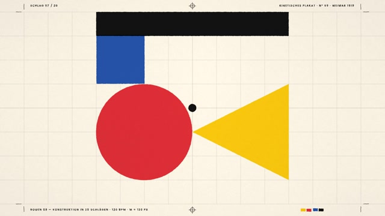
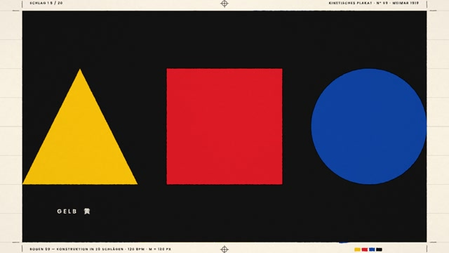

# MF-011 · 把几何转场锁在网格单元内，并为标签保留稳定区
案例：[ mg-styles-15 ](../cases/mg-styles-15.md) · 机制证据：`still_observed`

效果图用于理解来源作品，不自动验证本卡中的每个机制。

## 设计动作

约束转场的空间边界以保存阅读锚点；作为本片的具体实现案例，尚不构成跨作品普遍规律。

## 实现与参数

主网格实际M=120px；rotTile按单元半径延迟旋转，scale=1/(abs(cosθ)+abs(sinθ))控制旋转包围盒，采样coverage/clamp避免细缝。slideCol用240px配对列交替平移，y840–960标签区受保护。帧时间snap到30fps，io2不超调；音频将波纹事件分箱到约10次瞬态，非每格一声。

## 审美细节

奶油底、红黄蓝与黑，几何和留白比纹理更重要；标签受保护使复杂版面转换仍有固定阅读入口。提示词示例240px不等于主网格实际值。

## 适用条件

- 元素与网格对齐
- 需固定阅读区已定义
- 转场边界支持抗锯齿

## 相邻方案与区别

不同于全屏任意旋转擦除：每格有边界且文字区可豁免；比柔性弹性转场更强调机械节律。

## 失败模式

- 斜角缩放会暂时缩小面积，不能误称面积守恒
- 非网格照片可能出现切片破碎
- 音频分箱不能说成逐单元精准对齐

## Movie 裁决

- **verdict**：adapt
- **reason**：适合章节分屏和抽象结构展示。

## Frontend 裁决

- **verdict**：adapt
- **reason**：数据卡重排可借稳定标签区；真实内容不得被shader替换为不可选字。

## 最小对照

以最长标签和边缘图形测试45°旋转和列交换；出现细缝、裁字、阅读区漂移即失败。

## 源码证据

- [Repos/mg-styles-15/demos/09-bauhaus/film.js:8–30](https://github.com/Vincentwei1021/mg-styles-15/blob/49052d80bfaf9fa8412cc9710530e5e95a3b8d8c/demos/09-bauhaus/film.js#L8-L30)：网格与时间函数
- [Repos/mg-styles-15/demos/09-bauhaus/film.js:350–421](https://github.com/Vincentwei1021/mg-styles-15/blob/49052d80bfaf9fa8412cc9710530e5e95a3b8d8c/demos/09-bauhaus/film.js#L350-L421)：格内旋转包围盒、交替列与标签保护
- [Repos/mg-styles-15/demos/09-bauhaus/audio.py:73–101](https://github.com/Vincentwei1021/mg-styles-15/blob/49052d80bfaf9fa8412cc9710530e5e95a3b8d8c/demos/09-bauhaus/audio.py#L73-L101)：涟漪音效按分箱聚合

## 项目效果图

本地影片 3 秒静帧。

来源：本轮已观察的历史截图 · video_still。静帧观察；没有由此验证连续动画或性能。

本地影片 7 秒静帧。

来源：本轮已观察的历史截图 · video_still。静帧观察；没有由此验证连续动画或性能。

## 归纳与练习

暂未归入新增专业视角；保留原机制边界。

[MP-14](../patterns/MP-14.md)
