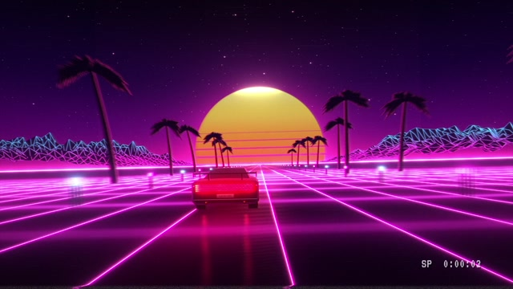
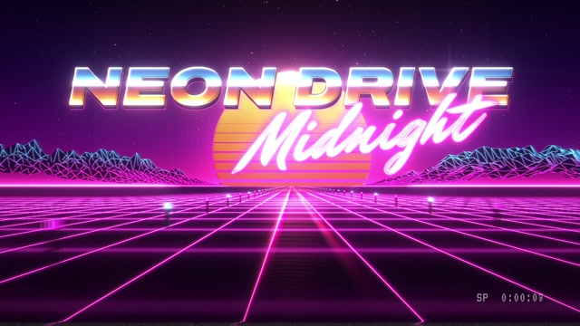

# MF-012 · 用一道亮暗突变和多层字边塑造铬字，再给入场留出声音空拍
案例：[ mg-styles-15 ](../cases/mg-styles-15.md) · 机制证据：`still_observed`

效果图用于理解来源作品，不自动验证本卡中的每个机制。

## 设计动作

用高对比结构而非真实金属模拟建立标题材质；作为本片的具体实现案例，尚不构成跨作品普遍规律。

## 实现与参数

2D字形画14层挤出/轮廓并叠gradient face；垂直渐变在.494亮白→.506暗色形成金属地平线。4.133–4.2s两帧scale2.2→1，后加-.045*sin(24t)*exp(-7.5t)回弹和.16exp(-13t)闪光；glint4.95–5.55。audio用同slam cue安排impact/boom，霓虹6.6s另由neon_strike控制音量门。

## 审美细节

深蓝/青/白与紫橙在字面分界，粉色手写副标题叠在Chrome字外；静帧可见高亮，但强glow可能吞笔画。仅借片内排版，生产Title不动。

## 适用条件

- 字体具有足够粗的字干
- 高对比地平线与字面方向一致
- 周边背景低亮留层级

## 相邻方案与区别

不同于PBR金属字：二维渐变+描边足以建立材质暗示；与纯外发光相比，字面亮暗结构更关键。

## 失败模式

- 细字体被暗带切碎
- 字号变小后14层挤出堵孔
- 同套效果用于正文损害阅读

## Movie 裁决

- **verdict**：adapt
- **reason**：适合特定复古插片；与世界观不符则仅参考。

## Frontend 裁决

- **verdict**：reference
- **reason**：只借强调字/徽标材质，不作为常规UI组件风格。

## 最小对照

关掉glow后检查材质是否仍可读，再在手机宽比较细/粗字体；高光跨两帧连续吞字或暗带切断字干则失败。

## 源码证据

- [Repos/mg-styles-15/demos/10-synthwave/index.html:470–510](https://github.com/Vincentwei1021/mg-styles-15/blob/49052d80bfaf9fa8412cc9710530e5e95a3b8d8c/demos/10-synthwave/index.html#L470-L510)：挤出字边与高反差金属渐变
- [Repos/mg-styles-15/demos/10-synthwave/index.html:893–906](https://github.com/Vincentwei1021/mg-styles-15/blob/49052d80bfaf9fa8412cc9710530e5e95a3b8d8c/demos/10-synthwave/index.html#L893-L906)：slam缩放/回弹/闪光/glint
- [Repos/mg-styles-15/demos/10-synthwave/audio.py:91–124](https://github.com/Vincentwei1021/mg-styles-15/blob/49052d80bfaf9fa8412cc9710530e5e95a3b8d8c/demos/10-synthwave/audio.py#L91-L124)：撞击音与霓虹门控

## 项目效果图

本地影片 3 秒静帧。

来源：本轮已观察的历史截图 · video_still。静帧观察；没有由此验证连续动画或性能。

本地影片 7 秒静帧。

来源：本轮已观察的历史截图 · video_still。静帧观察；没有由此验证连续动画或性能。

## 归纳与练习

暂未归入新增专业视角；保留原机制边界。

保留独立案例。
