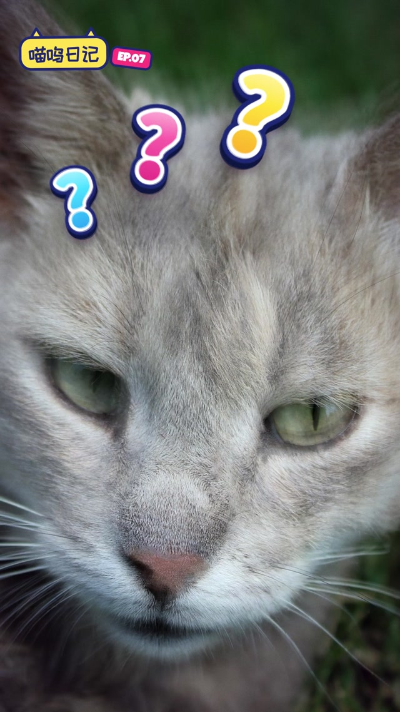
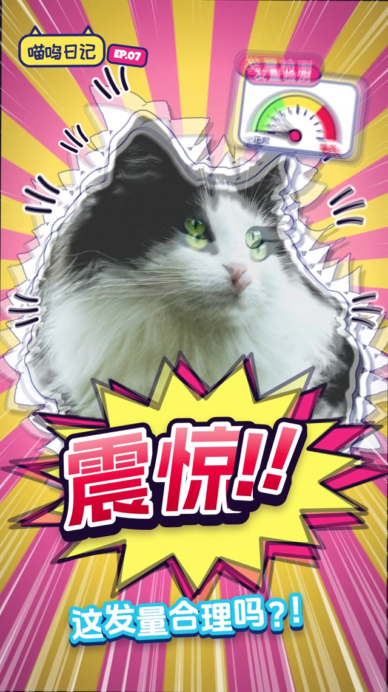

# MF-015 · 让字幕逐字错峰回答角色动作，并用多层描边抵抗杂乱画面
案例：[ mg-styles-15 ](../cases/mg-styles-15.md) · 机制证据：`still_observed`

效果图用于理解来源作品，不自动验证本卡中的每个机制。

## 设计动作

把字幕的动作相位作为情绪表达的一部分；作为本片的具体实现案例，尚不构成跨作品普遍规律。

## 实现与参数

char组件按挤出→外色描边→白描边→渐变面→gloss绘制；charXf用zeta=.517、w22的弹簧，.22s后渐入持有态，1.8°摆/3px浮/1.2%呼吸。titlebeatwave每字2帧延迟，预压.07s、腾空.24s高40、落定.13s。问号比2.5s scratch晚2/4/6帧；不是所有字都晚，shock首字5.933早于6s主拍。

## 审美细节

1080×1920竖幅，猫轮廓与白/深蓝字边跨粉黄放射背景仍能分离；7s信息很密，需要按字幕层级删减。

## 适用条件

- 字幕短且每字可独立排布
- 文本层级优先于装饰
- 角色动作与字幕情绪对应

## 相邻方案与区别

不同于均匀打字机：逐字位置/弹性/延迟组成情绪表演；不同于普通视频字幕：不适合承担长段准确转录。

## 失败模式

- 中文字形缺失或fallback会改变轮廓
- 所有字都弹跳会变噪音
- 不能把作者手设时间当音频自动识别

## Movie 裁决

- **verdict**：adapt
- **reason**：适合2D角色幽默插片，保持世界观语气。

## Frontend 裁决

- **verdict**：reference
- **reason**：少量庆祝反馈可借；导航/错误提示应稳定可读。

## 最小对照

把背景换为高细节图片，缩到360px宽，测短句一遍能否读完；多描边堵笔画、角色脸被遮或字幕晚到误解情绪即失败。

## 源码证据

- [Repos/mg-styles-15/demos/18-hanazi/index.html:57–116](https://github.com/Vincentwei1021/mg-styles-15/blob/49052d80bfaf9fa8412cc9710530e5e95a3b8d8c/demos/18-hanazi/index.html#L57-L116)：多层字边和单字弹簧/保持状态
- [Repos/mg-styles-15/demos/18-hanazi/index.html:429–450](https://github.com/Vincentwei1021/mg-styles-15/blob/49052d80bfaf9fa8412cc9710530e5e95a3b8d8c/demos/18-hanazi/index.html#L429-L450)：逐字2帧波动和跳跃曲线
- [Repos/mg-styles-15/demos/18-hanazi/cues.json:1–117](https://github.com/Vincentwei1021/mg-styles-15/blob/49052d80bfaf9fa8412cc9710530e5e95a3b8d8c/demos/18-hanazi/cues.json#L1-L117)：问号、惊讶、主拍之间的精确时间关系

## 项目效果图

本地影片 3 秒静帧。

来源：本轮已观察的历史截图 · video_still。静帧观察；没有由此验证连续动画或性能。

本地影片 7 秒静帧。

来源：本轮已观察的历史截图 · video_still。静帧观察；没有由此验证连续动画或性能。

## 归纳与练习

暂未归入新增专业视角；保留原机制边界。

保留独立案例。
