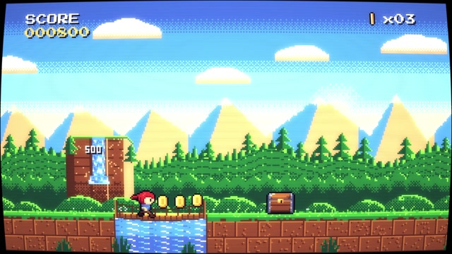
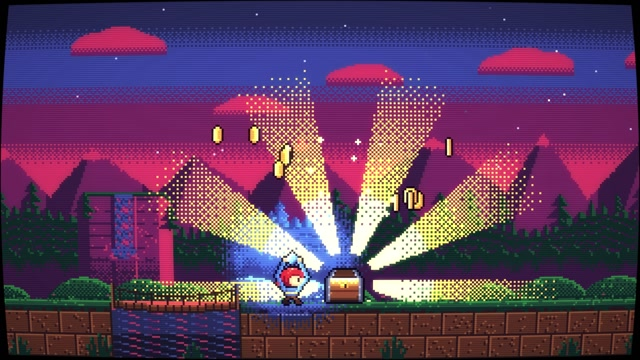

# MF-017 · 按材质语义切换有限色表，再用抖色边界传播夜色和局部光
案例：[ mg-styles-15 ](../cases/mg-styles-15.md) · 机制证据：`still_observed`

效果图用于理解来源作品，不自动验证本卡中的每个机制。

## 设计动作

通过颜色索引重照明来保持像素风格的离散结构；作为本片的具体实现案例，尚不构成跨作品普遍规律。

## 实现与参数

主调色板32色，NSLOT128语义槽；环境槽映射日/午/金/落日/暮/夜六状态，sprite槽64+独立。阶段过渡先混RGB再nearest映回主32色；night波前12逻辑像素宽，用Bayer选择LUT，不连续混合输出RGB。材质MAT与天空蓝亮度等级控制局部光LUT，RGBA=MP[L[IB[i]]]；30fps量化和整数crop保持像素坐标。

## 审美细节

森林天际从青绿到暮紫，宝箱白黄闪光形成局部亮源；在调色查找阶段维持32色，不代表CRT后处理或压缩MP4最终只有32种颜色。

## 适用条件

- 素材以索引而非任意RGB组织
- 材质语义与颜色分离
- 显示放大和相机坐标保持整数

## 相邻方案与区别

不同于全屏滤色/亮度渐变：同位置不同材质可被不同重映射；不是实时PBR光照。

## 失败模式

- 统一蓝色覆盖会把材质身份抹掉
- CRT后处理打破严格色数，不能误报
- Bayer频率与缩放不合会出现摩尔纹

## Movie 裁决

- **verdict**：adapt
- **reason**：适合明确像素风的章节或2D场景。

## Frontend 裁决

- **verdict**：reference
- **reason**：借有限色层次与语义槽；非像素UI不需要整套CRT。

## 最小对照

关CRT检查输出索引是否始终落32色，再开局部光检查天空/草/岩石仍可分；亚像素相机抖动或色表跳变过强即失败。

## 源码证据

- [Repos/mg-styles-15/demos/20-pixel/film.js:1–85](https://github.com/Vincentwei1021/mg-styles-15/blob/49052d80bfaf9fa8412cc9710530e5e95a3b8d8c/demos/20-pixel/film.js#L1-L85)：主色表、语义环境槽、阶段映射和最近色
- [Repos/mg-styles-15/demos/20-pixel/film.js:816–853](https://github.com/Vincentwei1021/mg-styles-15/blob/49052d80bfaf9fa8412cc9710530e5e95a3b8d8c/demos/20-pixel/film.js#L816-L853)：材质光照LUT、夜色波前、Bayer和输出

## 项目效果图

本地影片 3 秒静帧。

来源：本轮已观察的历史截图 · video_still。静帧观察；没有由此验证连续动画或性能。

本地影片 7 秒静帧。

来源：本轮已观察的历史截图 · video_still。静帧观察；没有由此验证连续动画或性能。

## 归纳与练习

暂未归入新增专业视角；保留原机制边界。

[MP-01](../patterns/MP-01.md)
