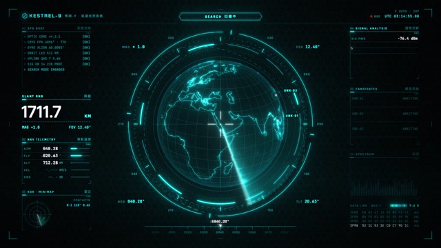
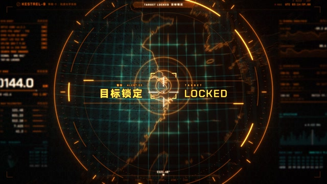

# MF-018 · 把搜寻、犹豫、收拢、确认分成可读状态，再让背景信息退位
案例：[ mg-styles-15 ](../cases/mg-styles-15.md) · 机制证据：`still_observed`

效果图用于理解来源作品，不自动验证本卡中的每个机制。

## 设计动作

用状态变化组织高密度界面的戏剧节奏；作为本片的具体实现案例，尚不构成跨作品普遍规律。

## 实现与参数

brackets从5.9s用8帧飞入，半宽176/204交替并抖18px（注释称16，执行值18）；6.2333 snap用[1.35,1.08,.96,1]四关键值、3帧落到半宽130；6.3333 settle后2帧6.4 LOCK，再.2s缩至72。36段环按brackets_in→settle二次填充；音频ratchet实际用snap终点，settle beep另明确同6.3333。

## 审美细节

青黑扫描阶段到橙色警示，锁定时中间白黄标题优先、侧栏信息弱化；这是影片编排的模拟状态，并无真实目标检测/置信度输入。

## 适用条件

- 状态来自可靠事件或明确标记虚构演示
- 进度环代表的量被定义
- 失败/中断分支存在于真实产品迁移设计

## 相邻方案与区别

不同于满屏随机HUD装饰：有逐段状态和关注中心；与真实追踪界面相比，片内时间由作者固定，不是测量结果。

## 失败模式

- 随机读数会误充真实系统状态
- 视觉fill到settle而音频ratchet到snap，非逐段同步
- 仅成功电影无真实失败态，迁移必须补齐

## Movie 裁决

- **verdict**：prototype
- **reason**：适合明确虚构的科幻侦测短镜头。

## Frontend 裁决

- **verdict**：reference
- **reason**：只借状态叙事，禁止把固定动画用作真实处理成功依据。

## 最小对照

把固定cue改为mock pending/fail/success事件，分别延迟/失败/取消；结果未到却显示LOCK即拒收。音画逐段对应需要另对齐终点。

## 源码证据

- [Repos/mg-styles-15/demos/22-hud/js/hud.js:522–573](https://github.com/Vincentwei1021/mg-styles-15/blob/49052d80bfaf9fa8412cc9710530e5e95a3b8d8c/demos/22-hud/js/hud.js#L522-L573)：搜寻/收拢/锁定几何以及36段进度
- [Repos/mg-styles-15/demos/22-hud/audio.py:64–93](https://github.com/Vincentwei1021/mg-styles-15/blob/49052d80bfaf9fa8412cc9710530e5e95a3b8d8c/demos/22-hud/audio.py#L64-L93)：候选失败、ratchet时间和settle/LOCK音

## 项目效果图

本地影片 3 秒静帧。

来源：本轮已观察的历史截图 · video_still。静帧观察；没有由此验证连续动画或性能。

本地影片 7 秒静帧。

来源：本轮已观察的历史截图 · video_still。静帧观察；没有由此验证连续动画或性能。

## 归纳与练习

暂未归入新增专业视角；保留原机制边界。

[MP-15](../patterns/MP-15.md)
