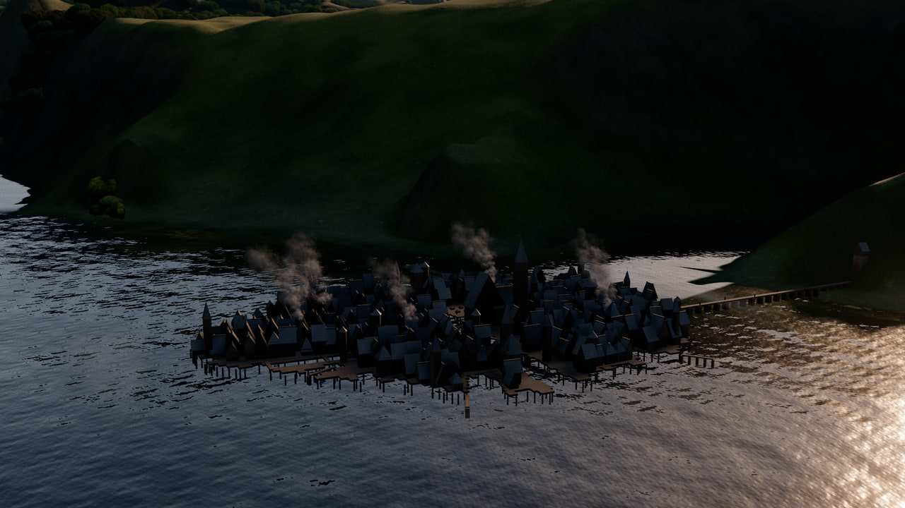
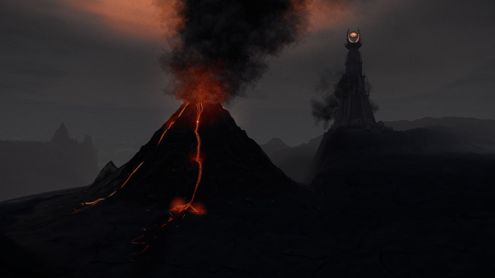

# MOME-005 · 把景深限制为画幅的小比例，保留微缩世界的结构尺度
案例：[ map-of-middle-earth ](../cases/map-of-middle-earth.md) · 机制证据：`source_only`

效果图用于理解来源作品，不自动验证本卡中的每个机制。

## 设计动作

历史米那斯提力斯日夜对照保留了城墙层级、远山和河流，不靠大幅虚化制造微缩感。本实现孔径按取景距离缩放，是屏幕尺度一致的美术镜头形式；代码注释“physically exact”不能外推成固定真实相机标定。

## 实现与参数

COC_CAP=.003≈1080p的3.24px；fStop>=22或lensSpp<8关闭。A=cocInfinity*F*tan(fov/2)，孔径位移dx/dy配合px/py反向投影补偿；lensSpp用基础采样数，运动采样增加不会单独开启景深。

## 审美细节

历史米那斯提力斯日夜对照保留了城墙层级、远山和河流，不靠大幅虚化制造微缩感。本实现孔径按取景距离缩放，是屏幕尺度一致的美术镜头形式；代码注释“physically exact”不能外推成固定真实相机标定。

## 适用条件

- 离线积累样本足够
- 目标是可读的环境结构，而非大片虚化

## 相邻方案与区别

区别于屏幕后期高斯模糊或tilt-shift条带；这里移动孔径且维持焦平面，但做了艺术尺度归一化。

## 失败模式

- 过少采样产生斑点
- 画幅/焦距改变后同数值未必符合美术目标
- 直接搬实时积累会延迟交互反馈

## Movie 裁决

- **verdict**：adapt
- **reason**：适合少量英雄近景；先检查当前movie是否已有同等镜头功能。

## Frontend 裁决

- **verdict**：defer
- **reason**：互动前端本轮以模型/材质优先，不引入多样本离线累积。

## 最小对照

同镜头对比f/22与轻微景深，在输出分辨率检查主角轮廓和远处信息；城市场景读成小玩具或建筑层级丢失即失败。

## 源码证据

- [Repos/map-of-middle-earth/src/render/lens.ts:20–52](https://github.com/earthwalker17/map-of-middle-earth/blob/696e968e9d550327beda9e663ef5aec6961583c9/src/render/lens.ts#L20-L52)：默认f/22、至少8样本、无穷远弥散圈限制画高.003
- [Repos/map-of-middle-earth/src/render/lens.ts:72–106](https://github.com/earthwalker17/map-of-middle-earth/blob/696e968e9d550327beda9e663ef5aec6961583c9/src/render/lens.ts#L72-L106)：按focusDistance/FOV计算孔径并补偿view window，Halton5/7采样
- [Repos/map-of-middle-earth/src/core/Engine.ts:175–217](https://github.com/earthwalker17/map-of-middle-earth/blob/696e968e9d550327beda9e663ef5aec6961583c9/src/core/Engine.ts#L175-L217)：先按针孔相机更新系统，再偏移镜头累积，结束恢复针孔位置
- [Repos/map-of-middle-earth/src/tour/compile.ts:184–192](https://github.com/earthwalker17/map-of-middle-earth/blob/696e968e9d550327beda9e663ef5aec6961583c9/src/tour/compile.ts#L184-L192)：在镜头过渡中插值1/fStop而非直接插值fStop

## 项目效果图

已查看的来源静帧；不证明当前版本运行。

来源：[原作者/出处](https://github.com/earthwalker17/map-of-middle-earth/blob/696e968e9d550327beda9e663ef5aec6961583c9/docs/images/lake-town.jpg) · historical_still_viewed。静帧观察；没有由此验证连续动画或性能。

已查看的来源静帧；不证明当前版本运行。

来源：[原作者/出处](https://github.com/earthwalker17/map-of-middle-earth/blob/696e968e9d550327beda9e663ef5aec6961583c9/docs/images/mount-doom.jpg) · historical_still_viewed。静帧观察；没有由此验证连续动画或性能。

## 归纳与练习

[CINE-08](../lenses/CINE-08.md)

[MP-11](../patterns/MP-11.md)
