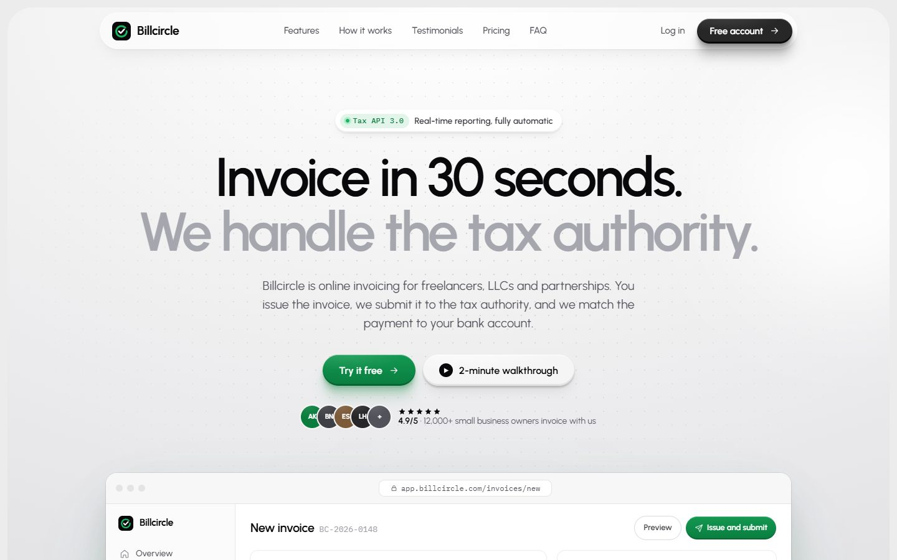
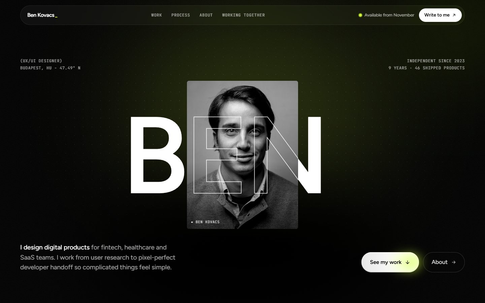

# NF-002 · 用下一张卡的到达推动上一张退出视觉中心
案例：[ premium-saas-web-skill ](../cases/premium-saas-web-skill.md) · 机制证据：`source_only`

效果图用于理解来源作品，不自动验证本卡中的每个机制。

## 设计动作

把层级交接绑定内容推进，旧项目退为背景；不是每张都同时浮起。静帧未证明这一运动。

## 实现与参数

桌面sticky→next.top bottom到top120px驱动旧卡缩暗；≤768px用y50淡入替代。

## 审美细节

把层级交接绑定内容推进，旧项目退为背景；不是每张都同时浮起。静帧未证明这一运动。

## 适用条件

- 每张卡内容不超过停留可读高度
- 窄屏改为文档流

## 相邻方案与区别

区别于自动轮播：用户滚动控制切换；区别于逐卡fade：旧卡仍提供空间记忆。

## 失败模式

- 0.45亮度使仍可点旧卡不可读
- sticky卡高过视口隐藏按钮

## Movie 裁决

- **verdict**：adapt
- **reason**：可作项目展示片转场结构

## Frontend 裁决

- **verdict**：reference
- **reason**：手机Blog主列表不宜堆叠

## 最小对照

检查长内容与键盘focus进入旧卡时是否可读；不可达即撤销sticky。

## 源码证据

- [Repos/premium-saas-web-skill/docs/demos/portfolio-after/index.html:1045–1055](https://github.com/MiddleSugar7000/premium-saas-web-skill/blob/813c8801649b1e7220ca207e4534df8424138fa7/docs/demos/portfolio-after/index.html#L1045-L1055)：桌面下一卡触发上一卡scale .93/brightness .45，手机改淡入
- [Repos/premium-saas-web-skill/docs/demos/portfolio-after/index.html:122–122](https://github.com/MiddleSugar7000/premium-saas-web-skill/blob/813c8801649b1e7220ca207e4534df8424138fa7/docs/demos/portfolio-after/index.html#L122-L122)：sticky top96px与顶部变换原点

## 项目效果图

view_image executed 2026-10-25; repository historical still only; not current runtime or motion evidence

来源：[原作者/出处](https://github.com/MiddleSugar7000/premium-saas-web-skill/blob/813c8801649b1e7220ca207e4534df8424138fa7/assets/screenshots/invoicing-after.jpg) · observed_still。静帧观察；没有由此验证连续动画或性能。

view_image executed 2026-10-25; repository historical still only; not current runtime or motion evidence

来源：[原作者/出处](https://github.com/MiddleSugar7000/premium-saas-web-skill/blob/813c8801649b1e7220ca207e4534df8424138fa7/assets/screenshots/portfolio-after.jpg) · observed_still。静帧观察；没有由此验证连续动画或性能。

## 归纳与练习

暂未归入新增专业视角；保留原机制边界。

保留独立案例。
