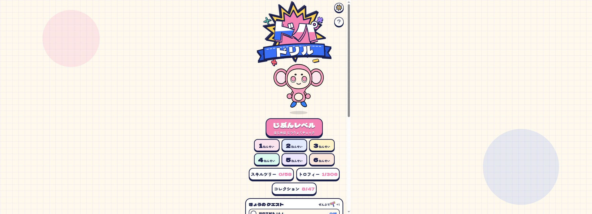

# NI-001 · 用同一进度能量逐层增加画面与配器
案例：[ dopa-drill ](../cases/dopa-drill.md) · 机制证据：`source_only`

效果图用于理解来源作品，不自动验证本卡中的每个机制。

## 设计动作

层级增长通过新增频段/图形形态传达进展，温和木琴随L衰减，避免全程从第一秒满配。

## 实现与参数

basicE=.08+.92*(i/(N-1))^1.3；L=round(E*10)≤10；BPM112→128；L1鼓、L2低音、L3拍手、L5琶音、L8lead、L9choir；背景E>.82开始隧道。

## 审美细节

层级增长通过新增频段/图形形态传达进展，温和木琴随L衰减，避免全程从第一秒满配。

## 适用条件

- 进度具有清晰起点终点
- 音频启动与静音由用户控制

## 相邻方案与区别

区别一味加音量和Bloom：增加独立层次并退掉旧层；区别随机庆祝：各层由同一进度统一调度。

## 失败模式

- 把视觉兴奋误当学习效果或算法性能
- 同时加密音乐/粒子压住核心信息
- 镜头只会越来越强而缺少回落

## Movie 裁决

- **verdict**：adapt
- **reason**：可借段落渐强结构，音乐需重新设计

## Frontend 裁决

- **verdict**：adapt
- **reason**：仅明确短任务反馈，普通阅读界面不适合

## 最小对照

固定一段任务，比较常满强度与三档渐强；峰值时关键操作仍应可识别；静音后进度仍明确。

## 源码证据

- [Repos/dopa-drill/app/js/main.js:237–249](https://github.com/grmchn/dopa-drill/blob/e4da063f74c423b5e6eaad3faeb9631e741d821c/app/js/main.js#L237-L249)：E映射level/BPM/角色摆动
- [Repos/dopa-drill/app/js/audio.js:565–625](https://github.com/grmchn/dopa-drill/blob/e4da063f74c423b5e6eaad3faeb9631e741d821c/app/js/audio.js#L565-L625)：分层合成配器与固定16步节拍
- [Repos/dopa-drill/app/js/bg.js:21–48](https://github.com/grmchn/dopa-drill/blob/e4da063f74c423b5e6eaad3faeb9631e741d821c/app/js/bg.js#L21-L48)：由E控制射线/彩虹/隧道阈值

## 项目效果图

2026-10-25根代理Chrome访问线上页面并保存，本子代理实际view_image复核。首页为浅米方格纸底，粉色与浅蓝大圆点置于两侧；居中窄列、粗深蓝轮廓的logo/粉色角色/圆角按钮，主入口粉底，年级按钮为浅色格组。只观察首页；未作答、未试听、未验证演出递增，设置点击未成功打开。

来源：[原作者/出处](https://dopa-drill.tanosix.com/) · live_site_still。静帧观察；没有由此验证连续动画或性能。

## 归纳与练习

[IF-07](../lenses/IF-07.md)

[MP-01](../patterns/MP-01.md)
