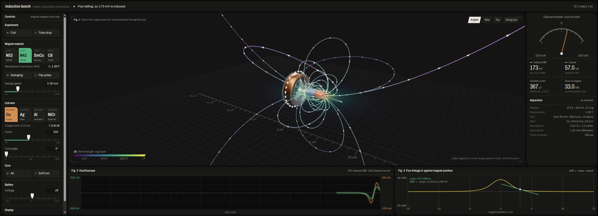

# NI-008 · 把控制、空间观察与仪表组织成可扫描的实体实验台
案例：[ electromagnetism ](../cases/electromagnetism.md) · 机制证据：`still_observed`

效果图用于理解来源作品，不自动验证本卡中的每个机制。

## 设计动作

空间实验保持在视野，滚控件时不丢反馈；主次刻度代替滑杆装饰。圆角卡片没有统一套用，切角与仪表语义一致；未实际截图评审。

## 实现与参数

宽屏272px控制+中心视图+292px读数，下排200px曲线；720px以下单栏且视图sticky44vh；墨灰/灰白作底、绿为控制/通道1、铜为电流/通道2；tabular-nums稳读数；量程仅增大或降到1/4以下才缩。

## 审美细节

空间实验保持在视野，滚控件时不丢反馈；主次刻度代替滑杆装饰。圆角卡片没有统一套用，切角与仪表语义一致；未实际截图评审。

## 适用条件

- 信息量足以支持多面板
- 移动端仍有空间容纳操作与sticky视图

## 相邻方案与区别

区别瀑布流仪表卡：输入—对象—结果形成固定空间关系；区别纯霓虹HUD：克制底色和有限语义强调。

## 失败模式

- sticky44vh可能挤压短屏操作
- 量程变化会造成针角变化却实际值未变
- 小字号/微灰文本对比需测试

## Movie 裁决

- **verdict**：reference
- **reason**：可借道具屏幕构图，完整工具台非成片镜头

## Frontend 裁决

- **verdict**：prototype
- **reason**：适合现有lab操作台，需用自写实现

## 最小对照

360×640和宽屏检查全部控件可达、视图无关键遮挡；量程变化时单位/刻度同步，键盘焦点始终清晰。

## 源码证据

- [Repos/electromagnetism/src/style.css:1–31](https://github.com/thebuggeddev/electromagnetism/blob/820835eb3d429fdbc601a37cc1da811390d830f3/src/style.css#L1-L31)：暗/亮主题token、等宽数字、四栏grid与切角
- [Repos/electromagnetism/src/style.css:98–115](https://github.com/thebuggeddev/electromagnetism/blob/820835eb3d429fdbc601a37cc1da811390d830f3/src/style.css#L98-L115)：尺式slider主次刻度与焦点
- [Repos/electromagnetism/src/style.css:144–167](https://github.com/thebuggeddev/electromagnetism/blob/820835eb3d429fdbc601a37cc1da811390d830f3/src/style.css#L144-L167)：1180/720断点重排，移动端视图sticky
- [Repos/electromagnetism/src/main.js:1041–1063](https://github.com/thebuggeddev/electromagnetism/blob/820835eb3d429fdbc601a37cc1da811390d830f3/src/main.js#L1041-L1063)：模拟仪表正负刻度和量程滞回

## 项目效果图

2026-10-25根代理Chrome访问线上页面并保存，本子代理实际view_image复核。深灰台面分成左参数、中3D磁铁与线圈场线、右指针和数字读数、下方示波器与磁通曲线；绿/铜区分通道，紫青黄场线带方向箭头。截图只证明此时布局与显示内容，不能由静帧判断多面板同步或物理精度。

来源：[原作者/出处](https://electromagnetism.wasmer.app/) · live_site_still。静帧观察；没有由此验证连续动画或性能。

## 归纳与练习

[IF-01](../lenses/IF-01.md) / [IF-03](../lenses/IF-03.md)

[MP-14](../patterns/MP-14.md)
