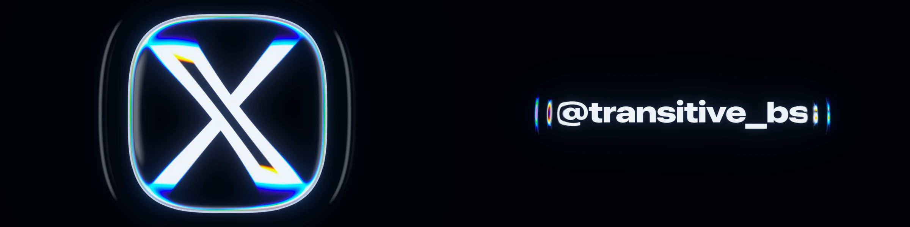

# NWR-004 · 用整段视觉统计约束调色而保留人工裁决
案例：[ apple-music-effect ](../cases/apple-music-effect.md) · 机制证据：`still_observed`

效果图用于理解来源作品，不自动验证本卡中的每个机制。

## 设计动作

已查看scorecard静图：单指标改善不代表暖冷、色量、运动都吻合；应把图和帧同时审阅。

## 实现与参数

作者报告lit/colorful/warm/black/sharpness/motion等曲线，约.2秒平滑、按shot比较；RMS/SSIM偏爱柔暗或塌缩形体；14.9→9.4是原作者结果，未复跑。

## 审美细节

已查看scorecard静图：单指标改善不代表暖冷、色量、运动都吻合；应把图和帧同时审阅。

## 适用条件

- 有合法且固定的参考片段
- 指标只是偏差线索

## 相邻方案与区别

区别截图打分：比较变化曲线与片段；区别全自动美学分数：不以单值替代视觉判断。

## 失败模式

- 优化RMS得到更暗更软错误画面
- 时间平滑掩盖瞬时闪烁
- 复制对比片/音效/商标受到单独权利约束

## Movie 裁决

- **verdict**：prototype
- **reason**：直接服务镜头打磨验收

## Frontend 裁决

- **verdict**：adapt
- **reason**：可用于转场片段，不能替代可用性测试

## 最小对照

用故意压暗/柔化的负例挑战指标：若分数更好而细节更差，应记录拒绝；不要宣称原仓评分已复现。

## 源码证据

- [Repos/apple-music-effect/docs/effect-analysis.md:75–95](https://github.com/transitive-bullshit/apple-music-effect/blob/e31a67602ea03659d60de5290f85b657d11ab27d/docs/effect-analysis.md#L75-L95)：作者记录像素拟合失败、时序指标与尚存误差
- [Repos/apple-music-effect/readme.md:15–21](https://github.com/transitive-bullshit/apple-music-effect/blob/e31a67602ea03659d60de5290f85b657d11ab27d/readme.md#L15-L21)：逐帧与统计图的工作流陈述

## 项目效果图

本轮view_image实际看过的仓内历史静图，未验证运行或运动

来源：[原作者/出处](https://github.com/transitive-bullshit/apple-music-effect/blob/e31a67602ea03659d60de5290f85b657d11ab27d/docs/preview.webp) · observed_still。静帧观察；没有由此验证连续动画或性能。

本轮view_image实际看过的仓内历史静图，未验证运行或运动

来源：[原作者/出处](https://github.com/transitive-bullshit/apple-music-effect/blob/e31a67602ea03659d60de5290f85b657d11ab27d/docs/scorecard.webp) · observed_still。静帧观察；没有由此验证连续动画或性能。

## 归纳与练习

暂未归入新增专业视角；保留原机制边界。

[MP-07](../patterns/MP-07.md)
