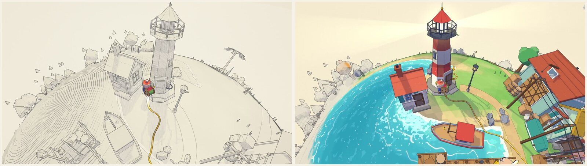
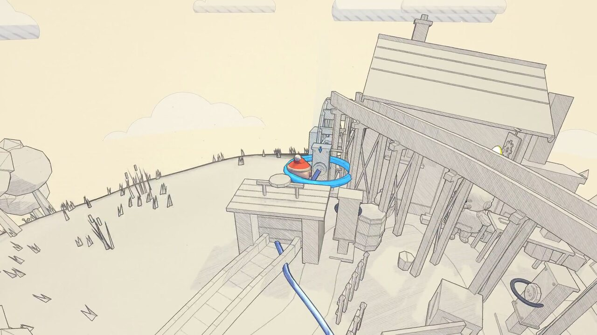

# NWR-007 · 用世界坐标毛边和散点让颜色像颜料渗入
案例：[ yarn-planet ](../cases/yarn-planet.md) · 机制证据：`still_observed`

效果图用于理解来源作品，不自动验证本卡中的每个机制。

## 设计动作

历史对比图见相同地形从米色线稿恢复水青、红屋顶、绿地。纸纹与扩散属于程序风格化，不是流体水彩求解。

## 实现与参数

最多16波；角距acos(dot)*PLANET_RADIUS；radius按speed*dt增长；soft=1.6；world噪声扭曲wavefront，外侧2.8范围散点；uFringe=#ffd27a混色*.42并加*.16。

## 审美细节

历史对比图见相同地形从米色线稿恢复水青、红屋顶、绿地。纸纹与扩散属于程序风格化，不是流体水彩求解。

## 适用条件

- 所有受影响表面消费同一复苏场
- 球面坐标模型与场景一致

## 相邻方案与区别

区别整屏饱和度渐变：状态有地理边界；区别光滑圆形mask：毛边与散点提供材质感。

## 失败模式

- 直接搬球面角距到平面会错
- 16波上限淘汰按target排序而非明确只淘汰完成波
- 相机空间噪声会游泳，须保留world anchoring

## Movie 裁决

- **verdict**：prototype
- **reason**：适合局部环境苏醒镜头

## Frontend 裁决

- **verdict**：adapt
- **reason**：仅重点操作，保留信息层可读性

## 最小对照

固定相机/移动相机各看扩散；边界应贴地不漂移，多源重叠无硬接缝；第17个源不能突然熄灭未完成区域。

## 源码证据

- [Repos/yarn-planet/src/art/revival.ts:43–81](https://github.com/makerjackie/yarn-planet/blob/5c8acce8df04fc7788d48a98343e38c05a458a16/src/art/revival.ts#L43-L81)：有限波阵列、半径增长、球面距离
- [Repos/yarn-planet/src/art/revival.ts:104–143](https://github.com/makerjackie/yarn-planet/blob/5c8acce8df04fc7788d48a98343e38c05a458a16/src/art/revival.ts#L104-L143)：worldpos噪声扭边、发光带与外沿散点
- [Repos/yarn-planet/src/art/toon.ts:210–234](https://github.com/makerjackie/yarn-planet/blob/5c8acce8df04fc7788d48a98343e38c05a458a16/src/art/toon.ts#L210-L234)：纸面/彩色混合及金色边缘

## 项目效果图

本轮view_image实际看过的仓内历史静图，未验证运行或运动

来源：[原作者/出处](https://github.com/makerjackie/yarn-planet/blob/5c8acce8df04fc7788d48a98343e38c05a458a16/docs/media/sketch-to-color.jpg) · observed_still。静帧观察；没有由此验证连续动画或性能。

本轮view_image实际看过的仓内历史静图，未验证运行或运动

来源：[原作者/出处](https://github.com/makerjackie/yarn-planet/blob/5c8acce8df04fc7788d48a98343e38c05a458a16/docs/media/lay-thread.jpg) · observed_still。静帧观察；没有由此验证连续动画或性能。

## 归纳与练习

暂未归入新增专业视角；保留原机制边界。

[MP-01](../patterns/MP-01.md)
