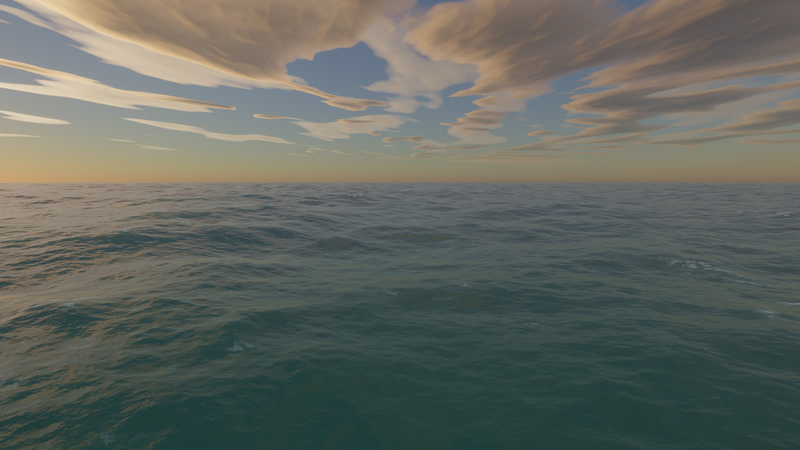
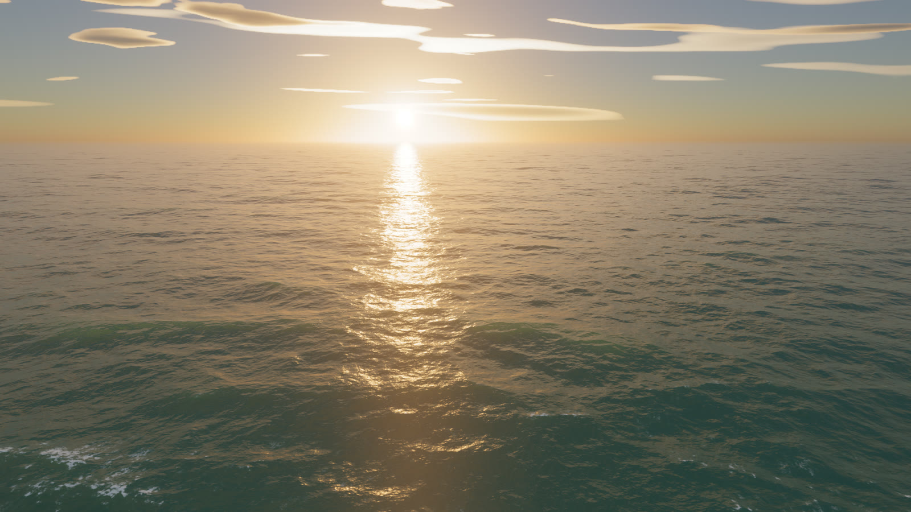

# OCN-006 · 先压孤立亮点再控制高光去饱和
案例：[ web-ocean ](../cases/web-ocean.md) · 机制证据：`still_observed`

效果图用于理解来源作品，不自动验证本卡中的每个机制。

## 设计动作

静帧太阳附近趋白、远处保暖色而青水不全变橙；这是本例色彩脚本，不能直接作为游戏赛博朋克默认调色。

## 实现与参数

HDR→首层稳健降采样→8层blur平均→mix(c,b,.1)→exposure→高光lum .7–6去饱和最多.55→AgX→1/255dither。

## 审美细节

静帧太阳附近趋白、远处保暖色而青水不全变橙；这是本例色彩脚本，不能直接作为游戏赛博朋克默认调色。

## 适用条件

- 线性HDR并明确最终输出转换
- 目标风格允许亮部去饱和

## 相邻方案与区别

与把曝光压低消爆点不同，先限制孤立高亮传播，再设计高光颜色；现有post.js已有bloom/grade，应借局部算法。

## 失败模式

- Bloom mix会降低原对比，与加法Bloom不是等价参数
- AgX与现有tone mapping双重处理
- 过度去饱和破坏霓虹色身份

## Movie 裁决

- **verdict**：adapt
- **reason**：海景输出可参考

## Frontend 裁决

- **verdict**：reference
- **reason**：仅在既有后期出现glint firefly时小样

## 最小对照

固定曝光截太阳反光和霓虹两组A/B；孤立闪点减少但霓虹身份不得失去，任一不满足则不采用。

## 源码证据

- [Repos/web-ocean/js/wgsl/post.js:38–51](https://github.com/Noniv/web-ocean/blob/a07c7fd522ef0a897601c114f927a49d93d95520/js/wgsl/post.js#L38-L51)：首层Karis加权downsample抑制fireflies
- [Repos/web-ocean/js/wgsl/post.js:107–128](https://github.com/Noniv/web-ocean/blob/a07c7fd522ef0a897601c114f927a49d93d95520/js/wgsl/post.js#L107-L128)：8层bloom归一mix、曝光、白平衡、高光去饱和、AgX和三角dither
- [Repos/web-ocean/js/main.js:29–37](https://github.com/Noniv/web-ocean/blob/a07c7fd522ef0a897601c114f927a49d93d95520/js/main.js#L29-L37)：默认exposure1.35/bloom.10/haze3

## 项目效果图

正对太阳低机位：暖金反光柱，深青近景水，暖云边；大块云呈平层形态。

来源：[原作者/出处](https://github.com/Noniv/web-ocean/blob/a07c7fd522ef0a897601c114f927a49d93d95520/docs/front.jpg) · observed_still。静帧观察；没有由此验证连续动画或性能。

偏离太阳方向：主反光柱移出，水体保留蓝青层次；不证明移动时反光稳定。

来源：[原作者/出处](https://github.com/Noniv/web-ocean/blob/a07c7fd522ef0a897601c114f927a49d93d95520/docs/side.jpg) · observed_still。静帧观察；没有由此验证连续动画或性能。

高机位：近景泡沫碎片和较宽海面层级；无法由静帧验证泡沫持久性。

来源：[原作者/出处](https://github.com/Noniv/web-ocean/blob/a07c7fd522ef0a897601c114f927a49d93d95520/docs/high.jpg) · observed_still。静帧观察；没有由此验证连续动画或性能。

## 归纳与练习

[CINE-04](../lenses/CINE-04.md) / [CINE-08](../lenses/CINE-08.md)

[MP-02](../patterns/MP-02.md)
