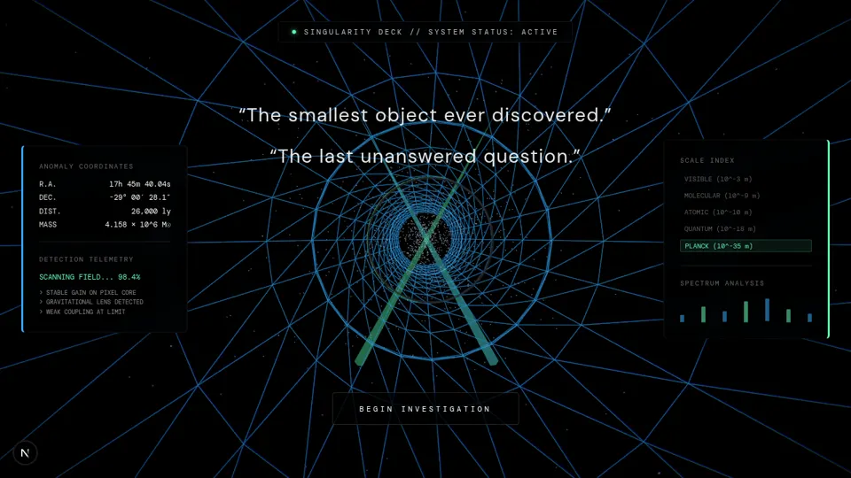

# REN-001 · 用被扭曲的星场建立黑洞作用范围
案例：[ Singularity ](../cases/Singularity.md) · 机制证据：`source_only`

效果图用于理解来源作品，不自动验证本卡中的每个机制。

## 设计动作

星场提供畸变参照；暖盘与蓝白外环构成冷暖层次。设计推论，不代表已看效果。

## 实现与参数

uIntensity→k=.052*intensity→三个lens采样(k,1.7k,2.4k)→盘+光子环。是风格化二维效果，无光线步进。

## 审美细节

星场提供畸变参照；暖盘与蓝白外环构成冷暖层次。设计推论，不代表已看效果。

## 适用条件

- 窗口远景/屏幕投影允许平面近似
- 有明确环外背景参照

## 相邻方案与区别

与3D弯光线积分不同：本例只偏移星场UV；适合便宜远景，不能声称物理模拟。

## 失败模式

- smoothstep多处edge0>edge1，GLSL结果未定义；不可直接移植
- 74–76行shadow在内侧接近1而外侧接近0，可能截掉外盘；未跑不能宣布黑洞正确
- 全屏平面随自由视角暴露平面性

## Movie 裁决

- **verdict**：reference
- **reason**：先修遮罩与alpha再做固定窗外镜头

## Frontend 裁决

- **verdict**：reference
- **reason**：只借构图机制；源码许可未知且自由视角未验证

## 最小对照

保存原稿与修正smoothstep/遮罩的A/B；若外星场被全黑截断或中心不黑即失败。

## 源码证据

- [Repos/Singularity/shaders/blackhole.frag.glsl:11–23](https://github.com/broskell/Singularity/blob/363c12d0e0926bdbd0cfe1a138af2abb0da27c64/shaders/blackhole.frag.glsl#L11-L23)：stars哈希网格320；lens以k/(r²+0.0006)偏移
- [Repos/Singularity/shaders/blackhole.frag.glsl:50–79](https://github.com/broskell/Singularity/blob/363c12d0e0926bdbd0cfe1a138af2abb0da27c64/shaders/blackhole.frag.glsl#L50-L79)：三层星场、两条环与horizon遮罩最终合成
- [Repos/Singularity/components/scenes/Scene06_BlackHole.tsx:14–30](https://github.com/broskell/Singularity/blob/363c12d0e0926bdbd0cfe1a138af2abb0da27c64/components/scenes/Scene06_BlackHole.tsx#L14-L30)：入口只给ShaderPlane传黑洞fragment，scale=76

## 项目效果图

实际查看：蓝绿线框漏斗汇聚到中央粒子核，两侧遥测/尺度面板与开始按钮，黑底高对比。

来源：本轮已观察的历史截图 · archived_local_screenshot。2026-09-27历史项目快照的引导界面；不证明后续黑洞、原子或滚动镜头效果，不绑定当前源提交。

## 归纳与练习

[CINE-08](../lenses/CINE-08.md)

[MP-24](../patterns/MP-24.md)
