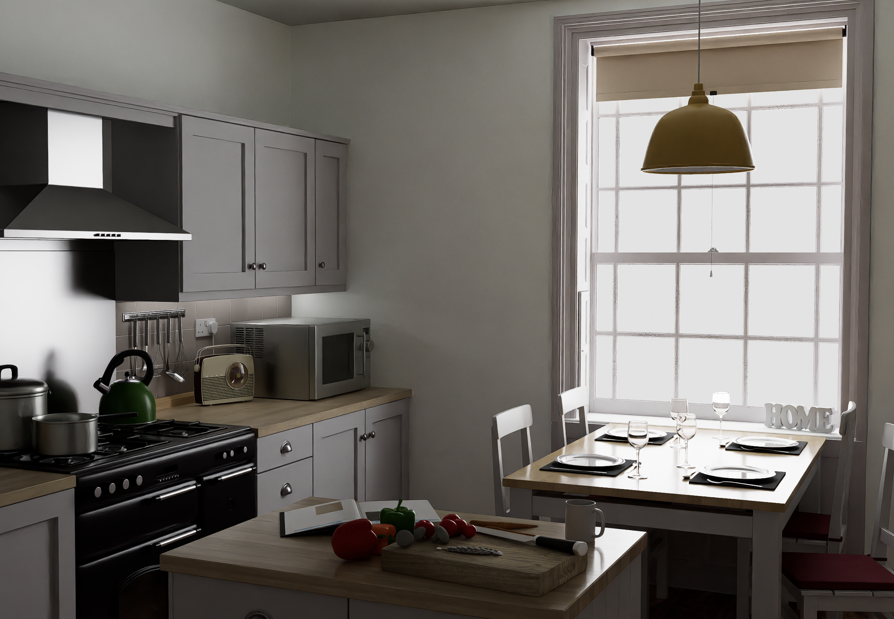

# REN-004 · 停住时间累积采样后才推进影片一帧
案例：[ three-gpu-pathtracer ](../cases/three-gpu-pathtracer.md) · 机制证据：`source_only`

效果图用于理解来源作品，不自动验证本卡中的每个机制。

## 设计动作

这提供稳定封面/短片制作切口，能把光照审美与访客实时渲染拆开。

## 实现与参数

WebGPURenderer→WebGPUPathTracer→renderSample；averageSamples>=maxSamples才写帧，resetCount阻止旧回调提前完成下一帧。 writeVideoFrame成功写出后才advanceAnimation，mixer.update(1/frameRate)并regenerateScene。

## 审美细节

这提供稳定封面/短片制作切口，能把光照审美与访客实时渲染拆开。

## 适用条件

- 独立开发渲染环境three>=.185
- 素材和相机固定到每输出帧

## 相邻方案与区别

与录屏不同：输出时间不等于GPU耗时；与实时升级不同：结果是图片/视频资产。

## 失败模式

- 旧异步采样计数污染下一帧会产生未收敛帧
- 10 samples只是demo默认值，不是质量门槛
- 自定义shader不会自动兼容支持材质集

## Movie 裁决

- **verdict**：prototype
- **reason**：最适合离线单镜头短片或hero still

## Frontend 裁决

- **verdict**：defer
- **reason**：不引入访客实时管线；只消费导出资产

## 最小对照

同机位32/128/512样本对照，检查亮点噪声、霓虹溢光和自定义材质差异；结果损失场景身份则失败。

## 源码证据

- [Repos/three-gpu-pathtracer/example/renderVideo.js:40–89](https://github.com/gkjohnson/three-gpu-pathtracer/blob/288363980a20e53f0627d350fd1bdacb1608643d/example/renderVideo.js#L40-L89)：异步采样均值与resetCount；maxSamples10,frameRate12,fadeDuration0
- [Repos/three-gpu-pathtracer/example/renderVideo.js:370–414](https://github.com/gkjohnson/three-gpu-pathtracer/blob/288363980a20e53f0627d350fd1bdacb1608643d/example/renderVideo.js#L370-L414)：拒绝旧reset采样结果，到阈值才writeVideoFrame
- [Repos/three-gpu-pathtracer/example/renderVideo.js:317–350](https://github.com/gkjohnson/three-gpu-pathtracer/blob/288363980a20e53f0627d350fd1bdacb1608643d/example/renderVideo.js#L317-L350)：writeVideoFrame先await videoSource.add并增加帧号，未完成时调用advanceAnimation；动画推进量为1/frameRate。

## 项目效果图

灰白厨房，右侧大窗形成宽柔光；木台、金属厨具、透明杯与暗处柜门仍有层次。

来源：本轮已观察的历史截图 · author_demo_screenshot。仓内README Screenshots历史成片，展示材质与间接光的外观；无参数A/B、无当前HEAD或性能验证。

## 归纳与练习

[CINE-06](../lenses/CINE-06.md) / [CINE-08](../lenses/CINE-08.md) / [IF-08](../lenses/IF-08.md)

保留独立案例。
