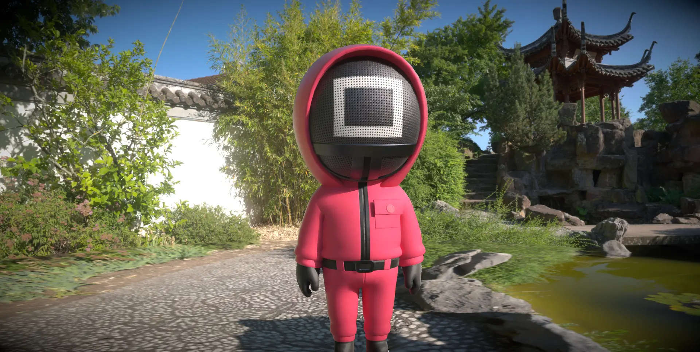
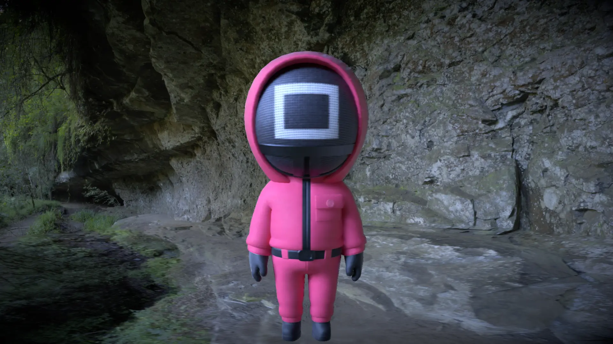

# REN-011 · 沿像素运动方向模糊并按帧时间归一
案例：[ realism-effects ](../cases/realism-effects.md) · 机制证据：`source_only`

效果图用于理解来源作品，不自动验证本卡中的每个机制。

## 设计动作

运动体保持方向性，静止UI应在后期之后合成；不是把阅读内容一起拉糊。

## 实现与参数

velocityTexture→intensity缩放→蓝噪声jitter→中心两侧采样→均值；静止像素不模糊。

## 审美细节

运动体保持方向性，静止UI应在后期之后合成；不是把阅读内容一起拉糊。

## 适用条件

- 有效velocity和deltaTime
- UI后合成或明确排除

## 相邻方案与区别

与Ride已有径向速度线不同，它表达独立物体运动，开销是额外velocity链。

## 失败模式

- 细杆前景会采到后景颜色
- deltaTime过小导致超长模糊
- 镜头摇动时整幅难读

## Movie 裁决

- **verdict**：adapt
- **reason**：列车/物体运动镜头可借

## Frontend 裁决

- **verdict**：reference
- **reason**：Ride已有速度特效，不重复加全局blur

## 最小对照

同一镜头保持车厢不动、外景移动，对照径向/矢量blur；车内字被糊或反向拖尾即失败。

## 源码证据

- [Repos/realism-effects/src/motion-blur/shader/motion_blur.frag:11–44](https://github.com/0beqz/realism-effects/blob/061daeaefb7773d8a1a8e10fa95a184fbcda1fb7/src/motion-blur/shader/motion_blur.frag#L11-L44)：无运动直接返回，velocity控制采样端点，frameSpeed=.01/deltaTime

## 项目效果图

粉红衣黑面罩角色位于竹林园景，角色受光与背景石/水/白墙形成明暗层次。

来源：本轮已观察的历史截图 · author_demo_screenshot。README标为SSGI示例；单张图不分离SSGI与环境照明、贴图和模型贡献。角色形象和背景权利未独立核验。

岩壁环境中的粉红衣角色；面罩方框和轮廓可见拖叠/模糊，背景保留石纹。

来源：本轮已观察的历史截图 · author_demo_screenshot。README标为motion blur示例；静帧可见模糊，不能证明运动过程中稳定、遮挡正确或无ghosting。

## 归纳与练习

暂未归入新增专业视角；保留原机制边界。

[MP-12](../patterns/MP-12.md)
