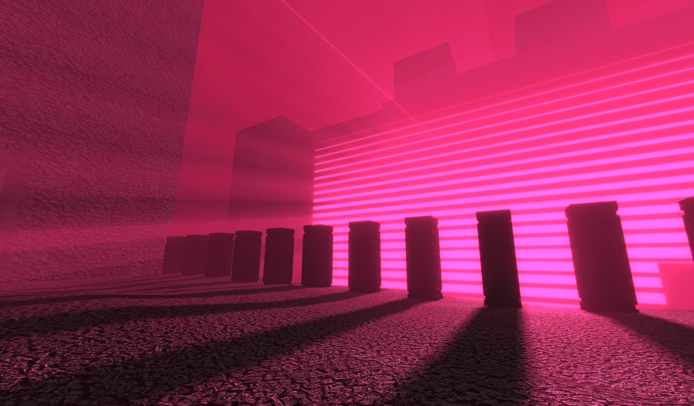

# REN-012 · 让空气亮柱继承真实遮挡的投影
案例：[ three-good-godrays ](../cases/three-good-godrays.md) · 机制证据：`source_only`

效果图用于理解来源作品，不自动验证本卡中的每个机制。

## 设计动作

光柱依赖窗框/遮挡分割，不能在无遮拦的空庭院无故开雾制造“神光”。

## 实现与参数

sceneDepth还原worldPos→shadowMap查询→受光长度积分→指数响应。citadel现有VOL使用24步、HG、上下高度限制，已是改造实现。

## 审美细节

光柱依赖窗框/遮挡分割，不能在无遮拦的空庭院无故开雾制造“神光”。

## 适用条件

- 可指认光源和遮挡结构
- 阴影图覆盖光柱空间

## 相邻方案与区别

与透明锥体不同，march能响应真实遮挡；与Bloom不同，它表现空间介质。

## 失败模式

- 无遮挡时只有均匀雾
- 光源超出shadow frustum后消失
- 密度过高洗白材质

## Movie 裁决

- **verdict**：adapt
- **reason**：仅有遮挡的镜头适用

## Frontend 裁决

- **verdict**：adapt
- **reason**：扩展现有VOL场景配置，禁止重复vendor

## 最小对照

同一灯位删去遮挡再恢复，光束必须随遮挡变化；只提升雾亮度则失败。

## 源码证据

- [Repos/three-good-godrays/src/godrays.frag:125–167](https://github.com/Ameobea/three-good-godrays/blob/70ad1c41c78796637064b3bb9246be08e81ee777/src/godrays.frag#L125-L167)：按灯空间shadowMap判断受光
- [Repos/three-good-godrays/src/godrays.frag:244–260](https://github.com/Ameobea/three-good-godrays/blob/70ad1c41c78796637064b3bb9246be08e81ee777/src/godrays.frag#L244-L260)：沿观察线积分并以1-exp(-illum)压缩
- [Repos/three-good-godrays/README.md:95–105](https://github.com/Ameobea/three-good-godrays/blob/70ad1c41c78796637064b3bb9246be08e81ee777/README.md#L95-L105)：默认density1/128,maxDensity.5,steps60

## 项目效果图

明亮洋红百叶状光源、粗石地面和一列暗柱；柱后长阴影与粉色空气亮带形成明显深度。

来源：[原作者/出处](https://i.ameo.link/dg2.png) · author_demo_screenshot。README明确作者demo截图的原图地址；属于历史体积光外观，无独立当前版本运行/帧率/参数对照。

## 归纳与练习

[CINE-05](../lenses/CINE-05.md)

[MP-04](../patterns/MP-04.md)
