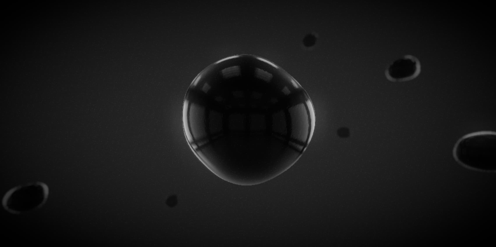

# REN-016 · 把发光资格绑定到对象身份
案例：[ react-postprocessing ](../cases/react-postprocessing.md) · 机制证据：`source_only`

效果图用于理解来源作品，不自动验证本卡中的每个机制。

## 设计动作

用局部霓虹或可交互道具作为强调源，避免每个白物件都发光；不能以发光替代照明。

## 实现与参数

selection→useSelectionSync→指定灯layer→SelectiveBloomEffect ADD；luminanceThreshold等constructor-only，intensity可live更新。

## 审美细节

用局部霓虹或可交互道具作为强调源，避免每个白物件都发光；不能以发光替代照明。

## 适用条件

- 选择层与灯层一致
- 先核对现有Bloom是否已满足

## 相邻方案与区别

与亮度阈值Bloom不同，先按对象分类；如果emissive阈值已可区分就无需额外pass。

## 失败模式

- 遗漏灯或层号冲突导致对象消失/不亮
- effect重建频繁造成跳变
- 新源码React19不兼容本站18

## Movie 裁决

- **verdict**：adapt
- **reason**：指定镜头可稳定突出道具

## Frontend 裁决

- **verdict**：reference
- **reason**：优先现有post.js强度/阈值，必要时才做mask

## 最小对照

保持照明，选1个霓虹源与相邻白物体；若白物体仍同亮或取消选择残留则失败。

## 源码证据

- [Repos/react-postprocessing/src/effects/SelectiveBloom.tsx:21–34](https://github.com/pmndrs/react-postprocessing/blob/3da552af77f5f6e150c1a0ba262c55fd570b6914/src/effects/SelectiveBloom.tsx#L21-L34)：灯和选择层同步，默认layer10
- [Repos/react-postprocessing/src/effects/SelectiveBloom.tsx:50–95](https://github.com/pmndrs/react-postprocessing/blob/3da552af77f5f6e150c1a0ba262c55fd570b6914/src/effects/SelectiveBloom.tsx#L50-L95)：选择集合与lights同步，卸载清layer；部分阈值需重建effect

## 项目效果图

暗灰单色空间中的多个反射球体，中央大球边缘清晰，前后小球虚化，表面反射窗格。

来源：本轮已观察的历史截图 · author_demo_screenshot。仓内Bubbles演示封面，与README所列演示同名；只证明历史封面外观，不能据此确认某后期组件/配置生效。

## 归纳与练习

[CINE-08](../lenses/CINE-08.md)

[MP-02](../patterns/MP-02.md)
