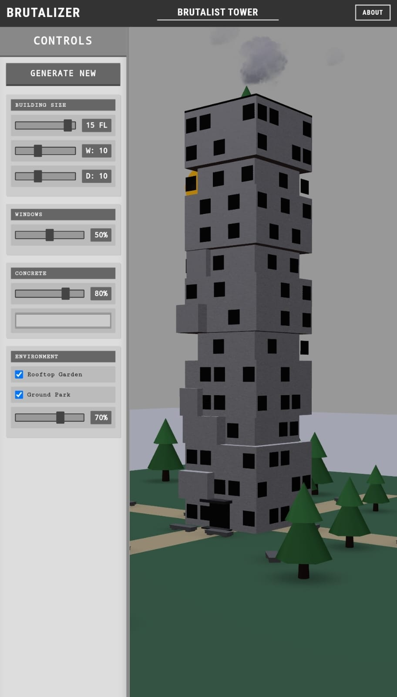

# SD-BR01 · 从按层退台提取轮廓，但把窗面绑定真实楼层尺寸
案例：[ TheBrutalizer ](../cases/TheBrutalizer.md) · 机制证据：`still_observed`

效果图用于理解来源作品，不自动验证本卡中的每个机制。

## 设计动作

参数建筑要让开口、楼层和附属体共享尺寸来源；该仓同时提供可借轮廓与明确反例。

## 实现与参数

main.jsx→App.jsx→scenes/BrutalistScene.jsx→Building.jsx；当前楼层i%3==0缩至0.8，下一层恢复；windows每2.5间距仍使用原width/depth。

## 审美细节

built.jpg历史图可见灰色主量、黑色窗孔、层间凹口和绿树；仅能说明静态构图，不证明生成器无错位。

## 适用条件

- 许可核清
- 窗口能读取每层真实面

## 相邻方案与区别

Nexus类型语法更适合中景；本仓可作为尺寸耦合失效的负例。

## 失败模式

- 未seed的Math.random让扩展和门不稳定
- retreat层窗仍在原表面
- utils生成器不是当前Building实现

## Movie 裁决

- **verdict**：reference
- **reason**：保留块体节奏，不直接当hero建筑资产。

## Frontend 裁决

- **verdict**：defer
- **reason**：许可和错位问题清理后再考虑集成。

## 最小对照

每层输出立面边界与窗中心，缩窄层窗不得悬空；固定seed两次输出一致。

## 源码证据

- [Repos/TheBrutalizer/src/components/Building.jsx:28–103](https://github.com/KrishGaur1354/TheBrutalizer/blob/ec8708101d5debb8cd61d2a6bbdee75edde91b91/src/components/Building.jsx#L28-L103)：3米层高、每三层0.8缩窄，但窗仍按原width/depth定位
- [Repos/TheBrutalizer/src/utils/buildingGenerator.js:25–84](https://github.com/KrishGaur1354/TheBrutalizer/blob/ec8708101d5debb8cd61d2a6bbdee75edde91b91/src/utils/buildingGenerator.js#L25-L84)：独立工具有退台、悬挑、核心筒数据，不等于当前组件调用

## 项目效果图

已view_image built.jpg：灰塔/黑窗/绿树历史静帧；未运行动画。

来源：[原作者/出处](https://github.com/KrishGaur1354/TheBrutalizer/blob/ec8708101d5debb8cd61d2a6bbdee75edde91b91/built.jpg) · observed_still。静帧观察；没有由此验证连续动画或性能。

## 归纳与练习

暂未归入新增专业视角；保留原机制边界。

[MP-08](../patterns/MP-08.md)
