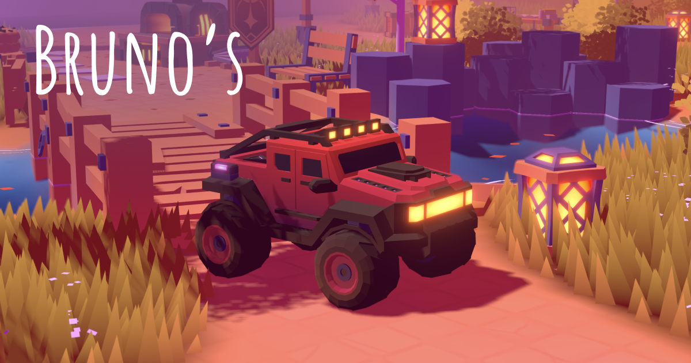

# SD-FO03 · 给风格化暗面保留地面反色和统一阴影色
案例：[ folio-2025 ](../cases/folio-2025.md) · 机制证据：`still_observed`

效果图用于理解来源作品，不自动验证本卡中的每个机制。

## 设计动作

暗面也参与色彩构图，但补色应有朝向/高度约束。

## 实现与参数

bounceOrientation=normal dot down smoothstep；bounceDistance=(1-y/d)^2；terrain色混合后施加light color，再将max(core,drop,custom)作为shadowMix。

## 审美细节

有色阴影适合低多边形风格；不是物理GI，地面反色仅按朝向高度。

## 适用条件

- 风格化目标明确
- 未已有同等bake反弹

## 相邻方案与区别

不同于物理反弹光；相比全屏抬黑更有空间约束。

## 失败模式

- 会覆盖真实PBR能量关系
- 直接叠加造成双重染色

## Movie 裁决

- **verdict**：reference
- **reason**：可借暗部配色，不替换全部PBR。

## Frontend 裁决

- **verdict**：defer
- **reason**：现有bake场景不可叠加同类暗部色造成双重处理。

## 最小对照

固定暗面与亮面比较，暗部应保有形状，地面换色仅影响低处朝下面；高处染色即失败。

## 源码证据

- [Repos/folio-2025/sources/Game/Materials/MeshDefaultMaterial.js:81–118](https://github.com/brunosimon/folio-2025/blob/41046b57eeed8d156d9c3fd7fa259900baef7816/sources/Game/Materials/MeshDefaultMaterial.js#L81-L118)：下向法线×距地衰减混入terrain色，统一合并阴影

## 项目效果图

已view_image static/social/share-image.png：暖橙草地/灯、紫灰石、红车低多边形静帧；不是当前运行截图。

来源：[原作者/出处](https://github.com/brunosimon/folio-2025/blob/41046b57eeed8d156d9c3fd7fa259900baef7816/static/social/share-image.png) · observed_still。静帧观察；没有由此验证连续动画或性能。

## 归纳与练习

暂未归入新增专业视角；保留原机制边界。

保留独立案例。
