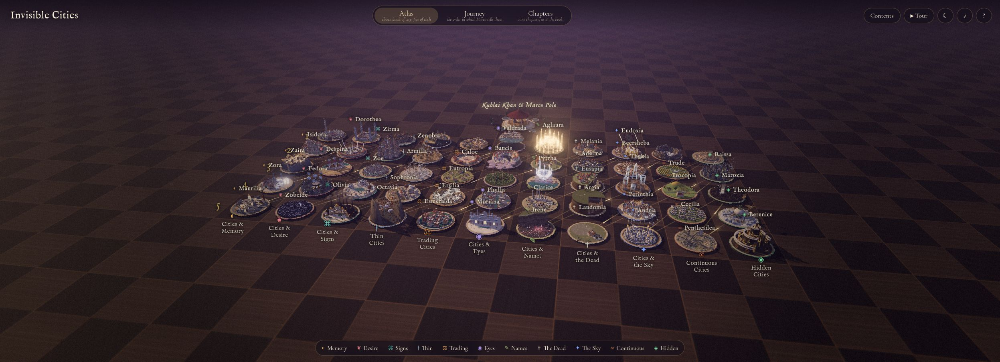
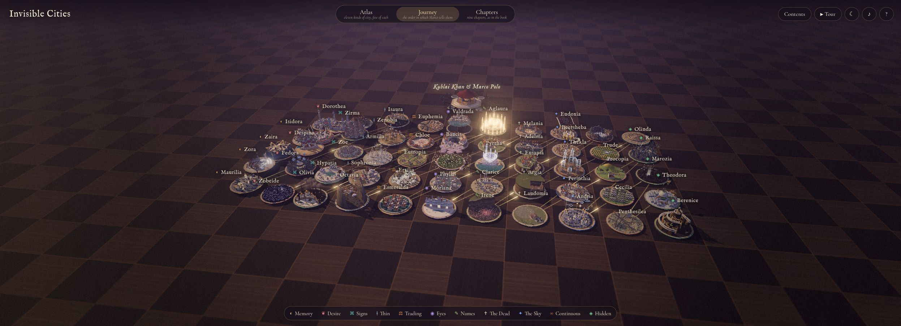

# SD-IC02 · 布局重排时保留对象身份、选中状态与观察偏移
案例：[ invisible-cities-opus-5.5 ](../cases/invisible-cities-opus-5.5.md) · 机制证据：`source_only`

效果图用于理解来源作品，不自动验证本卡中的每个机制。

## 设计动作

同一批对象在不同组织维度间变换时，用户应看得出“它移到哪里”，而不是读一个重建后的新页面。

## 实现与参数

e.city.order索引目标坐标，实体holder不重建。Atlas11类×5，Journey近似等弧长螺旋，Chapters按10/5…/10排9行。3.2s转场，stagger=order/N*.35，局部阶段除.65，立方ease，抬升sin(pi*t)*6；已聚焦时保留camera-target偏移并移动到同实体新位置。

## 审美细节

空间组织在类别、阅读顺序和章节之间切换，thread也随holder更新；运动用于解释数据重排。overview竖屏允许x1.6投影范围，是有意裁剪，不能声称所有横向内容都fit。

## 适用条件

- 实体有稳定ID
- 各布局共享同一数据集合
- 有非动画切换路径

## 相邻方案与区别

与普通页面淡入不同保留对象对应关系；与Nexus控制交还互补，此处解决重排后的认知连续性。

## 失败模式

- 竖屏overview允许裁剪，需另定可读框
- 相机轨道没有碰撞避让
- 大量延迟运动会拖慢定向查找
- 美术参考不能成为提前恢复Atlas施工理由

## Movie 裁决

- **verdict**：reference
- **reason**：适合介绍系列结构的转场，不直接提升单个hero场景建模。

## Frontend 裁决

- **verdict**：adapt
- **reason**：适合设计卡或研究案例浏览器的可选组织视图；本站Atlas仍后置。

## 最小对照

选中同一对象依次切三布局、动画中再次切换；ID、选中和镜头目标不丢，文字不乱序，reduce-motion直接到终点；穿叠挡住对象则失败。

## 源码证据

- [Repos/invisible-cities-opus-5.5/src/world.js:181–217](https://github.com/stared/invisible-cities-opus-5.5/blob/3c2d0cc6657d053d5c36802db359ce8bb3820aa1/src/world.js#L181-L217)：Atlas类目网格、Journey螺旋、Chapters九行布局
- [Repos/invisible-cities-opus-5.5/src/main.js:292–330](https://github.com/stared/invisible-cities-opus-5.5/blob/3c2d0cc6657d053d5c36802db359ce8bb3820aa1/src/main.js#L292-L330)：from/to重排，3.2秒错峰缓动，焦点相机保留offset
- [Repos/invisible-cities-opus-5.5/src/main.js:333–385](https://github.com/stared/invisible-cities-opus-5.5/blob/3c2d0cc6657d053d5c36802db359ce8bb3820aa1/src/main.js#L333-L385)：overview边界拟合与相机flyTo

## 项目效果图

小型城市按类别列与序号行放在棋盘上；瓷金造型和标签共用空间位置，分类导航在下方。

来源：[原作者/出处](https://p.migdal.pl/invisible-cities-opus-5.5/) · live_site_still。本轮线上默认Atlas静帧，线上版本未绑定本地HEAD；不证明全部55城细节。

选择Journey后保留城市身份，发光线路把叙述顺序联结起来。

来源：[原作者/出处](https://p.migdal.pl/invisible-cities-opus-5.5/) · live_site_still。切换后的单帧，不据此认证完整过渡或输入中断。

## 归纳与练习

[IF-04](../lenses/IF-04.md)

[MP-13](../patterns/MP-13.md)
