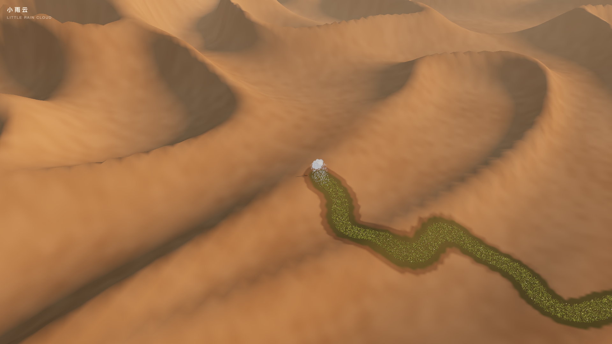

# SD-LR02 · 用可恢复的滞后表现跟随物的重量与性格
案例：[ little-rain-cloud ](../cases/little-rain-cloud.md) · 机制证据：`source_only`

效果图用于理解来源作品，不自动验证本卡中的每个机制。

## 设计动作

跟随物和主体不完全同步，奔跑、召回和阵风才有可读差异；动作仍由同一位置状态驱动雨源。

## 实现与参数

目标点后退clamp(fox.speed*.9,0,2.2)，高度为主体+3.9和小幅正弦；stiff=6，阵风先降至.25，damp=2sqrt(stiff)*.9，速度与位置按dt积分。召回绕半径1.3，云速度映射倾斜并clamp±.3。阻尼比.9近临界，不能写成严格临界阻尼。

## 审美细节

重感来自位置追赶、速度倾斜和雨落地点一起延迟；仅给云外形做scale呼吸无法替代。当前未观察奔跑与召回动作。

## 适用条件

- 有明确参考物
- 滞后不会遮挡交互目标
- 能限制最大dt或子步积分

## 相邻方案与区别

与固定delay动画不同，停下后状态会恢复；与普通lerp不同拥有速度状态，但仍须验证积分稳定。

## 失败模式

- 显式积分对大dt敏感
- 地面高度夹持只阻止穿地不防侧面穿墙
- 不能把装饰性弹簧称流体或真实动力学

## Movie 裁决

- **verdict**：adapt
- **reason**：适合近景建立主体与小物件关系。

## Frontend 裁决

- **verdict**：reference
- **reason**：在有跟随装饰物的局部交互中才有价值。

## 最小对照

同一输入以30/60/120fps走、停、突转和阵风；最大位移/恢复时间相近，物件不穿地，雨源与云位置一致；高dt爆振即失败。

## 源码证据

- [Repos/little-rain-cloud/main.js:866–890](https://github.com/dososo/little-rain-cloud/blob/8180c1b1c98e993bad05e77eb596d472ce2910cd/main.js#L866-L890)：速度滞后、弹簧阻尼、召回轨道、阵风冲量与倾斜
- [Repos/little-rain-cloud/main.js:902–935](https://github.com/dososo/little-rain-cloud/blob/8180c1b1c98e993bad05e77eb596d472ce2910cd/main.js#L902-L935)：降雨落点随云位置与环境状态更新

## 项目效果图

已view_image shots/04-look-back.png：暖沙丘、白云、深湿痕与绿色曲线；它是历史静帧，只支持构图判断，不支持动画或当前运行验收。

来源：[原作者/出处](https://github.com/dososo/little-rain-cloud/blob/8180c1b1c98e993bad05e77eb596d472ce2910cd/shots/04-look-back.png) · observed_still。静帧观察；没有由此验证连续动画或性能。

## 归纳与练习

[CINE-06](../lenses/CINE-06.md)

[MP-12](../patterns/MP-12.md)
