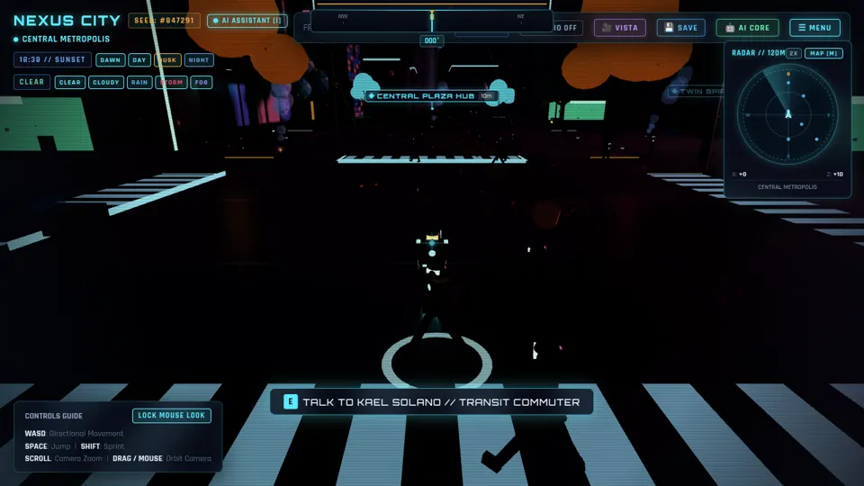

# SD-NX01 · 让体量变化、附属设备和灯带共享建筑语法
案例：[ NexusCity ](../cases/NexusCity.md) · 机制证据：`source_only`

效果图用于理解来源作品，不自动验证本卡中的每个机制。

## 设计动作

先建立可辨认轮廓，再让灯带解释结构，避免给相同盒子随机贴霓虹。

## 实现与参数

generateBuilding(lot,rng)→四类 archetype；高38–115、退界2–4；退台2–4层×0.78；悬挑底座0.7宽、底高35%。输出 tiers/lightStrips/rooftopEquipment/collisionBounds。

## 审美细节

色板 #00f0ff/#00ffaa/#ffaa00/#ff0077，每栋选一 accent；退台灯位于檐口，悬挑灯位于肚底。

## 适用条件

- 中景楼体可见轮廓
- 布局尺寸固定
- 固定seed

## 相邻方案与区别

与 TheBrutalizer 的按层局部缩窄相比，Nexus显式定义可辨认类型；与纯贴图天际线相比具有近中景体积。

## 失败模式

- 悬挑collisionBounds覆盖整块宽底空间，不能直接当可走碰撞
- 并非所有随机纹理都可复现

## Movie 裁决

- **verdict**：prototype
- **reason**：适合作为窗外中景轮廓样机。

## Frontend 裁决

- **verdict**：adapt
- **reason**：仅移植几何数据生成器，不引入整个开放世界。

## 最小对照

同一窗框固定镜头对比盒子/四语法，检查主楼剪影识别；逐层碰撞不得封死悬挑下可走区。

## 源码证据

- [Repos/NexusCity/src/city/BuildingGenerator.ts:39–123](https://github.com/vineetsharma96/NexusCity/blob/bc33737396179be841338eb09675239b5d1f82f0/src/city/BuildingGenerator.ts#L39-L123)：MONOLITH楼体、机房、天线、边灯同一生成器
- [Repos/NexusCity/src/city/BuildingGenerator.ts:124–227](https://github.com/vineetsharma96/NexusCity/blob/bc33737396179be841338eb09675239b5d1f82f0/src/city/BuildingGenerator.ts#L124-L227)：退台每级0.78与悬挑35/65比例

## 项目效果图

实际查看：夜街斑马线、中央NPC与交互提示，青色HUD/雷达、暗楼体和橙色树冠；画面整体很暗。

来源：本轮已观察的历史截图 · archived_local_screenshot。2026-09-27本地审阅项目快照中的Nexus City界面；未绑定当前Repos/NexusCity提交。静帧不证明当前运行、动画或模型质量。

## 归纳与练习

暂未归入新增专业视角；保留原机制边界。

[MP-08](../patterns/MP-08.md)
