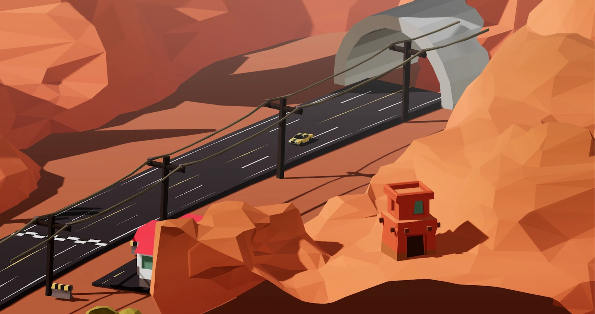

# SD-RA01 · 让加速与刹车留下不同空间尺度的动作证据
案例：[ racing-game ](../cases/racing-game.md) · 机制证据：`still_observed`

效果图用于理解来源作品，不自动验证本卡中的每个机制。

## 设计动作

加速短命尾焰说明当前状态，刹车地面痕迹保存刚发生的动作，两种时间尺度让运动有重量。

## 实现与参数

尾焰两排x±.4，z=-1.8-progress*.75，progress按1s循环，非boost缩至0；Skid取后轮2/3坐标与车身旋转，每帧写两个面，500槽循环。

## 审美细节

尾焰青#5ecfff、opacity .5；轮痕黑opacity .5且depthWrite=false；thumbnail只见暖峡谷低模赛道，未观察动作效果。

## 适用条件

- 物件/地面在镜头内可见
- 车轮真实接触点可得

## 相邻方案与区别

与屏幕速度线不同，本卡是世界内反馈；不要把同类后期算二次集成。

## 失败模式

- 原skid位置直接用轮中心可能悬浮
- 每帧落痕密度依赖fps
- 环形index普通变量重渲可能重置
- 透明boost depthWrite=true可能遮挡

## Movie 裁决

- **verdict**：reference
- **reason**：可借动作因果，但车内镜头通常看不到尾焰。

## Frontend 裁决

- **verdict**：adapt
- **reason**：作为Ride第三人称或环境车辆小范围反馈。

## 最小对照

加速/滑行/刹车各5s，反馈不得串状态；地面痕迹不悬浮、不随车运动，fps变化密度应相近。

## 源码证据

- [Repos/racing-game/src/effects/Boost.tsx:18–49](https://github.com/pmndrs/racing-game/blob/7816a5d954b75e6ad853ae4e4f0cbbd628072643/src/effects/Boost.tsx#L18-L49)：boost状态控制12实例渐缩尾焰
- [Repos/racing-game/src/effects/Skid.tsx:20–57](https://github.com/pmndrs/racing-game/blob/7816a5d954b75e6ad853ae4e4f0cbbd628072643/src/effects/Skid.tsx#L20-L57)：brake且speed>10时从后轮世界坐标写入500槽环形痕迹

## 项目效果图

已view_image thumbnail.webp：橙色多面岩地形、浅隧道、深道路清晰分层；运动尚未观察。

来源：[原作者/出处](https://github.com/pmndrs/racing-game/blob/7816a5d954b75e6ad853ae4e4f0cbbd628072643/thumbnail.webp) · observed_still。静帧观察；没有由此验证连续动画或性能。

## 归纳与练习

暂未归入新增专业视角；保留原机制边界。

[MP-12](../patterns/MP-12.md)
