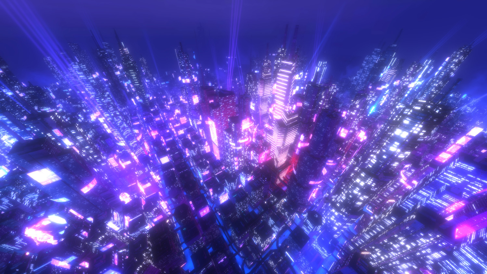
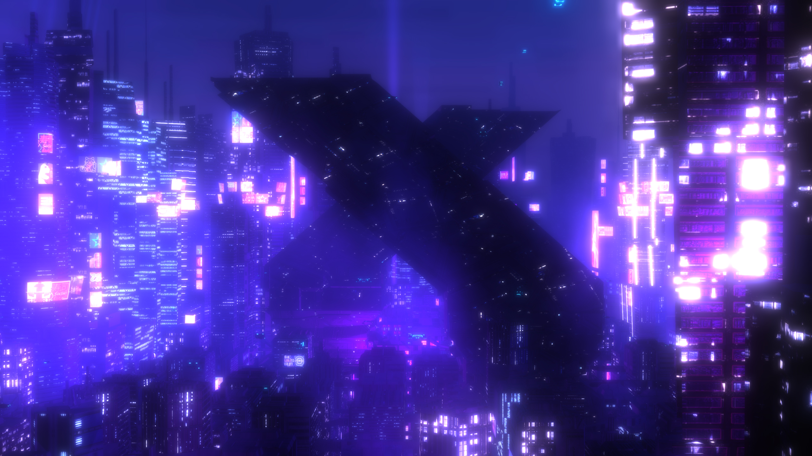

# SD-SY02 · 拒绝用强锐化替代材质细节
案例：[ synthcity ](../cases/synthcity.md) · 机制证据：`source_only`

效果图用于理解来源作品，不自动验证本卡中的每个机制。

## 设计动作

高频增强不能补不存在的几何/贴图，会放大霓虹边界噪声。

## 实现与参数

8邻域权重-1、中心9，按width/height求像素步长，输出不显式clamp。

## 审美细节

此实现只有屏幕锐化；没有材质法线或几何细节。

## 适用条件

- 输入已有足够分辨率

## 相邻方案与区别

与抗锯齿、分辨率提升和法线细节是不同问题。

## 失败模式

- 光晕与负值
- 不能恢复缺失资产

## Movie 裁决

- **verdict**：defer
- **reason**：仅后期诊断，不优先用于打磨。

## Frontend 裁决

- **verdict**：reject
- **reason**：不作为前端画质默认提升。

## 最小对照

细线招牌/高反差栏杆A/B，出现黑白边、噪点放大即拒绝。

## 源码证据

- [Repos/synthcity/src/classes/Shaders.js:5–47](https://github.com/jeffbeene/synthcity/blob/5a4ee0dd231ce06653a2a9776ed2e36137918d21/src/classes/Shaders.js#L5-L47)：九抽头[-1..9..-1]锐化核

## 项目效果图

实际查看：高角度密集夜城，蓝紫雾压远景，窗格/招牌粉青发光，光柱与高楼构成竖向节奏。

来源：本轮已观察的历史截图 · author_repository_screenshot。原仓README所用效果图的本地同名文件；历史静帧，不证明当前帧率、雨动或车辆控制。

实际查看：近中景大块深色交叉悬挑楼体，被蓝紫雾与白粉霓虹窗面包围，轮廓与高亮区分明。

来源：本轮已观察的历史截图 · author_repository_screenshot。原仓screenshots目录的历史渲染图；可观察体量与色彩，不能单凭此图认定所有几何可通行或动态稳定。

## 归纳与练习

暂未归入新增专业视角；保留原机制边界。

保留独立案例。
