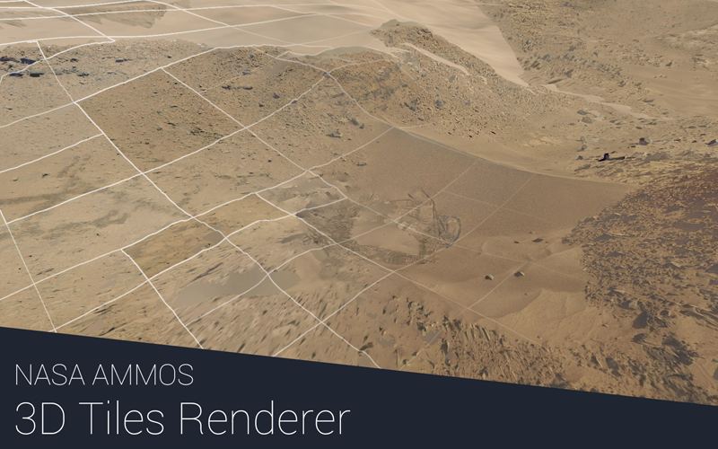
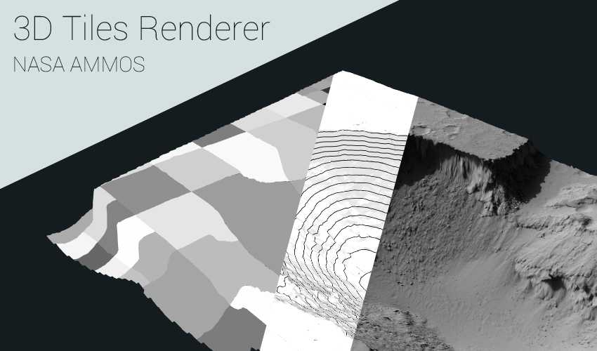

# SD-TI01 · 在LOD交接时保留旧几何直到抖动淡出结束
案例：[ 3DTilesRendererJS ](../cases/3DTilesRendererJS.md) · 机制证据：`source_only`

效果图用于理解来源作品，不自动验证本卡中的每个机制。

## 设计动作

减少大块pop-in需要把可见性转换和资源回收分开，不只是插值opacity。

## 实现与参数

shader用4×4阈值分16档discard；FadeManager持有状态；plugin每帧markTileUsed避免淡出未完被卸载；过量且快速运动时可结束fade。

## 审美细节

这是连续性处理，不产生新的建筑细节；抖动颗粒在小字号/细栏杆附近可能更明显。

## 适用条件

- 确有多级几何
- 旧新几何对应
- 缓存容许短暂共存

## 相邻方案与区别

与neon近远身份一致不同：此卡只柔化交接，不保证窗格身份；两者不能互相替代。

## 失败模式

- shader chunk兼容问题
- Bayer pattern本身可见
- 性能优化后置

## Movie 裁决

- **verdict**：defer
- **reason**：固定hero镜头不应以LOD抖动作为首要美术改进。

## Frontend 裁决

- **verdict**：reference
- **reason**：只有实证存在LOD跳变才提取局部机制。

## 最小对照

慢推/停顿跨LOD阈值，建筑无硬跳、空洞或长驻重叠；细线闪烁比原跳变更显著则弃用。

## 源码证据

- [Repos/3DTilesRendererJS/src/three/plugins/fade/wrapFadeMaterial.js:60–135](https://github.com/NASA-AMMOS/3DTilesRendererJS/blob/eb6ea84c74fa38ad3c8151aeba877520289485f2/src/three/plugins/fade/wrapFadeMaterial.js#L60-L135)：4×4 Bayer discard按fadeIn/fadeOut阈值
- [Repos/3DTilesRendererJS/src/three/plugins/fade/TilesFadePlugin.js:99–115](https://github.com/NASA-AMMOS/3DTilesRendererJS/blob/eb6ea84c74fa38ad3c8151aeba877520289485f2/src/three/plugins/fade/TilesFadePlugin.js#L99-L115)：淡出期间markTileUsed保持资源
- [Repos/3DTilesRendererJS/src/three/plugins/fade/FadeManager.js:6–15](https://github.com/NASA-AMMOS/3DTilesRendererJS/blob/eb6ea84c74fa38ad3c8151aeba877520289485f2/src/three/plugins/fade/FadeManager.js#L6-L15)：默认250ms转场与状态事件

## 项目效果图

实际查看：火星地形的摄影纹理和岩石细节上叠加白色瓦片边界，底部为项目标题。

来源：本轮已观察的历史截图 · author_demo_banner。原作者README渲染展示横幅，确有地形效果；带标题的静态展示，不是本轮运行截图，也不能证明LOD淡出动画。

实际查看：同块地形以平面分区、等高线和灰度细节三种表示并列，能比较轮廓和表面信息层。

来源：本轮已观察的历史截图 · author_demo_banner。原仓展示横幅，包含真实地形可视化效果与项目字样；不是单个现场运行状态。

## 归纳与练习

暂未归入新增专业视角；保留原机制边界。

[MP-22](../patterns/MP-22.md)
