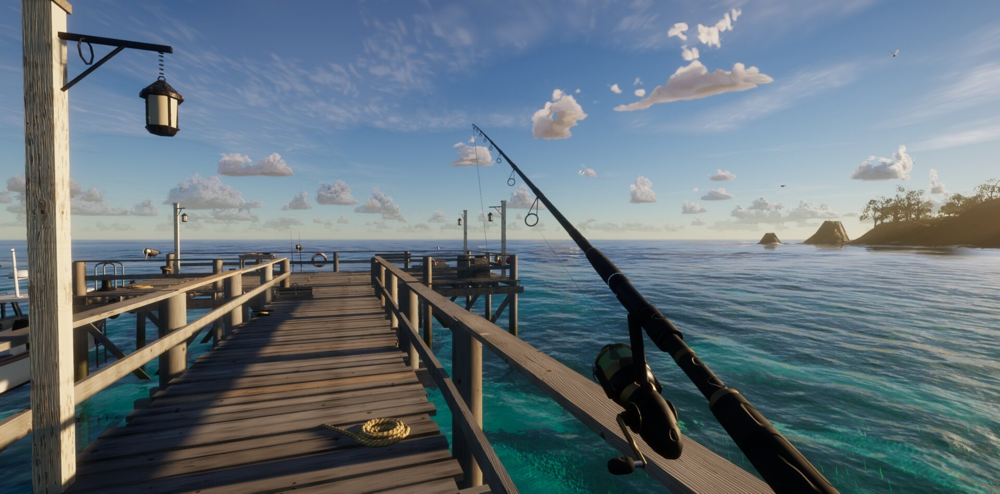

# SD-TW01 · 按真实尺寸铺纹理，再让招牌油漆共享底材老化
案例：[ tidewater ](../cases/tidewater.md) · 机制证据：`source_only`

效果图用于理解来源作品，不自动验证本卡中的每个机制。

## 设计动作

场景表面可信度来自纹理尺寸、方向与磨损层关系：木纹沿板长，字漆覆盖木面而不是悬浮贴图。

## 实现与参数

纹理层wood按1.8米、deck2米、tin1.8米、painted1.1米重复；每块偏移但不任意缩放纹理。UV2招牌atlas独立于底材UV；chips由fbm与底材亮度共同影响，文字alpha乘(1-chips*.8)和细噪声，roughness混到.62。铁皮有真实16道/1.8m波纹，法线贴图肋强度减到.35。

## 审美细节

区别在油漆、木材、粉笔、搪瓷触感：粉笔板roughness.9，秤盘搪瓷.22；木纹不会因为牌面宽度不同变成巨纹。静图仅看到码头木纹与硬件，未观察这些摊位表面。

## 适用条件

- 资产单位一致
- UV方向有约定
- 底材和涂层可独立调节

## 相邻方案与区别

与小雨云状态mask同属多通道一致性；此处是材质层叠和使用磨损，不是可变湿润模拟。

## 失败模式

- 本仓WebGPU/WGSL接口不兼容本站材质注入
- 粗暴随机UV会破坏方向纹理
- PBR通道与色空间须核对
- 扫描资产许可应逐文件保留，不能用代码MIT覆盖

## Movie 裁决

- **verdict**：prototype
- **reason**：一个招牌/柜台近景即可检验，不需要迁移海岛。

## Frontend 裁决

- **verdict**：adapt
- **reason**：把米制UV与有底材来源的磨损作为资产规范。

## 最小对照

两种宽度同材质木板并排，纹理每米密度相同；近看漆裂跟随底材、远看文字仍可读。几何与法线双重波纹、文字剥落到不可辨认判失败。

## 源码证据

- [Repos/tidewater/src/game/StallKit.js:1–130](https://github.com/dgreenheck/tidewater/blob/4811ba48d795197de5621985f404e765c0b7c0ef/src/game/StallKit.js#L1-L130)：扫描surface/prop分层与世界米制重复尺寸
- [Repos/tidewater/src/game/StallKit.js:181–208](https://github.com/dgreenheck/tidewater/blob/4811ba48d795197de5621985f404e765c0b7c0ef/src/game/StallKit.js#L181-L208)：采PBR层，波纹铁法线强度降至.35避免几何法线重复
- [Repos/tidewater/src/game/StallKit.js:245–272](https://github.com/dgreenheck/tidewater/blob/4811ba48d795197de5621985f404e765c0b7c0ef/src/game/StallKit.js#L245-L272)：招牌色漆按底材/噪声剥落，字漆和roughness混合
- [Repos/tidewater/src/game/StallKit.js:360–403](https://github.com/dgreenheck/tidewater/blob/4811ba48d795197de5621985f404e765c0b7c0ef/src/game/StallKit.js#L360-L403)：箱体按真实尺寸和轴向建立UV，UV2只给招牌正面

## 项目效果图

已view_image docs/screenshot.jpg：夕阳码头、近景木栏杆/绳索/灯具/钓竿、远近水色层次。仅为历史静帧，没有证明当前实时水体、声画同步或性能。

来源：[原作者/出处](https://github.com/dgreenheck/tidewater/blob/4811ba48d795197de5621985f404e765c0b7c0ef/docs/screenshot.jpg) · observed_still。静帧观察；没有由此验证连续动画或性能。

## 归纳与练习

暂未归入新增专业视角；保留原机制边界。

[MP-05](../patterns/MP-05.md)
